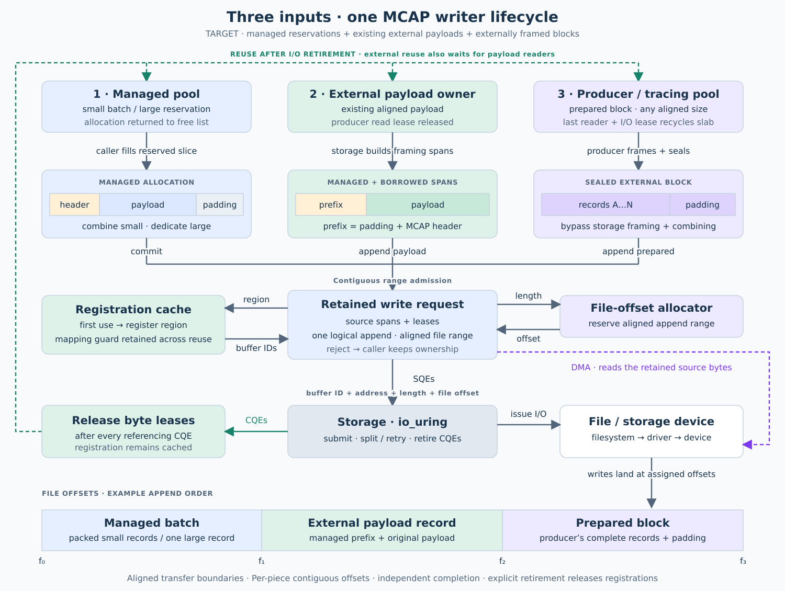

# Storage persistence



Single-owner storage primitives with growable aligned buffers, transactional file
ranges, and one io_uring per writer. Accepted leases remain owned through write
completion and retries. Call `close` to observe final write and sync errors.

The MCAP layer provides direct payload reservations and uncompressed,
index-free files. The caller supplies schema/channel metadata and serializes
into the returned slice. Protobuf and Dora remain application responsibilities.

| Module | Responsibility |
|---|---|
| `file_offsets` | Checked, non-overlapping append ranges; abandoned reservations |
| `managed_buffers` | Best-fit free list, stable aligned allocations and exclusive leases |
| `writer` | Buffered/registered direct writes, retries, cancellation and retirement |
| `mcap` | File framing, schemas/channels and payload reservations |

Registered direct I/O supports configured 512-B and 4-KiB alignment. Small
messages share one combining allocation. `reserve(message, size)` exposes one
contiguous writable payload slice, including for 100-MiB messages. A free-list
miss allocates a sufficiently large buffer without waiting for earlier CQEs.
Recorder/demo defaults are eight 256-KiB buffers; framing and alignment reduce
the largest payload that fits in a combining buffer.

New direct-I/O allocations register before use. Registrations and allocated
capacity survive reuse and rotation; explicit idle-only `trim()` unregisters
before releasing memory. Allocation, registration and address-space limits
return errors. Direct I/O never falls back to buffered I/O or a copied payload.

`WriterConfig` separates ring depth, pending-write capacity, registration slots
and transfer size. Large allocations can span multiple registrations/SQEs.
A lease returns to the free list after its last referencing CQE. For retryable
queue pressure, use reservation `try_commit()` and `progress()`; a failed
`try_commit()` preserves the payload. Consuming `commit()` abandons it on error.
`Writer::try_append()` likewise returns the rejected lease without consuming a
file range. Callers drive progress explicitly.

See the [implementation milestones](docs/101926-growable-buffer-pool.md) and
[next-stage external-memory plan](docs/101826-external-buffer-leases.md).

Call `finish` to flush combining buffers and seal MCAP. Dropping an unfinished
MCAP writer can leave an incomplete file. The owner must poll the exposed flush
deadline while input is idle. See [validation evidence](docs/101826-mcap-writer-design.md).

Validation: `cargo test -p storage-persistence` includes real Linux io_uring tests.
The tests fail explicitly when the host cannot create a ring.

## Optional diagnostics

Enable the `diagnostics` Cargo feature for `McapWriter::diagnostics`,
`write_events`, `finish_with_diagnostics`, and the underlying writer event/counter
accessors. It adds a fixed 256-event history and per-write clock reads. The demo
opts in explicitly. Default builds omit these APIs, event storage and timing work.
Web transport, Protobuf inputs, percentile windows and demo controls live in
`apps/storage-demo`. Cargo features unify across dependents in a build; build the
production application independently to keep diagnostics disabled.

The explicit large direct-I/O qualification requires over 104 MiB of available
locked-memory allowance:

```sh
cargo test -p storage-persistence --all-features --test growable -- --include-ignored
```
