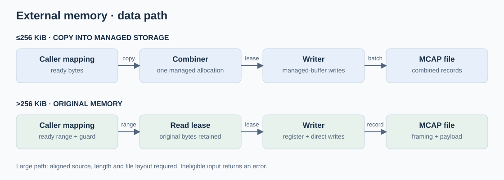
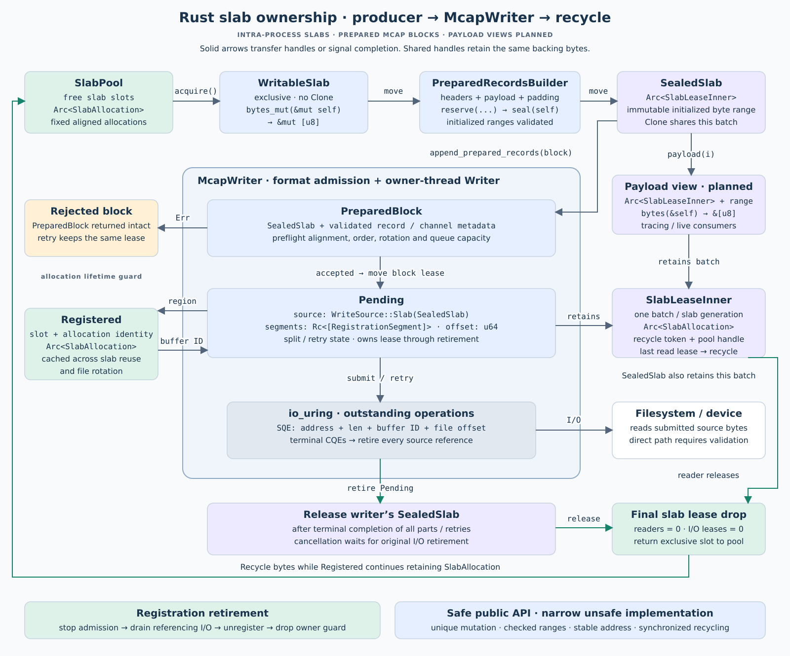
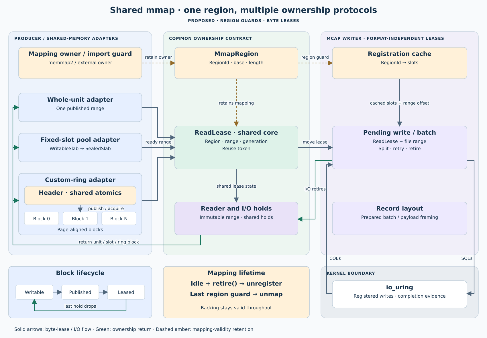

# External-memory persistence

Implemented correction · 2026-10-20. x86 and ARM64 default/all-feature tests and strict
Clippy pass (ARM64 job 77). Historical E1 evidence applies to
mapping ownership; the new ingress evidence is recorded below.

- Existing payload: `append_external_payload(message, ReadLease)` adds one 4-KiB managed prefix.
- Existing MCAP messages: `append_external_records(ReadLease)` validates and submits unchanged bytes.
- Removed `MappedRecordsBuilder`, `PreparedMappedBlock` and writable-mmap MCAP entry points.
- External inputs bypass combining; invalid layouts return ownership intact.
- Initial submission advances prefix then payload. Vectored submission remains optional work.

[Input contracts](101926-memory-ingress-cases.md) · [Region lifetimes](architecture/mmap-slab-ownership.svg).

## Correction gates

- [x] Remove writable-mmap MCAP framing and its example/tests; retain ownership/registration machinery and intra-process slab support.
- [x] Accept externally stamped records through a validated read-lease entry point, independent of our builder.
- [x] Qualify both external APIs against the diagram with pointer identity, exact file bytes and guard-lifetime tests (evidence below).

## E0 — Intra-process sealed slabs first

- [x] Provide bounded producer-owned `SlabPool`, exclusive `WritableSlab` and cloneable `SealedSlab`; consume writable access when sealing.
- [x] Retain `Arc<SlabAllocation>` independently in registration entries; final `Arc<SlabLeaseInner>` release recycles the whole slab.
- [x] Extend pending writes to retain managed or sealed sources through splitting, retry, cancellation and terminal completion.
- [x] Cache registrations per writer by allocation identity; retain resolved segments in pending writes. Pre-register pools before capture and retire explicitly.
- [x] Track actual buffer-table update attempts; slab reuse and file rotation preserve registrations. Keep handles private to their writer and prohibit retirement while requests remain.
- [x] Use the existing aligned allocator and standard-library ownership. `bytes` was evaluated for owned views; `memmap2` remains an E1 adapter candidate. Add no dependency for E0.
- [x] Validation: cross-thread handoff, compile-fail exclusive borrow, reader-before-I/O and I/O-before-reader release, and registration guard lifetime.
- [x] Validation: 1,000 warmed reuse cycles produce zero registration updates; verify exact readback and explicit retirement/re-registration.
- [x] Validation: rejection, partial registration rollback, short/error completions, cancellation and submission failure preserve ownership.
- [x] Validation: default/all-feature tests, Clippy and ARM64 worker result recorded below.

First release uses one `Arc` allocation per seal and a mutex-protected free list.
The storage path submits the entire sealed range; payload-only views and tracing
sink migration remain follow-ups. Each slab allocation is fixed-size; create and
pre-register another pool to add capacity. Mapped ranges use E1's separate registration and reuse guards.

## E1 — Mapped regions and read leases

- [x] Adopt `memmap2`: `MmapRegion` owns mapping validity; `WritableRange → ReadLease` controls disjoint bytes.
- [x] Add unsafe provider import/publication with a separate reuse token and generation; retain mapping guards through registration retirement.
- [x] Cache registration by region identity; handle nonzero offsets and segment boundaries; return rejected leases intact.
- Historical implementation: `MappedRecordsBuilder → PreparedMappedBlock`; superseded by the correction gates above.
- [x] Use pinned Zenoh POSIX SHM blocks as the test fixture. Its buffer owner retains the allocation until registration retirement.
- [x] Gate: `MAP_PRIVATE` and `/dev/shm` shared mappings pass x86_64 and ARM64 qualification.
- [x] Gate: split writes, stable registration counts, readers, rejection, rollback and cancellation pass on both architectures.
- [x] Gate: separate-process publication and Zenoh provider guards pass on both architectures.
- [ ] Follow-up: qualify memfd-backed mappings explicitly.
- [ ] Follow-up: production ring/transport adapters provide page-aligned blocks and publication/reuse synchronization.

The core checks range overlap and I/O alignment. Ring headers and synchronization
belong to the provider. The Zenoh fixture retains immutable allocations; independent
transport-block recycling under a retained segment registration remains E3 work.

## E2 — Existing external payload API

- [x] `append_external_payload(message, lease)`: accept existing aligned bytes at any supported size.
- [x] Lease one managed prefix page: valid MCAP padding followed by the 31-byte message header.
- [x] Preflight both sources, registration and capacity; reserve one contiguous file range before admission.
- [x] Retain both owners in one logical write; advance prefix then payload without flushing independent combining batches.
- [ ] Optional vectored submission: qualify backend/registration support before adoption.
- [ ] Discover device/filesystem alignment where supported; validate configured fallback, addresses, transfer lengths and file offsets.
- [x] Reject unsupported layouts intact; payload bytes remain unchanged throughout.
- [ ] Validate exact MCAP decoding, pointer identity, small/large aligned payloads, misalignment and 100-MiB payloads.
- [ ] Validate out-of-order/short completions, cancellation, failed admission, rotation and shutdown; no premature reuse.
- [ ] Confirm warmed registration reuse, bounded prefix storage and zero payload copies on x86 and ARM64.

## E2P — Prepared blocks and external as-is ingress

- [x] Builder-produced intra-process slabs: add `append_prepared_records(block)` independently of E2's payload-size policy; accept any supported aligned block size.
- [x] Provide a framing helper for producer-reserved MCAP header/padding space and a sealed prepared-block type.
- [x] Admit existing bytes unchanged; bypass combining, serialization and framing writes after sealing.
- [x] Preserve channel/schema compatibility, per-piece contiguous ranges, rotation and finalization; return rejected blocks intact.
- [ ] Follow-up: integrate tracing's slab owner and optional payload views; the last reader/I/O lease recycles the slab.
- [x] Validation: 4-KiB and 64-KiB prepared blocks reach direct I/O with zero storage copies and exact independent MCAP readback.
- [x] Validation: hold readers beyond CQEs and CQEs beyond readers; recycling waits for both while registration persists.
- [ ] Validation: mixed managed/payload/prepared appends preserve per-piece contiguity under queue pressure, cancellation and rotation.

## E3 — Dora/Zenoh integration

- [ ] Retain the actual received payload owner; separate mapping lifetime from message reuse where necessary.
- [ ] Identify required adapter/upstream APIs if the received owner cannot expose those lifetimes separately.
- [ ] Account for transport materialization separately from storage copies.
- [ ] Validation: completed messages return to the producer pool while region registration remains valid.
- [ ] Validation: actual Dora transport passes reuse stress, sender exit, receiver shutdown and slow-storage tests with exact hashes.

## E4 — Mixed-workload qualification

- [ ] Run each E1, E2, E2P and E3 gate on x86 and ARM64; verify Pueue results and applicable separate Dora end-to-end tests.
- [ ] Benchmark [three paths](101926-growable-buffer-pool.md#benchmark-paths): plain `fwrite`, direct from already-registered managed memory, and direct from external memory.
- [ ] Set budgets and qualify small combining, large managed reservations and external direct writes together; separate cold registration cost from warmed writes.
- [ ] Validation: every finalized rotated file decodes; pressure and failures preserve accounting and guard reclamation.
- [ ] Validation: record throughput, CPU, p99 latency, allocations, copy/borrow bytes and registration events against budgets.
- [ ] Validation: attach commands, commit, filesystem/platform and worker job; qualify end-to-end DMA on target hardware.

## E5 — Future device providers

- [ ] Qualify driver-owned host RAM for pinning, readiness and reuse.
- [ ] Investigate PCIe BAR/P2P/DMA-BUF backends with driver removal/invalidation protocols.
- [ ] Qualify CUDA-accessible host RAM and GPU readiness/visibility synchronization.
- [ ] Investigate CUDA IPC-imported memory with import/export guards and a cuFile/GPUDirect backend.
- [ ] Validation: backend selection follows backing-memory capabilities; an mmap address or `/dev/shm` name alone never establishes eligibility.
- [ ] Validation: physical Thor tests cover events, reuse, failures and shutdown; large-payload CPU/GPU bounce-buffer paths are rejected.

References: [page pinning](https://docs.kernel.org/core-api/pin_user_pages.html),
[PCI P2P](https://docs.kernel.org/driver-api/pci/p2pdma.html),
[GPUDirect Storage](https://docs.nvidia.com/gpudirect-storage/overview-guide/).

## E0 / E2P validation evidence

- [x] x86_64 Linux, local ext filesystem: default and all-feature storage suites each passed 30 runtime tests and one compile-fail doctest. The existing opt-in 100-MiB registered test remains ignored in these runs.
- [x] `cargo clippy -p storage-persistence --all-targets --all-features --no-deps -- -D warnings`, `cargo fmt --all --check`, and `git diff --check` passed.
- [x] ARM64 WSL2: serial Pueue job **49**, result **Success**, full log inspected. Workspace default/all-feature tests, native cgroup/allocation tests, existing Dora comparisons and storage-demo validation passed.
- [x] New gates: direct 4-KiB/64-KiB MCAP readback, cross-thread builders/readers, mixed managed/prepared ordering, rotation, intact rejection, registration rollback and guard lifetime, cancellation, injected short/error completion, and 1,000 reuse cycles with zero new table updates.

Commands: `cargo test -p storage-persistence`,
`cargo test -p storage-persistence --all-features`,
`python3 scripts/ci/submit.py --source /home/cutuy/doramcap/.git/agent-pool/worktrees/1`,
`ssh doramcap-ci@100.64.0.20 pueue log --full 49`.

Source: base commit `5aa714c3b8c435545095ae695a0b3f58bfa987a0` plus the dirty
snapshot at `/home/doramcap-ci/jobs/c7ef57f1308f47ce973876cc80447ae2`.
`SOURCE.json` records per-file hashes; subsequent local edits update documentation.
Tests live in `tests/sealed_slabs.rs` and the `slabs` / `writer` unit tests. The prepared builder binds records to the
originating writer's schema/channel identity; that identity survives rotation.
Blocks from another writer are rejected intact. Actual target-device DMA and
allocation-free sealing remain unqualified.

## E1 validation evidence

- [x] x86_64 Linux 7.0: default/all-feature storage tests, strict Clippy, formatting and diff checks passed; `/tmp` ext filesystem and `/dev/shm` tmpfs.
- [x] ARM64 WSL2 Linux 6.18: mmap tests passed in default/all-feature runs, including Zenoh, cross-process publication and failure injection.
- [x] ARM64 complete worker suite: Pueue **55**, **Success**; full log inspected. Native accounting, allocation checks, Dora comparisons and storage-demo validation passed.
- [x] Borrow-safety compile-fail test; exact bytes and independent MCAP decoding; unchanged registration counts across repeated ranges; reader and owner drop counts.

Tests: `tests/mapped.rs`, `writer::tests::mapped_segment_offsets_rollback_and_cancellation`.
Commands: `cargo test -p storage-persistence [--all-features]`,
`cargo clippy -p storage-persistence --all-targets --all-features -- -D warnings`.
Worker: `ssh doramcap-ci@100.64.0.20 pueue log --full 55`.
Snapshot: `/home/doramcap-ci/jobs/a19d9b392b314b2a980a02ffa227cfd7`;
`SOURCE.json` records source hashes against base `5aa714c3b8c435545095ae695a0b3f58bfa987a0`.
Subsequent local edits change comments/documentation only. The existing opt-in
100-MiB registered-I/O test remains ignored; physical-device DMA is unqualified.

## Independent write-path validation

- [x] Large managed, sealed-slab and mapped writes use one available pending slot while a small batch remains buffered; exact position-dependent payloads decode after split writes.
- [x] x86_64 default/all-feature tests, strict Clippy, formatting and diff checks passed.
- [x] ARM64 Pueue **59: Success**; full log inspected, including workspace tests and native/application checks. Snapshot: `/home/doramcap-ci/jobs/6c629ad5380846409c5389af4fbcf355`.

Regression: `tests/sealed_slabs.rs::standalone_paths_do_not_flush_or_reserve_capacity_for_combining`.
Each piece occupies contiguous offsets; cross-piece placement and completion order are unspecified.

## Corrected ingress evidence · 2026-10-20

- [x] x86 default/all-feature suites and strict Clippy pass.
- [x] `MAP_PRIVATE` and `/dev/shm`: pre-populated 4-MiB payload, exact independent MCAP decoding, two operations, unchanged bytes, registration reuse and reader/reuse-token lifetime.
- [x] Caller-stamped records: exact whole-range file comparison, channel validation, malformed-record rejection and rotation.
- [x] Unit fault injection: original payload pointer retained through prefix short writes and payload failure; registration rejection, failed submission and cancellation preserve owners.
- [x] Activity traces: prefix/payload operations share one logical write and contiguous offsets; all spans close.
- [x] ARM64 Pueue **77: Success**, full log inspected: default/all-feature storage tests, strict Clippy and all-feature demo build check. Snapshot `a033752d82ba4140aecb0fa69be148a8`.
- Full ARM64 workspace **83: Success** after repairing the resource-policy `Placement` schema; snapshot `eec3a64111bc46ba96a5788eab3e0832`, full log inspected. Job 75 exposed the small trace-test sink queue; the fixture now retains its finite burst.

Commands: `cargo test -p storage-persistence [--all-features]`;
`cargo clippy -p storage-persistence --all-features --all-targets -- -D warnings`.
Tests: `tests/mapped.rs`, `tests/activity_timeline.rs`, `writer::tests::prefixed_*`.
Device-alignment discovery, the 100-MiB gate and optional vectored I/O remain open.
