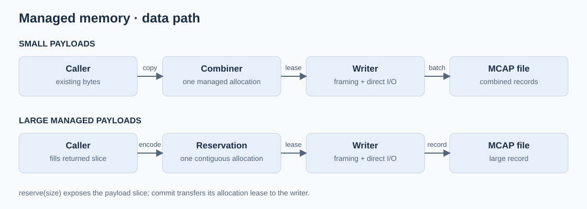
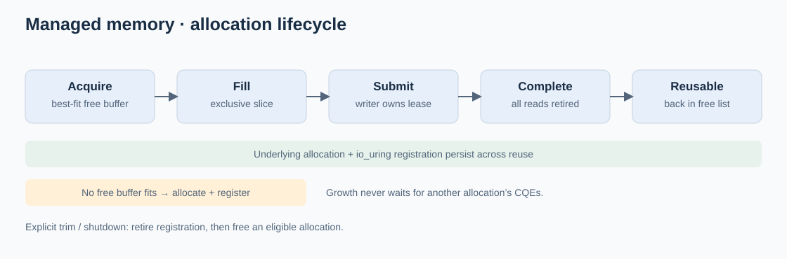
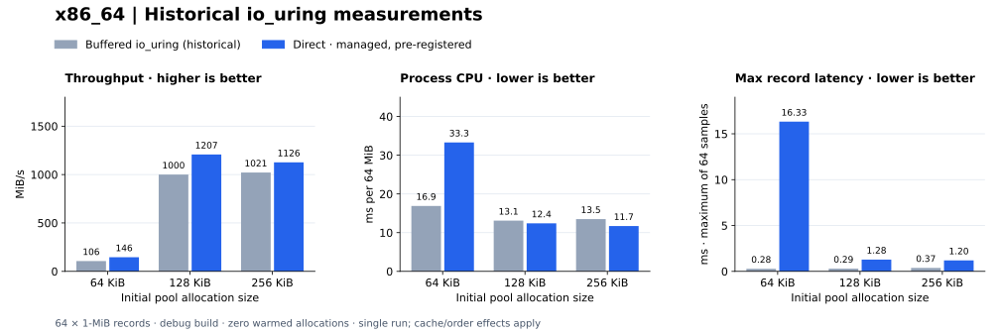
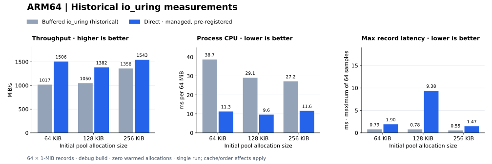

# Growable managed buffers

[Payload, allocation and file-offset detail](architecture/storage-persistence-review.svg) ·
[Three input paths and shared lifecycle](architecture/three-path-writer-lifecycle.svg).

Status: implemented; qualification below · 2026-10-19. Next: [external memory](101826-external-buffer-leases.md).
Supersedes the fixed-pool and segmented-reservation design; historical validation stays unchanged.
The existing aligned wrapper was retained after evaluating `aligned-vec`; no dependency was added.

## G1 — Growable free list

Evidence: [Managed-pool tests](../src/managed_buffers.rs) and [recorded functional evidence](#validation-evidence--2026-10-19) cover growth, reuse, abandonment and allocation failure.

### Work items

- [x] Evaluate [aligned-vec](https://docs.rs/aligned-vec/latest/aligned_vec/) against the existing aligned allocation wrapper before choosing an implementation.
- [x] Keep a best-fit free list of independently owned, contiguous aligned allocations.
- [x] Default to eight 256-KiB allocations; grow when no free allocation fits.
- [x] Preserve allocation addresses and retained capacity; reserve metadata for allocation-free returns.

### Validation

- [x] Reserve `256 KiB × 7` and 100 MiB while all eight initial buffers remain leased.
- [x] Verify contiguous slices, disjoint ranges, stable addresses, best-fit reuse and abandonment.
- [x] Inject allocation failure and test checked arithmetic; existing leases remain valid.

## G2 — Contiguous reservations and persistent registration

Evidence: [Writer tests](../src/writer.rs), [MCAP readback tests](../tests/growable.rs) and [recorded functional evidence](#validation-evidence--2026-10-19) cover admission, registration, failure and exact readback.

### Work items

- [x] Make `reserve(message, size)` expose one writable payload slice for every supported size; migrate the segmented API and callers.
- [x] Populate sparse registration slots incrementally; retain registrations through reuse and rotation.
- [x] Remove CQE waits from pool growth and large reservations; queue any preceding combining batch at commit.
- [x] Separate pending-write limits, ring depth, registration limits and pool capacity.
- [x] Preflight commit admission; return ownership on retryable backpressure without consuming file ranges.
- [x] Split large writes/registrations as kernel limits require; retain one lease through every referencing request.

### Validation

- [x] Delay CQEs and prove a new large reservation completes before any delayed CQE arrives.
- [x] Independently decode a 100-MiB record with exact payload equality.
- [x] Exercise full registration/pending queues, partial writes, retries, cancellation and submission errors.
- [x] Verify registration rollback, completion identity, ownership retention and checked transfer lengths.

## G3 — Combining, defaults and explicit trim

Evidence: [Combining tests](../tests/combining.rs), [growth/readback tests](../tests/growable.rs) and [recorded functional evidence](#validation-evidence--2026-10-19) cover mixed sizes, alignment, reuse, trim and rotation.

### Work items

- [x] Copy small existing payloads into one managed combining allocation; keep direct encoding available.
- [x] Use 256-KiB initial allocations; framing/alignment reduce the combining cutoff, and larger reservations grow independently.
- [x] Update recorder/demo defaults and current documentation; preserve historical benchmark results.
- [x] Pad between MCAP records and retain exact logical EOF; keep each returned payload contiguous.
- [x] Add explicit idle-only trim: retire registrations before freeing eligible allocations; return Busy while leases/writes remain.
- [x] Report allocated, free, in-flight and registered bytes separately from queue depth.

### Validation

- [x] Mixed sizes decode exactly in buffered mode and configured 512-B/4-KiB direct modes.
- [x] Warmed reuse allocates nothing; capacity persists until trim; rotation and shutdown preserve ownership.
- [x] Threshold boundaries and framing overhead fit; small-message batching avoids per-message alignment gaps.

## G4 — Qualification

Evidence: [Recorded commands, platforms and worker job 46](#validation-evidence--2026-10-19) establish functional validation. Unchecked benchmark and target-device qualification items remain open.

### Work items

- [ ] Add a plain stdio baseline using `fwrite`, with ordinary stdio buffering and no managed pool or io_uring.
- [x] Keep the warmed direct path: pool-owned memory already registered with io_uring.
- [ ] Benchmark external-memory direct writes: intra-process prepared slabs are implemented in E0/E2P; large payloads remain E1–E2 work.
- [ ] Set workload budgets; compare the three paths below on target storage.

### Validation

- [x] Run affected tests, formatting and Clippy on x86 and ARM64; verify the serial Pueue job result.
- [x] Run applicable Dora end-to-end comparisons separately.
- [ ] Use identical logical records, payload sizes and sync policy; include final `fflush`/`fsync` or direct drain/`fsync` in end-to-end throughput.
- [ ] Report call/admission, write-completion and durable-completion latency separately; collect enough samples for percentiles and report cold registration separately.
- [x] Bounded queue pressure, injected failures and rotation preserve exact readback and explicit backpressure.
- [ ] Record throughput, CPU, p99 latency, copies, allocations and retained/registered memory against budgets.
- [x] Attach commands, source manifest, platform/filesystem, worker job and counters; distinguish WSL functional results from target DMA evidence.

References: [registration updates](https://man7.org/linux/man-pages/man3/io_uring_register_buffers_update_tag.3.html),
[resource retirement](https://man7.org/linux/man-pages/man2/io_uring_register.2.html),
[direct-I/O alignment](https://man7.org/linux/man-pages/man2/open.2.html), [worker](../../../scripts/ci/README.md).

## Benchmark paths

| Path | Memory / I/O | Status |
|---|---|---|
| Buffered stdio | Plain `fwrite`; ordinary stdio buffering | Baseline to implement |
| Direct, managed | Pool-owned allocation; io_uring registration warmed before timing | Implemented |
| Direct, external | Producer-owned memory; persistent io_uring registration | Prepared slabs implemented; benchmark pending; large payloads TBD: E1–E2 |

## Validation evidence · 2026-10-19

- [x] X86_64 Linux 7.0.0-38, ext4: storage tests with all features and `--include-ignored` (23 passed); no-default-feature tests; affected application tests; formatting and Clippy.
- [x] X86 demo: independent MCAP readback, SSE/CQEs, rotation, sealing and restart.
- [x] Functional budgets: zero warmed storage allocations; zero payload relocation during managed reservation/commit; zero CQE waits during large reserve; exact readback under bounded admission.
- [ ] Target-device throughput/latency budgets and physical DMA qualification remain open. WSL results establish functional behavior.

Commands: `cargo test -p storage-persistence --all-features -- --include-ignored`,
`cargo test -p storage-persistence --no-default-features`,
`cargo test -p telemetry-mcap -p storage-demo -p system-monitor`,
`cargo clippy -p storage-persistence --all-targets --all-features --no-deps -- -D warnings`,
`cargo fmt --all -- --check`, `python3 apps/storage-demo/validate.py --bin-dir target/debug`.

Warmed benchmark: 64 one-MiB records; growth/registration warmed before counting;
record latency includes explicit write completion, final fsync is in total elapsed.
Historical results below use io_uring for both modes. The buffered rows measure
io_uring buffered writes; the new plain-stdio baseline has no measurements yet.
These single debug-build samples have cache/order effects and do not establish an optimal cutoff.
The recorded “p99” selects the maximum of 64 samples; the plots label it max.

### x86_64 · Linux 7.0.0-38, ext4

### ARM64 · Pueue job 46, Linux 6.18.54.1 / WSL2, ext4

All cases recorded **zero warmed allocations**. Axes use the same scales across platforms.
[Raw measurements](benchmarks/20261019.csv) · [Plot generator](benchmarks/plot.py).
Plain `fwrite` and external direct I/O remain unmeasured.

The pool test retains 103.75 MiB with all ten allocations free after the initial
eight leases plus 1.75-MiB and 100-MiB growth. Explicit trim reduces retained bytes
to zero. Direct tests assert registration counts, byte ownership and unregister-before-free.

The worker daemon has a 64-MiB memlock limit. Its ordinary suite runs 100-MiB
buffered and 16-MiB direct readback. `hundred_mib_registered_direct_readback` is
explicit qualification on a session with sufficient memlock allowance.
Local all-feature native application linking requires unavailable `libelf` development
files; ARM64 runs the native suite with its installed dependencies.

- [x] ARM64 final serial Pueue **job 46: Success**; Linux 6.18.54.1 / WSL2, ext4. No-default, workspace default/all-feature tests, native cgroup checks, native/synthetic Dora equality (24 snapshots each), live-demo validation and Clippy passed.
- [x] ARM64 explicit 100-MiB direct readback passed for 512-B and 4-KiB alignment in the SSH session after job 46; no privileged build or worker configuration changes.
- [x] Source traceability: base `f6cf75d216a4780c014de1e99a0e61029362666e` plus working changes; worker snapshot `/home/doramcap-ci/jobs/c0ede18c34c44433a2097de2dd71eb56/SOURCE.json`. Every Rust source hash matches the validated checkout. The manifest records the pre-commit validation snapshot.
- [x] ARM64 benchmark: zero warmed allocations for all six cases. 256-KiB direct: 1543.3 MiB/s, 11.6 ms process CPU, 1467.3 µs max record latency. Native accounting: 40 iterations, zero allocations.
