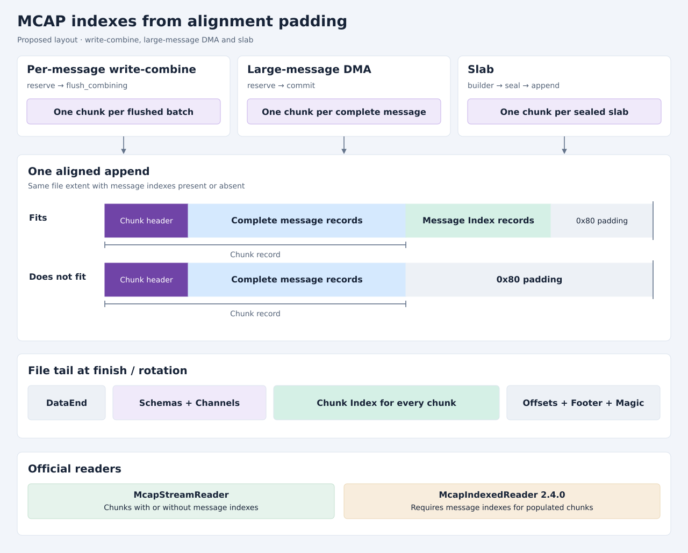

# MCAP input ownership

## Per-message write-combine

`reserve(message, size)` returns payload space in a writer-owned combining buffer.
The caller encodes there. A flush emits one uncompressed Chunk containing complete
messages and alignment padding.

## Large-message DMA

A payload above `max_inline_payload()` receives one contiguous writer allocation.
The caller fills the returned slice. The writer frames one Chunk and places
alignment padding immediately after the arbitrary-length payload.
The allocation address and physical write extent satisfy direct-I/O alignment.

## Caller-owned slab

The caller supplies an aligned slab containing a Chunk header, complete message
records and alignment padding. `PreparedBlock::from_slab`
adopts independently authored immutable bytes. `prepare_records(WritableSlab)` is
an optional caller-side helper that writes directly into the same allocation.

`append_prepared_records` validates framing and declared channel IDs, then submits
the supplied pointer, length and bytes unchanged. Payload encoding and its schema
compatibility belong to the caller. File ranges, summaries, rotation and finalization
belong to the writer. Slab appends leave an open combining batch buffered.

`SlabPool::acquire()` grants exclusive write access. Sealing publishes an immutable
read lease. `PreparedBlock::slab()` shares the same allocation with readers; storage
retains its I/O lease until completion. Recycling waits for all readers and I/O.
Registration independently retains mapping identity across reuse and rotation.

`prepare_slabs(&pool)` warms registration; reuse leaves registration-update counts
unchanged. `retire_slabs(&pool)` requires no pending writes and releases registration
while existing readers remain valid.

The shared writer owns admission, file offsets, registration, SQEs, retries and CQE
retirement. Backend support establishes DMA eligibility for the actual memory type.

The legacy immutable mmap APIs retain their existing unchunked wire contracts:
[external buffer leases](101826-external-buffer-leases.md). They remain separate
from the caller-owned slab contract above.
