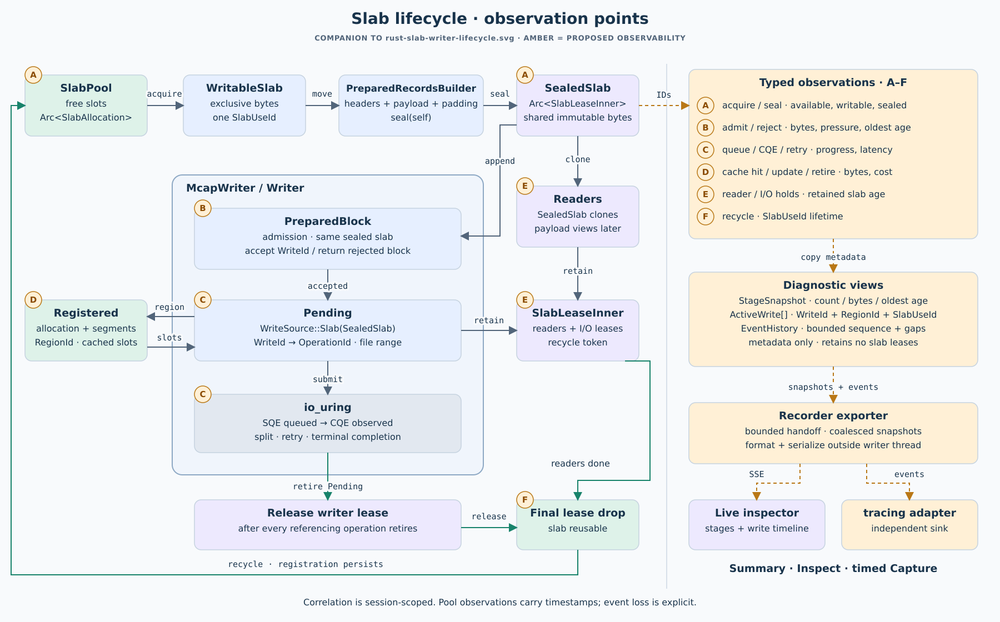
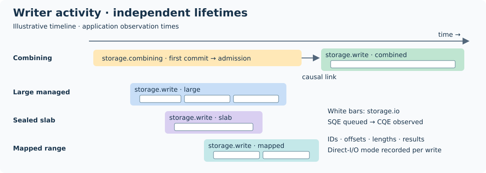

# Writer observability

Decision: inject an `Observer`; the default is disabled. Runtime modes control
collection. Reserve feature flags for optional exporters and their dependencies.
Exporters own formatting, transport and `tracing` integration.

## O1 — Collector contract

- [x] Add typed IDs/events and a disabled observer with no event construction or clock reads.
- [x] Add a preallocated history with nonblocking producer access, sequence cursors and explicit loss counts.
- [x] Support Off, Summary, Inspect and time-bounded Capture without rebuilding.
- [x] Evaluate Crossbeam `ArrayQueue` and `tracing` adapters; use standard-library `try_lock` history for this first collector.
- [x] Gate: disabled emission invokes no event factory; bounded history, contention, expiry and cursor loss tests pass.

## O2 — Writer stages and active writes

- [x] Expose owner-thread snapshots and bounded active-write iteration independently of event history.
- [x] Correlate session-scoped writer/file/write/operation IDs with source region and slab-use IDs.
- [x] Observe admission, registration, SQE queueing, CQE observation, retries, retirement, rotation and sync.
- [x] Include combining state, capacity, oldest known age, rejection reasons and written/sync coverage.
- [x] Gate: split/retry/cancel/failure/rotation maintain identities and counters; late inspection works after event loss.
- [x] Gate: existing diagnostics consumers and default/all-feature tests remain compatible.

## O3 — Independent slab lifetime

- [x] Observe acquire, seal, reader/I/O holds and final recycle with metadata-only records.
- [x] Expose pool/slab snapshots, including slabs retained by readers after I/O release.
- [x] Gate: a retained collector never delays recycling or allocation release; cross-thread readers and reused regions stay distinguishable.

## O4 — Qualification

- [x] Measure disabled and enabled overhead; retain bounded memory and allocation-free warmed writer emission.
- [x] Gate: format, Clippy, local storage regressions and serial ARM64 worker pass; record source and job evidence.

## O5 — Recorder integration

- [x] Migrate the live `storage-demo` adapter; sample typed diagnostics outside writer callbacks.
- [x] Add live stage/active-write views and bounded event timeline with gaps.
- [x] Add optional `tracing` export with an independent sink; exclude storage self-observation loops.
- [x] Gate: slow/disconnected viewers never block storage; capture controls and writer errors remain visible.
- [x] Add managed 1/4/16-MiB and sealed two-record workloads, reader holds, recycle and registration-retirement controls.
- [x] Gate: independent readback, four-reader exhaustion, intact rejection, release/reuse with zero registration updates pass locally.
- [ ] Gate: visually review the dashboard in a browser.

The live frontend is `apps/storage-demo`; `apps/mcap-recorder` remains a headless
DORA subscriber with its existing backend.

## O6 — Source-time activity capture

- [x] Feature-gate `tracing` hooks; use the existing activity runtime and application-owned subscriber.
- [x] Trace combined, large, slab and mmap writes; retain child operation spans through CQE observation.
- [x] Link combining residence to its admitted write; record results, retries and terminal outcomes.
- [x] Add opt-in `storage-demo --activity NEW_MCAP` capture with independent output workers and shutdown reporting.
- [x] Gate: decoded activity proves all paths, parentage, range coverage, terminal states and zero capture loss.
- [x] Gate: default/all-feature suites, Clippy, real demo capture and ARM64 full worker pass.

## Limits

- Observer IDs are process-session scoped; timestamps are monotonic observation times.
- SQE queue-to-CQE observation includes submission and owner polling delay.
- Late enabling leaves earlier timestamps unknown. Cross-thread pool snapshots are sampled views.
- Capture by region to include independent pool events; writer/write filters omit those events.
- Legacy `diagnostics` remains a compatibility feature during migration.

## Evidence

| Gate | Result |
|---|---|
| O1 | Unit tests: disabled factories, bounded history, contention, concurrent producers, capture expiry/cursors |
| O2–O3 | Integration + fault tests: split/short/failed I/O, cancellation, rotation, sync, late attachment, reader retention/recycle |
| Local | Default/all-feature storage tests, doctests, strict all-target Clippy, formatting passed |
| ARM64 | Pueue **50: Success**; workspace default/all-feature tests, native checks and application smoke checks |
| O1–O4 source | Worker snapshot `54c9aaac1bf942a598530d5b17e45f10`, base `5aa714c3b8c435545095ae695a0b3f58bfa987a0` + worktree changes |
| O4 allocation | Release test: 1,000 warmed 4-KiB writes + 100,000 emissions per mode; zero allocations |
| O4 timing | Single local run, emit only: disabled 0.9 ns; Off 0.7 ns; Summary 0.6 ns; Inspect 65.4 ns; Capture 81.1 ns |
| O5 local | HTTP smoke: capture expiry, Off/Inspect, unread SSE client, rotation, final sync/readback; frontend DOM fixture: IDs/filter/errors; blocked tracing stderr: 256 probes, restart and seal |
| O5 ARM64 | Pueue **52: Success**; workspace suites, native checks, updated HTTP smoke and Dora equality passed; snapshot `da219a4e120648089587865293af7bf8` |
| Memory-path controls | Local direct + buffered readback and DOM checks passed. ARM64 **54: Success**, source snapshot `eb07ff663fe440e6ae1df41bc424c27b`; 1/4/16-MiB managed writes, two-record slabs, reader-held exhaustion/recycle, cached reuse and explicit retirement |

Write timings varied 31.8–54.2 µs across modes; I/O noise prevents an overhead estimate.
Exporter reads allocate metadata copies. IDs/counters remain active when collection is off.

Visual browser review is pending: this session has no available browser.

## O6 evidence

- [x] x86: default/all-feature storage suites and strict Clippy with the feature off/on passed; decoded traces verify all source paths, split ranges, links, results and terminal span closure.
- [x] Real demo capture: 23 closed spans, combined/large/slab/metadata paths, zero recorded loss. Mmap is covered by the library capture test.
- [x] ARM64 Pueue **65: Success**; full log inspected, including 20 closed demo spans with zero recorded loss and native/application gates.

Snapshot: `/home/doramcap-ci/jobs/68d77bf6f053448093a84dbac7a3036e`.
Tests: `tests/activity_timeline.rs` and `apps/storage-demo/tests/activity_capture.py`.
Earlier worker submissions 61/63 exposed a default-feature Clippy issue, fixed before job 65.
The activity capture uses source-time hooks; the live dashboard retains its existing event list.

## Integration validation

- [x] Rebased onto main `47c8a18`; local all-feature storage tests passed.
- [x] ARM64 **69: Success**: targeted storage/demo default and all-feature tests, strict Clippy, HTTP readback and activity capture passed on snapshot `032bda20ed1a48e18d3367333e9460da`.
- [ ] Full rebased workspace gate: job 67 failed on main's existing resource-policy schema/Rust placement mismatch; storage changes leave that component unchanged. Job 68's targeted build omitted `CLANG=clang-18`; job 69 corrected the test environment.
