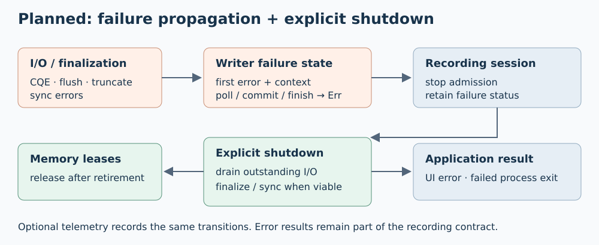

# Recording failure handling

The initial source audit found five gaps below. Full qualification remains open.
Prioritize F1 and F2. Completion errors must reach applications independently of
optional observation; outstanding I/O retains its memory until retirement.

## F1 — Completion-error propagation

Finding: [`Writer::progress`](../src/writer.rs) returns success after recording a
failed CQE. Small commits into an existing combining buffer can also succeed
after the writer has latched an error.

- [ ] Return latched failures from public progress/poll and all admission/commit paths.
- [ ] Separate internal draining from public error reporting so every outstanding request can retire safely.
- [ ] Preserve the first failure with operation/file context; classify backpressure separately.
- [ ] Validate injected EIO, ENOSPC, zero-byte and invalid short completions: idle polling and subsequent small/large/slab/SHM admission expose failure; draining releases owners safely.

## F2 — Explicit shutdown

Finding: dropping [`McapCore`](../src/mcap/core.rs) loses an active combining batch;
`Writer::drop` suppresses drain errors. Early returns in the system monitor and
storage demo can skip explicit finalization.

- [ ] Finalize recording on normal stop and recoverable application-error exits; preserve both the original error and any finalization failure.
- [ ] Define an explicit failure shutdown path that drains submitted I/O and reports accepted-but-unwritten data.
- [ ] Detect unfinished writer destruction with an always-available failure signal; define behavior during unwinding without a second panic.
- [ ] Validate early input/publication errors, pending combining data, footer/truncate/sync failures, and persistent submission failure. Assert error results, retained ownership and independently readable output where finalization succeeds.

## F3 — Durable sink completion

Finding: the [telemetry MCAP sink](../../telemetry/mcap/src/lib.rs) and
[activity MCAP sink](../../activity-tracing/src/sinks/mod.rs) finish and flush
buffered output without syncing the underlying file.

- [ ] Flush and sync the file before reporting successful sink finalization; propagate each failure.
- [ ] Validate injected flush/sync failures and successful finalized-file readback for both sinks.

## F4 — Application failure status

Finding: storage-demo catches recording failures, publishes a UI error and keeps
running; its worker returns `()`, allowing successful process exit. Exercise
commands classify preceding flush failures as command rejection.

- [ ] Retain session failure through worker join and process exit; keep the failure visible in the UI.
- [ ] Distinguish recoverable command rejection from recording failure in exercise controls.
- [ ] Validate a failed recording produces a failed session and nonzero exit; backpressure remains retryable.

## F5 — Sticky durability failures

Finding: [`Writer::sync_file`](../src/writer.rs) returns sync errors without
latching writer failure, allowing later admission or file replacement.

- [ ] Latch sync/finalization failures and reject subsequent admission or rotation; define any explicit recovery separately.
- [ ] Validate failed sync remains visible through polling, admission and shutdown; successful finalization reports synced coverage.

## Qualification

- [ ] Run fault-injection and byte-level readback tests on x86 and ARM64 with observation disabled and enabled.
- [ ] Run affected-package default/all-feature tests, strict Clippy and recorder/demo shutdown tests.
- [ ] Record commands, worker job IDs and results here before checking milestones.

## Submission-driven experiment

MCAP reservation, commit, prepared-block and mapped submissions drive completion
bookkeeping on the owner thread. Accepted batches immediately drive submission.
Rings use SINGLE_ISSUER, DEFER_TASKRUN and TASKRUN_FLAG with the existing
io-uring crate (Linux 6.1+). No dependency was added.

- `poll()` remains an optional idle refresh. Aged batches flush on the next submission.
- `flush_written()` drains accepted writes; `finish()` also seals and syncs.
- Completion errors reach public progress and subsequent admission. Internal draining
  continues retiring owners after a recorded failure.
- A failure discovered after ownership transfer is retained for the next call or
  barrier; the successful return still means acceptance.
- Storage-demo submits heartbeats roughly every 5 ms without calling writer poll.

Validation results will be recorded below; the broader F1–F5 qualification remains open.

Local validation (2026-10-20):

- Passed `cargo test -p storage-persistence -p storage-demo`, default and `--all-features`.
- Passed strict all-target/all-feature Clippy for both packages with `--no-deps`.
- Passed `npm run build --prefix apps/storage-demo/frontend`.
- Passed `python3 apps/storage-demo/validate.py --bin-dir target/debug` with direct I/O;
  independent readback reported CPU=13, heartbeat=201, large=1.
- Hosted port 8091: HTTP 200, live state, 230 completed writes and zero write/submission
  failures at the initial 24-second sample.
- Regression coverage: submissions alone flush aged batches and recycle capacity
  across 200 records; finalization yields independently readable MCAP.
- ARM64 Pueue job **85** succeeded (exit 0), snapshot
  `f9e0276b6de94dff9a720fb5033d1554`; verified with `pueue wait 85` and
  `pueue log --full 85`. Source submitted with
  `python3 scripts/ci/submit.py --source /home/cutuy/doramcap/.git/agent-pool/worktrees/1`.

### Slab-control follow-up

Repeated clicks exhausted the four-slab pool because reader retention was enabled
by default. Reproduction: four accepted writes, then two rejections, with four
readers held and zero free slabs. Completion processing was healthy.

- Default UI/API submissions now release reader ownership; retention is opt-in.
- Full retained pools report “Release readers”; the slab button states 2 × 256 KiB.
- Local HTTP regression passed 12 default slab writes, explicit retention
  exhaustion, release/reuse, rotation and independent MCAP readback.
- Frontend checks, demo Rust tests and strict all-feature Clippy passed.
- ARM64 job 86 passed slab/readback tests, then exposed intermittent activity-sink
  overflow (locally reproduced: 2 dropped MCAP batches with zero capture losses).
- Demo sink queues now hold 64 batches, with enough encoded buffers for both
  sinks. Ten local activity-capture runs passed; the test now checks sink drops.
- Final ARM64 job **87** succeeded (exit 0), snapshot
  `f5fb8e5469f2414facb5e523f9debd91`, including repeated slab writes, activity
  capture with zero recorded loss, and Dora publication/recording equality.
