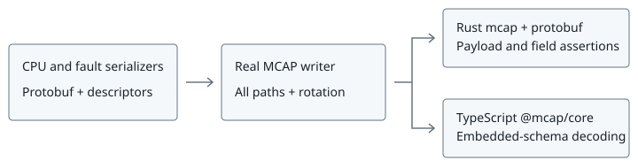

# MCAP reader compatibility

Created: 2026-11-04. Replaces PR #150's indexing proposal with reader qualification.
Recordings retain existing uncompressed, unchunked, index-free framing and DMA paths.
The 1 s batch age landed separately in PR #152.

## M1: Shared protobuf recordings

**Work items**

- [x] Generate CPU telemetry and fault publications with production serializers.
- [x] Exercise combining, direct reservations, prepared slabs, external records and
  external payloads, with two independently readable files per path through rotation.
- [x] Assert payload bytes, channel metadata, timestamps and protobuf values through
  Rust `mcap::MessageStream`; preserve source bytes for independent readback.

**Validation**

- [x] Release fixture generator passed on local x86_64: 18 recordings. CPU fixtures
  cover alignment boundaries and aligned external payloads; fault fixtures cover
  combining, reservation, slab and external-record paths.
- [x] CPU and fault decoders preserve counters above JavaScript's safe integer range,
  CPU dictionary Unicode, fault epoch/revision and timestamps.

## M2: TypeScript streaming and CI

**Work items**

- [x] Add locked, test-only `@mcap/core` and existing `protobufjs` tooling.
- [x] Decode each file independently using only its embedded descriptor set.
- [x] Run fixture generation and verification in a dedicated MCAP CI workflow on
  ARM64/x86_64, with its own runner also invoked by the ARM64 worker.

**Validation**

- [x] Local x86_64: 36 streaming tests passed, feeding each recording in 17-byte
  and 4,093-byte fragments. Assertions cover payload equality, message order,
  topics, timestamps, protobuf fields, no indexes/chunks and complete finalization.
- [x] Release Clippy for the fixture generator, workspace formatting and dependency
  boundaries pass. All 24 focused storage integration tests pass on local x86_64
  (combining, MCAP round trip, rotation, mapped inputs and sealed slabs).
- [ ] Dedicated GitHub MCAP CI passes on ARM64/x86_64.
- [x] ARM64 worker job 583 passed for code revision `846e5d6`: shared Node suites,
  all 36 streaming/protobuf checks, default/all-feature Rust validation and native
  checks. The completion record is in PR #150.
- [x] Extracted MCAP runner passed locally: Rust readback and all 36 TypeScript
  checks. Workflow YAML and Node/Python/shell entry points pass syntax checks;
  Node CI workflow and runner match their pre-PR contents.
- [ ] Updated worker snapshot submission passes with the separate MCAP runner.

Existing production-sink coverage remains in system-monitor's embedded recording
test, fault-watchdog's MCAP readback test and activity-tracing's output tests.
The shared corpus exercises serializers and storage APIs; it does not launch BPF,
Dora or the Console application. Those end-to-end qualifications remain separate.

## Run locally

Use a new output directory on Linux with io_uring and registered-buffer support:

```sh
cargo run --release --locked -p storage-persistence --example reader_compatibility -- /tmp/mcap-reader-recordings
cd libs/storage-persistence/tests/readers
npm ci
npm test -- /tmp/mcap-reader-recordings
```
