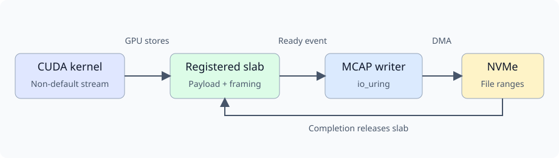

# CUDA-produced MCAP slabs

Created 2026-11-09. [Implementation and evidence](110926-cuda-mcap-slabs-impl.md).

The hardware example registers existing `SlabPool` allocations with
`cudaHostRegisterMapped`. A CUDA kernel produces payload bytes in the mapped
allocation. After a blocking CUDA event establishes readiness, the MCAP writer
submits the same sealed allocation through its existing direct-I/O slab path.

The example owns CUDA registration and holds the pool until unregister completes.
The writer owns file ranges, pending I/O, MCAP finalization and file sync. GPU
completion precedes sealing; storage completion precedes pool reuse. Failed GPU
synchronization retains the allocation instead of freeing live storage.

The executable compares mapped GPU stores, device-memory production followed by
an asynchronous device-to-host copy, and a pre-produced immutable MCAP block.
Every launch and copy uses a non-default CUDA stream. CUDA events use blocking
host waits. Setup, compilation and exact independent MCAP readback are outside
the timed interval; production, submission, drain and final file sync are inside.

The current prepared-record reservation clears payload bytes on the CPU in both
production modes. This cost remains in the benchmark. The storage-only baseline
reuses a GPU-produced immutable block and excludes per-message production.
Process CPU is measured with `getrusage`; it does not establish total-machine CPU
cost or attribute unrelated kernel worker activity.

On discrete GPUs the mapped allocation resides in host RAM. On integrated GPUs
it uses shared SoC RAM. These measurements qualify the tested machine and storage
stack; they do not establish PCIe peer-to-peer VRAM access or Thor qualification.

Rules: D-02 (existing APIs), D-06 (GPU/I/O lifetimes), D-11 (whole-path costs),
D-13 (hardware and independent decoding), I-03 (CUDA remains a development
dependency), I-05 (blocking completion), I-07 (observable recording outcomes).
