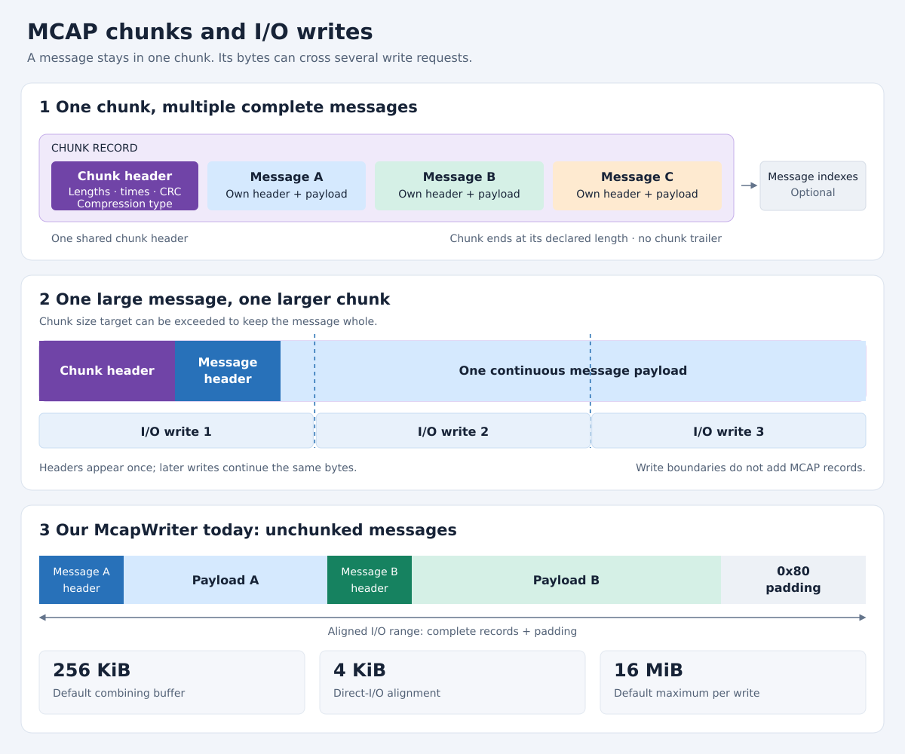

# MCAP chunks and I/O writes

Created: 2026-11-16.

An MCAP chunk groups complete Schema, Channel and Message records. A message
stays within one chunk; a large message can make the chunk exceed the writer's
size target. Each message keeps its own header. The chunk's record lengths mark
its end; it has no trailer.

The chunk header carries the message time range, lengths, compression type and
optional CRC. Message Index records follow the chunk when enabled. Chunk Index
records live in the file's summary, which the footer locates.

Chunk and message boundaries are independent of I/O requests. A chunk can span
several writes; its header appears once. Later writes continue the same bytes.
Padding belongs between complete records, outside message payloads and compressed
record bytes.

## Current writer

`McapWriter` writes uncompressed messages directly to the data section, without
chunks or indexes. It starts each file with its schema and channel declarations.
Small messages share a combining buffer; large managed messages use contiguous
allocations; prepared slabs and external ranges retain their backing through I/O.
Private records (`0x80`) supply direct-I/O alignment padding.

| Setting | Current default |
| --- | --- |
| Managed combining buffer | 256 KiB; initially eight buffers |
| Direct-I/O alignment | 4 KiB |
| Maximum bytes per io_uring write | 16 MiB |

The combining-buffer size is a batching unit. Larger messages can span several
I/O requests. These settings describe software buffers and writes; hardware and
drivers determine DMA transfers.

[MCAP specification](https://mcap.dev/spec#chunk-op0x06) ·
[Reference writer chunk sizing](https://docs.rs/mcap/latest/mcap/write/struct.WriteOptions.html#method.chunk_size) ·
[Writer API](../src/mcap.rs) · [I/O settings](../src/writer.rs) ·
[Writer contracts](contracts.md).
