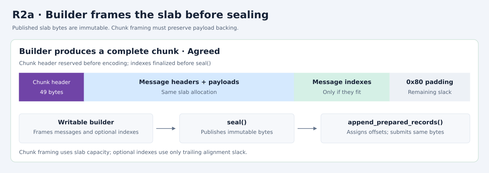
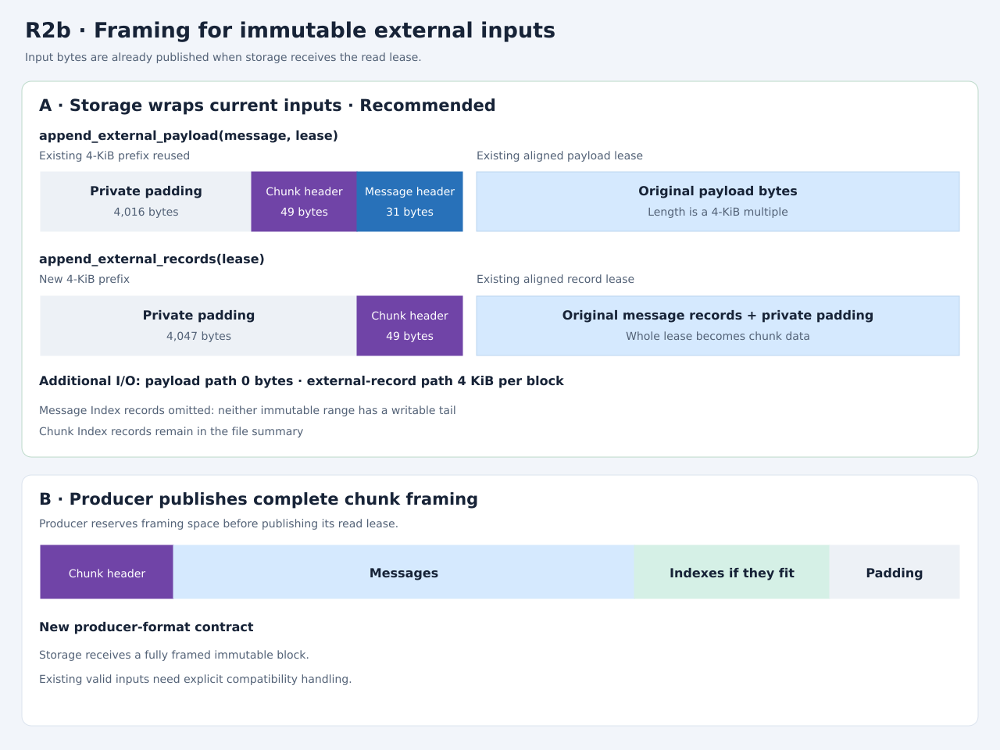

# Opportunistic MCAP indexes

Created: 2026-11-16. Proposed architecture; implementation waits for decision review.
[Implementation plan](111626-opportunistic-mcap-indexes-impl.md).

## Agreed behavior

Each flushed combining batch, complete large managed message, and prepared slab
becomes one uncompressed MCAP chunk. At the last writable point, use its trailing
alignment space for a complete set of Message Index records when they fit.
Otherwise retain padding and omit that chunk's message indexes.

- Determine the aligned write extent from required chunk framing and records.
- Indexes consume only space already in that extent. They never add a page,
  reduce message batching capacity, or move the next append's file offset.
- Emit every channel's complete message index, or none. Leave either no residual
  bytes or a valid private padding record with room for its nine-byte header.
- Every chunk has a Chunk Index in the final summary, including chunks without
  message indexes. Preserve schema/channel declarations there for decoding.
- Keep payload backing and current acceptance, ordering, reuse and durability
  contracts. Prepare all bytes before exposing them to io_uring.

## Three concrete paths

| Path | Chunk contents | Last writable point |
| --- | --- | --- |
| Per-message write-combine | Committed messages in one `flush_combining()` batch | Before handing the managed lease to the I/O writer |
| Large-message DMA | One complete managed message, across any split I/O writes | Before accepting its standalone reservation |
| Slab | Messages in one `PreparedRecordsBuilder` block | Before `seal()` publishes immutable bytes |

For slabs, commitment to I/O cannot rewrite a block already shared with readers.
R2a is agreed: finalize framing and optional indexes during builder sealing.
File offsets are assigned later when the writer accepts the block.

Existing external APIs also need a defined chunked layout. An aligned external
payload has prefix space before its message and no trailing space after its
payload. It can therefore have no message index without another page. Already
framed external records are immutable as well. R2b covers both inputs explicitly;
no existing valid input is silently rejected or left outside chunks.

## Records and file ownership

Message Index records immediately follow their chunk, outside its length.
Remaining alignment bytes form a private record. When indexes are absent, the
summary's Chunk Index has an empty message-index map and zero index length.
The summary is written separately at finish/rotation; its storage does not come
from individual chunks' padding. See the [MCAP specification](https://mcap.dev/spec#chunk-index-op0x08).

The storage writer reserves the full aligned append after its bytes and index
presence are final. Index bookkeeping records accepted file ranges. Refused
admission retains the complete buffer/block and must not publish summary entries.
Current large managed commits flush combining first; prepared/external appends
can precede a buffered combining batch in the file. Chunk ranges and time bounds
follow actual accepted records and offsets, rather than arrival or CQE order.

`finish()` drains writes, emits DataEnd, grouped summary records, summary offsets,
Footer and trailing magic, then truncates the final physical write to the logical
file length and syncs. Rotation gives each file independent declarations/indexes.
A failed write or finalization remains an error; no complete-recording claim is made.

## Reader contract — R1 agreed

Both classes are official exports of Foxglove's `@mcap/core`, already pinned to
2.4.0 in our reader fixtures. `McapStreamReader` traverses chunks with and without
message indexes. `McapIndexedReader` rejects populated chunks with no message
indexes. R1 is agreed: use the official streaming reader as the guaranteed
TypeScript path. Time/topic filtering scans records; indexes remain useful for
readers supporting this mixed layout. No indexed-reader fallback is planned.

Streaming does not promise a fixed 4-KiB read memory bound: the TypeScript reader
can retain a complete chunk, including a large message. Existing Rust consumers
use official sequential APIs; the production verifier's default linear reader
expands chunks. Both new chunked files and existing unchunked files need coverage.

Sources: [official package](https://github.com/foxglove/mcap/tree/main/typescript/core),
[stream reader](https://github.com/foxglove/mcap/blob/main/typescript/core/src/McapStreamReader.ts),
[indexed cursor](https://github.com/foxglove/mcap/blob/main/typescript/core/src/ChunkCursor.ts#L44-L51).

## Slab framing — R2a agreed

Agreed option A reserves 49 bytes for the uncompressed Chunk header before the
builder returns any payload space. At `seal()`, the builder finishes the header,
opportunistic message indexes and remaining padding while it still has exclusive
write access. The writer later assigns file offsets and submits that same sealed
allocation. Combining and large managed reservations can similarly reserve their
chunk header before exposing payload space.

## Immutable external inputs — R2b proposed

These are the existing `append_external_payload` and `append_external_records`
APIs. Their read leases are immutable before storage sees them. Chunk headers
can live in writer-owned prefix pages while the original input remains intact.

| Input | Proposed A layout | Added header-page traffic |
| --- | --- | --- |
| External payload | Reuse the current 4-KiB prefix: private padding, 49-byte Chunk header, 31-byte Message header; then the original aligned payload | None beyond the existing prefix |
| External message records | New 4-KiB prefix: private padding and 49-byte Chunk header; then the original aligned record block, including its private padding | 4 KiB per block |

Both layouts end with the original immutable range and have no writable trailing
space. They omit Message Index records and keep a Chunk Index in the summary.
No page is added for optional indexes. Required Chunk-header traffic is separate
from that policy.

Recommendation A preserves current caller inputs and payload backing. Alternative
B lets a producer publish complete chunk framing and optional indexes before
sharing its lease; it needs a new producer format and explicit compatibility
handling for existing valid inputs. R2b approval is required before either path
is implemented.

## Decision status

The padding-only policy, R1 and R2a are agreed. Review remaining decisions one at a
time before implementation.

| ID | Status | Proposal | Alternative / tradeoff |
| --- | --- | --- | --- |
| R1 | Agreed | Official sequential readers for mixed files | TypeScript time/topic queries scan records |
| R2a | Agreed | Reserve framing before managed/slab encoding; finalize slab indexes before sealing | Wrap a message-only sealed slab with a separate 4-KiB Chunk-header page; omit its message indexes |
| R2b | Pending | Prefix wrappers preserve immutable inputs: reuse the payload prefix; add a 4-KiB header page for external records | Producer-published chunk framing needs a new input contract and compatibility handling |
| R3 | Pending | Evaluate official `mcap` 0.26.0, then choose lease-aware framing integration | A production reference-writer adapter must preserve intact rejection, pinned leases and payload backing |
| R4 | Pending | Retain one summary entry per accepted chunk until finish/rotation | Spooling adds resources and failure handling |

No new runtime dependency, environment input or format option is approved.
External producer-format changes await R2b; framing integration awaits R3.
Summary memory grows with chunks per file; existing rotation bounds it only when
the caller actually rotates. Index scratch should be bounded by available padding;
collecting every message's metadata for the entire recording is unnecessary.

## Related contracts

[Writer contracts](contracts.md) · [Input ownership](101926-memory-ingress-cases.md) ·
[Reader compatibility](110426-mcap-reader-compatibility.md) ·
[Chunk/I/O explanation PR](https://github.com/Cutuy/doramcap/pull/435).
