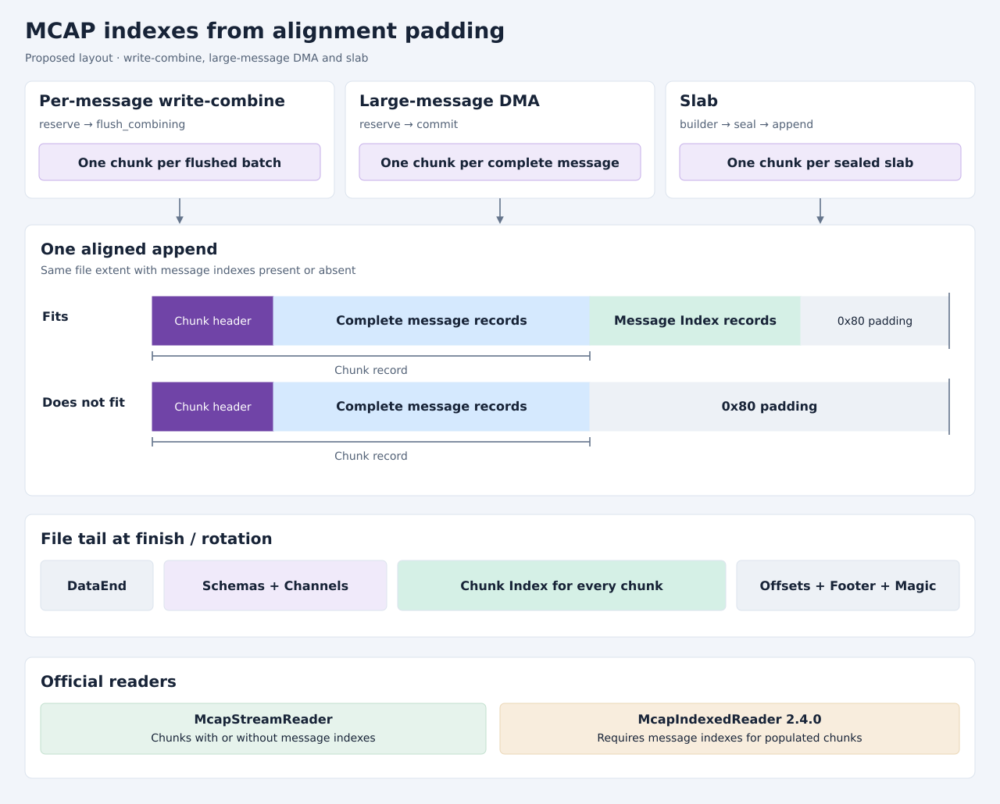
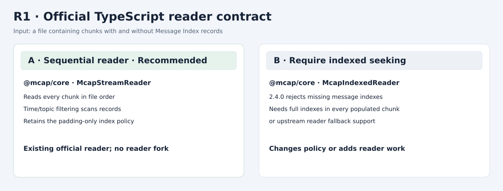

# Opportunistic MCAP indexes

Created: 2026-11-16. Proposed architecture; implementation waits for decision review.
[Implementation plan](111626-opportunistic-mcap-indexes-impl.md).

## Agreed behavior

Only the three existing write paths are in scope: per-message write-combine,
large-message DMA and slab. Extend them in place. Introducing a new write path
is forbidden. Keep the current shared io_uring writer; revise the existing slab
input contract to accept caller-framed chunks.

Each flushed combining batch, complete large managed message, and caller-framed
slab contains one uncompressed MCAP chunk. For #1/#2 the writer fills the framing.
For #3 the caller supplies all bytes. The framing owner can use trailing alignment
space for complete Message Index records; otherwise it retains padding and omits
the chunk's message indexes. The writer never adds indexes to a submitted slab.

- Determine the aligned write extent from required chunk framing and records.
- Indexes consume only space already in that extent. They never add a page,
  reduce message batching capacity, or move the next append's file offset.
- Emit every channel's complete message index, or none. Leave either no residual
  bytes or a valid private padding record with room for its nine-byte header.
- Every chunk has a Chunk Index in the final summary, including chunks without
  message indexes. Preserve schema/channel declarations there for decoding.
- Keep payload backing and current acceptance, ordering, reuse and durability
  contracts. Prepare all bytes before exposing them to io_uring.

## Three concrete paths

| Path | Allocation owner | Framing owner | Chunk contents |
| --- | --- | --- | --- |
| Per-message write-combine | `McapWriter` pool | `McapWriter`, before flushing | Messages in one combining batch |
| Large-message DMA | `McapWriter` allocator; caller fills the returned payload space | `McapWriter`, before acceptance | One complete message of arbitrary payload length |
| Slab | Caller | Caller, before publishing the immutable slab | Caller-supplied Chunk header, complete message records, optional Message Index records and valid padding |

For #2, close the Chunk record immediately after the message payload. If message
indexes fit, place them immediately next, then fill remaining alignment space.
The payload and index start need not be 4-KiB aligned. The buffer address, file
range start and physical I/O lengths must satisfy the 4-KiB contract.

For #3, the caller supplies a complete aligned, DMA-ready byte range. MCAP writer
admission validates framing, reserves file offsets and enqueues that same memory.
It does not allocate a replacement payload buffer, prepend a header, shift bytes,
or rewrite padding. The caller owns the allocation; I/O retains a lease until
completion and reuse waits for all readers and I/O. File-level declarations,
summary records and finalization remain writer responsibilities.

## Records and file ownership

Message Index records immediately follow their chunk, outside its length.
A channel ID identifies a topic with its schema/encoding. When a chunk has message
indexes, it has one complete Message Index record per channel present. A chunk
may mix channels on any path. Omitting message indexes applies to the whole chunk.
Remaining alignment bytes form a private record. When indexes are absent, the
summary's Chunk Index has an empty message-index map and zero index length.
The summary is written separately at finish/rotation; its storage does not come
from individual chunks' padding. See the [MCAP specification](https://mcap.dev/spec#chunk-index-op0x08).

The storage writer reserves the full aligned append after its bytes and index
presence are final. Index bookkeeping records accepted file ranges. Refused
admission retains the complete buffer/block and must not publish summary entries.
Current large managed commits flush combining first; prepared slab appends
can precede a buffered combining batch in the file. Chunk ranges and time bounds
follow actual accepted records and offsets, rather than arrival or CQE order.

`finish()` drains writes, emits DataEnd, grouped summary records, summary offsets,
Footer and trailing magic, then truncates the final physical write to the logical
file length and syncs. Rotation gives each file independent declarations/indexes.
A failed write or finalization remains an error; no complete-recording claim is made.

## Reader contract — R1 agreed

Both classes are official exports of Foxglove's `@mcap/core`, already pinned to
2.4.0 in our reader fixtures. `McapStreamReader` traverses chunks with and without
message indexes. `McapIndexedReader` rejects populated chunks with no message
indexes. R1 is agreed: use the official streaming reader as the guaranteed
TypeScript path. Time/topic filtering scans records; indexes remain useful for
readers supporting this mixed layout. No indexed-reader fallback is planned.

Streaming does not promise a fixed 4-KiB read memory bound: the TypeScript reader
can retain a complete chunk, including a large message. Existing Rust consumers
use official sequential APIs; the production verifier's default linear reader
expands chunks. Both new chunked files and existing unchunked files need coverage.

Sources: [official package](https://github.com/foxglove/mcap/tree/main/typescript/core),
[stream reader](https://github.com/foxglove/mcap/blob/main/typescript/core/src/McapStreamReader.ts),
[indexed cursor](https://github.com/foxglove/mcap/blob/main/typescript/core/src/ChunkCursor.ts#L44-L51).

## Caller-owned slab contract — R2a agreed

The existing #3 contract changes from message records plus padding to a complete
caller-framed chunk followed by optional indexes and padding. The caller provides
the 49-byte uncompressed Chunk header before publishing the slab. Any framing
helper is a caller-side convenience; admission must not require the writer's
builder to have authored the bytes. Compatible channels must match file declarations.

The submitted pointer, byte length and byte contents remain unchanged through
storage. The writer obtains summary metadata from the supplied framing and the
accepted file range; it does not reconstruct payloads or add a header page.

## Decision status

The three-path design and implementation are approved.

| ID | Status | Proposal | Alternative / tradeoff |
| --- | --- | --- | --- |
| R1 | Agreed | Official sequential readers for mixed files | TypeScript time/topic queries scan records |
| R2a | Agreed | #1/#2 use writer allocations; #3 supplies a caller-owned, fully framed aligned chunk | Revise the existing #3 contract and callers; submit slab bytes unchanged |
| R3 | Agreed | Extend the existing private encoder; keep official `mcap` as an independent test decoder | No new runtime dependency; current I/O writer remains |
| R4 | Agreed | Retain serialized Chunk Index records until finish/rotation | 73 bytes per chunk plus 10 per indexed channel and vector capacity |

No new runtime dependency, environment input or format option is approved.
The existing #3 contract changes as specified above;
introducing an additional write path remains forbidden.
Summary memory grows with chunks per file; existing rotation bounds it only when
the caller actually rotates. Index scratch should be bounded by available padding;
collecting every message's metadata for the entire recording is unnecessary.

## Related contracts

[Writer contracts](contracts.md) ·
[Reader compatibility](110426-mcap-reader-compatibility.md) ·
[Chunk/I/O explanation PR](https://github.com/Cutuy/doramcap/pull/435).
