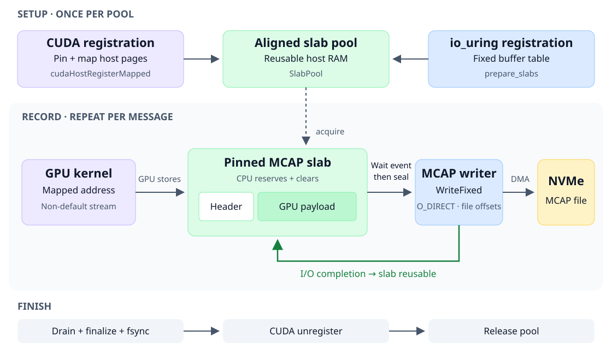

# GPU-produced MCAP files



Created 2026-11-09. [Details and results](implementation.md).

The data path is **GPU → pinned host RAM → NVMe**. The same reusable slab is
registered with CUDA for GPU access and with io_uring for file I/O. The MCAP
writer owns the file, offsets and finalization.

1. **Register once.** Allocate aligned `SlabPool` buffers. `cudaHostRegisterMapped`
   pins their host pages; `cudaHostGetDevicePointer` exposes a GPU address.
   `writer.prepare_slabs` registers those allocations as io_uring fixed buffers.
2. **Produce.** Acquire a slab and reserve an MCAP record. The CPU writes framing
   and clears the payload; a kernel fills the payload through its mapped address
   on a non-default CUDA stream.
3. **Wait and seal.** A blocking CUDA event confirms GPU completion before the
   CPU seals the slab as immutable and submits it to the writer.
4. **Write and reuse.** The writer uses `O_DIRECT` and io_uring `WriteFixed` to
   write from that slab. It retains the slab until I/O completes, then returns
   it to the pool. Both registrations remain available for the next message.
5. **Finish.** Drain writes, finalize and sync the MCAP file, then unregister
   CUDA memory before releasing the pool. An independent MCAP reader checks
   every recorded payload byte.

Requires NVIDIA CUDA driver/runtime/NVRTC and Linux direct I/O/io_uring support.
Run from the repository root with a new output path:

```sh
cargo build --release --locked -p storage-persistence --example cuda_mcap
target/release/examples/cuda_mcap /absolute/path/output.mcap mapped 8388608 128 4
```

Arguments: output path, mode, payload bytes, message count, slab count.
Modes: `mapped` (GPU writes the slab), `staged` (GPU device memory → async copy
into the slab), `io-only` (reuse a pre-produced block).
