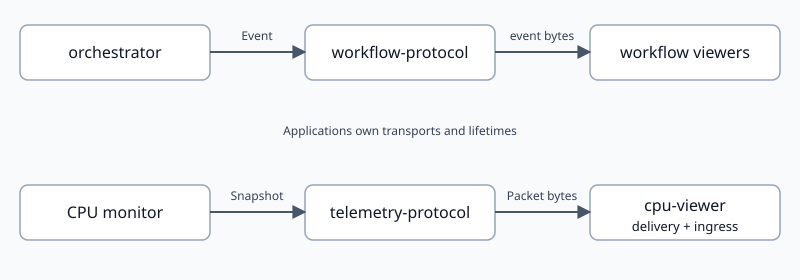

# Telemetry contract ownership

Created: 2026-10-26. Reviewed baseline:
`9acf3fa43728e6e5073901b90865767de71e8f2b`.
Scope: 20 library manifests/exports and sampled public contracts/callers. This
pass addresses the two telemetry ownership findings from that review.

- [x] Extract resource-independent workflow schema and codec into `workflow-protocol`.
  Evidence: repository dependency checker passes the executor/resource prohibition.
- [x] Move viewer ingress and delivery contracts into `apps/cpu-viewer/server`.
  Evidence: viewer ingress uses the application delivery schema.
- [x] Enforce dependency direction in hosted and ARM64 worker CI.
  Evidence: repository checker and its four behavioral fixtures pass locally.
- [x] Complete Rust/frontend compatibility, lint and ARM64 validation below.
  Evidence: local checks and final ARM64 job 142 passed; results follow.

## Ownership and compatibility

`orchestrator` imports `workflow-protocol` for observation. Its Docker example
uses CPU telemetry as a development dependency. The concrete demo application
uses both contracts. The workflow protobuf package, descriptor and event bytes
remain unchanged; Rust imports move from `telemetry_protocol::workflow` to
`workflow_protocol`.

`telemetry-protocol::Frame` describes producer measurements and metadata. The
viewer owns `Ingress`, `Packet` and its `SnapshotFrame` delivery envelope. It
imports shared measurement messages and mirrors envelope fields 1–10 so existing
browser clients receive the same bytes, with ingress at field 11. The adapter
explicitly transfers every producer envelope field; schema additions require
updating that transfer. No public aliases preserve the old coupling.

Producer packets, dictionary packets and recording payloads retain their layout.
Historical
MCAP files retain their embedded schemas. Core decoding accepts legacy viewer
annotations as unknown fields. Its Rust Frame no longer exposes those annotations;
viewer consumers use the application delivery contract. The browser fixture
generator moves from `telemetry-protocol` to `cpu-viewer`.

## Validation evidence

| Check | Evidence |
| --- | --- |
| Dependency boundaries | Repository rules pass; four checker fixtures include transitive violation rejection |
| CI tooling | Eight Python checker/snapshot tests pass |
| Workflow compatibility | Pre-refactor descriptor equality and fixed v1 event bytes pass |
| Viewer compatibility | Legacy packet encoding, unannotated producer/dictionary decoding and fixture regeneration pass |
| Rust tests | Executor, contracts, viewer, demo and MCAP suites pass locally |
| Frontends | CPU viewer: 12 tests; workflow demo: two tests; both production builds pass |
| Lint and docs | Strict affected-target Clippy and Rustdoc pass; formatting, whitespace, links and SVG XML pass |
| Live Dora viewer | 322 synthetic snapshots, 16 dictionaries, rates, 30-second eviction and reconnect names pass; ten latency samples pass |
| ARM64 | Final source snapshot passed in job 142 |

The live viewer checks ran separately from the worker suite using Dora CLI 1.1.0.
Their processes were stopped afterward. Final ARM64 job 142 covered
default/all-feature workspace checks, native cgroup accounting and allocations,
storage validation, and Dora recording equality. Its snapshot was
`7c840d6051064cc2b9dc9769d10ccae8`; the full log's source manifest includes the
final fixture-generator correction. Its example regression ran locally with
`cargo test -p cpu-viewer --example fixture`; worker checks compile examples.
Only documentation changed afterward.

Local logs: `/tmp/doramcap-telemetry-{rust-tests,app-tests,clippy,rustdoc}.log`.
Live results: `/tmp/doramcap-telemetry-viewer-live.log`.
Worker log: `/tmp/doramcap-telemetry-arm64-142.log`.

Local integration uses rebase and cherry-pick from `codex/telemetry-boundaries`.
The pool registry records source and main commit IDs when slot 2 is released.
