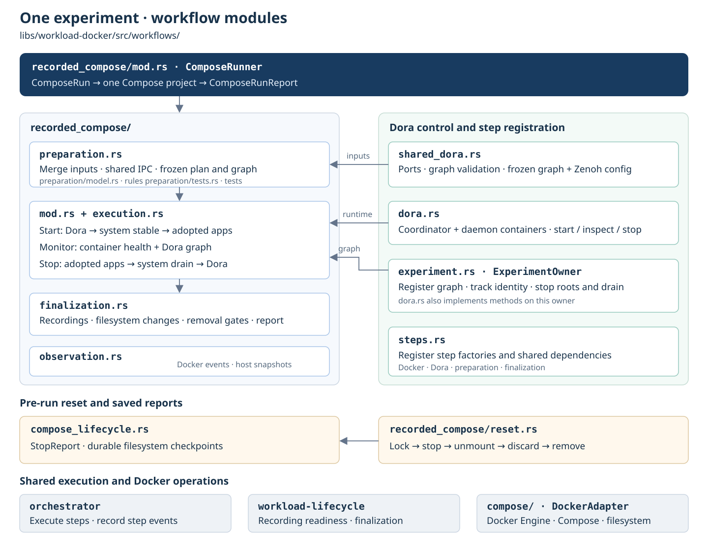

# Docker workload lifecycle

Run one machine-exclusive experiment in a stable Compose project per repository.
Pre-run reset stops old writers, unmounts overlays and discards old uppers before
preparation. Unexpected cleanup errors block launch. Per-run outputs and retained
named volumes remain separate; reset never replays interrupted host writes.

Compose handles configuration and container launch; Bollard verifies ownership,
readiness and cleanup. Dora starts before system apps, followed by adopted apps.

Module relationships and execution barriers:



```rust,no_run
# async fn example(spec: workload_docker::workflows::recorded_compose::ComposeRun) -> workload_docker::compose::Result<()> {
use std::rc::Rc;
use workload_docker::{compose::DockerAdapter, workflows::recorded_compose::ComposeRunner};
let docker = Rc::new(DockerAdapter::connect("/var/run/docker.sock").await?);
let mut manager = ComposeRunner::new(docker);
let report = manager.run(spec, async {
    let _ = tokio::signal::ctrl_c().await;
}, |event: &orchestrator::Event| {
    // Forward to an injected telemetry sink.
    let _ = event;
}).await?;
assert!(report.successful());
# Ok(()) }
```

[Prepared input and validation](docs/102626-compose-workflow.md) ·
[System Monitor Compose](../../apps/system-monitor/deploy/recording.yaml) ·
[Runnable example](examples/compose_experiment.rs) ·
[Robotics qualification](../workload-lifecycle/docs/102626-adoption-candidates.md) ·
[Filesystem metadata steps](docs/102626-filesystem-metadata.md) ·
[Experiment isolation design](docs/102626-docker-experiment-isolation.md) ·
[Direct write-back plan and coverage](docs/102726-direct-overlay-writeback.md)

API details: `cargo doc -p workload-docker --no-deps`.
Real native Docker tests: `python3 libs/workload-docker/scripts/compose-e2e.py --output /tmp/compose-test`.

Host overlays require Linux CAP_SYS_ADMIN, a local daemon sharing the manager mount
namespace, and rsync. Direct write-back rejects ambiguous hardlinks and overlay
redirect/metacopy features; ACL/xattr/capability fidelity is unqualified. Use
`filesystem.disposition: "discard"` to delete upper data without changing original
host directories. Named volumes retain their separate declared policy.
