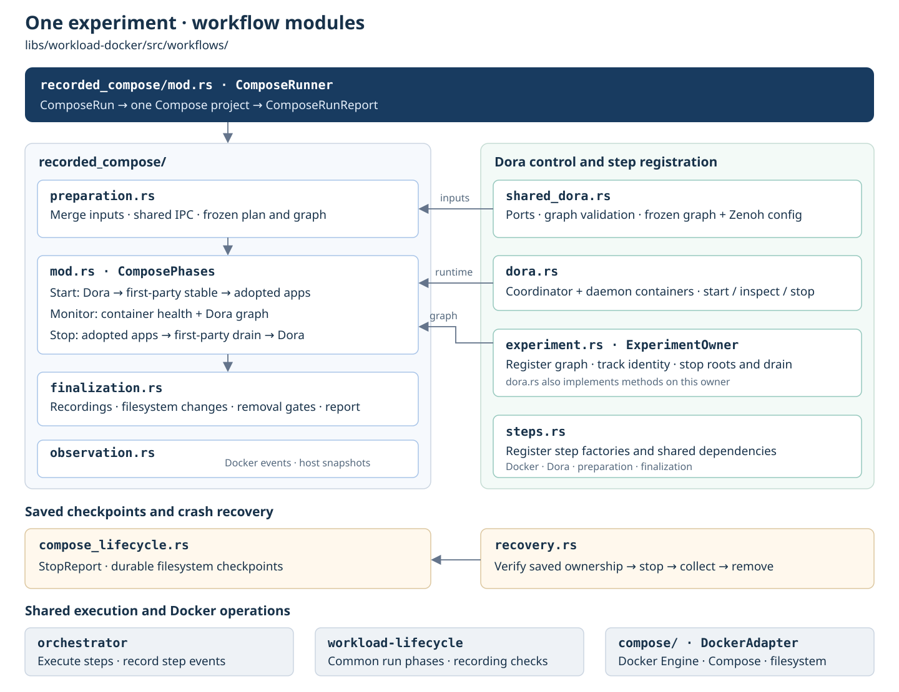

# Docker workload lifecycle

Run one experiment over prepared Compose projects. The workflow orders reusable
preparation, launch, observation, quiescence, finalization and removal steps.
Independent projects run concurrently on the local async task.
Dora-backed apps declare node groups in `SystemAppsConfig`; shared Rust steps launch, inspect and drain those flows before Compose teardown.
Compose handles project
semantics; Bollard inspects Engine state and verifies cleanup. Writable host-directory
binds use shared per-run OverlayFS views with default post-stop write-back.


Module relationships and execution barriers:



```rust,no_run
# async fn example(spec: workload_docker::workflows::recorded_compose::ComposeRun) -> workload_docker::compose::Result<()> {
use std::rc::Rc;
use workload_docker::{compose::DockerAdapter, workflows::recorded_compose::ComposeRunner};
let docker = Rc::new(DockerAdapter::connect("/var/run/docker.sock").await?);
let mut manager = ComposeRunner::new(docker);
let report = manager.run(spec, async {
    let _ = tokio::signal::ctrl_c().await;
}, |event: &orchestrator::Event| {
    // Forward to an injected telemetry sink.
    let _ = event;
}).await?;
assert!(report.successful());
# Ok(()) }
```

[Prepared input and validation](docs/102626-compose-workflow.md) ·
[System Monitor Compose](../../apps/system-monitor/deploy/recording.yaml) ·
[Runnable example](examples/compose_experiment.rs) ·
[Robotics qualification](../workload-lifecycle/docs/102626-adoption-candidates.md) ·
[Filesystem metadata steps](docs/102626-filesystem-metadata.md) ·
[Experiment isolation design](docs/102626-docker-experiment-isolation.md) ·
[Direct write-back plan and coverage](docs/102726-direct-overlay-writeback.md)

API details: `cargo doc -p workload-docker --no-deps`.
Real native Docker tests: `python3 libs/workload-docker/scripts/compose-e2e.py --output /tmp/compose-test`.

Host overlays require Linux CAP_SYS_ADMIN, a local daemon sharing the manager mount
namespace, and rsync. Direct write-back rejects ambiguous hardlinks and overlay
redirect/metacopy features; ACL/xattr/capability fidelity is unqualified. Use
`filesystem.disposition: "retain"` to materialize results without changing original
host directories. Named volumes retain their separate declared policy.
