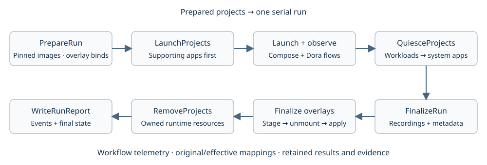

# Single-experiment Compose workflow

Created: 2026-10-26. Backend: local Docker Engine plus Compose CLI.

## Milestones and validation

- [x] M1: Prepared multi-project inputs, Compose normalization and immutable launch artifacts.
- [x] M2: Factory-injected lifecycle steps; Bollard inspection, readiness and verified teardown.
- [x] M3: One procedural experiment workflow, fresh first-party CPU monitor with embedded MCAP writer.
- [x] M4: Real Docker tests: multiple projects, service addition, partial launch, unhealthy/early exit and repeat-run isolation.
- [x] M5: Local lint/tests/docs, readable finalized MCAP, telemetry and ARM64 CI evidence.

Evidence, 2026-10-26: [validation record](102626-compose-validation.json).
Six real Docker scenarios passed with native BPF collection, finalized readable
MCAP, contiguous snapshot sequences and zero dropped batches. Two unit tests,
16 orchestrator regressions, strict Clippy, Rustdoc and formatting passed. The SVG
was rendered and visually inspected. ARM64 job 137 was killed during all-feature compilation after default tests passed.
Final-source job 138 succeeded at 18:05 PDT on 2026-10-26, snapshot
`e8168b4966ce4a9f949360e9388fa68f`: default/all-feature tests and native worker
validation passed. The six Compose scenarios ran separately on local x86_64.
Subsequent edits only record validation evidence.

## Boundary

Callers supply files/directories, environment, profiles/targets and local images.
This workflow accepts those explicit inputs;
it performs no discovery, prompts or image builds. Preflight resolves and validates
it before starting the first-party services. Existing image IDs are frozen for the
run. Application completion is an explicit caller-provided stop signal.

The CPU monitor embeds the existing MCAP writer. A separate foreign-message
recorder is an additional first-party workload once DORA/ROS subscriptions have
been configured. Generic Compose adoption does not infer or record message topics.

## Implementation

Compose CLI owns config/up/down semantics. The approved Bollard crate owns Engine
inspection, event streaming and stop/remove verification. Reuse Tokio, Serde,
thiserror, sha2 and futures-util already present in the repository. Compose steps
receive typed adapter fields from registered factories; service membership stays data.

Only the manager persists. Start fresh first-party services, then foreign projects;
stop foreign projects before the monitor drains its embedded writer. Cleanup runs
for every attempted project even after a partial launch. Inspection failures and
residual owned containers block further runs on that manager instance. Graceful
stop failure remains visible even when forced removal clears a container.

Initial scope is cooperative local Engine access. No remote execution, recovery
journal, application-specific machine reconfiguration, interactive PTY frontend,
or inferred robot readiness. Container healthchecks are honored; running without
one is reported as process-level readiness. Writable host-directory binds use per-run overlays with post-stop write-back.
Named volumes, devices and networks retain their explicit policies. See the
[isolation contract and current qualification](102626-docker-experiment-isolation.md).

## Prepared request

`ComposeRun` carries prepared workload projects, supporting projects, filesystem
policy and stop/readiness budgets. The generated `SystemAppsConfig` comes from
[system_apps.proto](../proto/system_apps.proto); its protobuf text representation
can select a fresh collector:

```protobuf
cpu_monitor {
  image: "doramcap-system-monitor:qualified"
}
```

`PrepareSystemApps` snapshots app configuration. `LaunchSystemApps` invokes the
existing Compose start steps, then `WaitForSystemApps` checks application outputs.
`FinalizeSystemApps` verifies recordings after writers stop. App templates, output
names and monitor-specific policy belong to this adapter.

Resolution and independent workload starts run concurrently on `LocalExecutor`.
System readiness precedes workload startup. Additional `first_party` projects keep
their declared order; independent workloads stop together before those services.
All writers stop before filesystem collection; recording verification and collection
then run concurrently. Resource removal waits for collection and overlay disposition.
Startup failures await sibling results; cancellation retains every attempted plan
for cleanup. The executor records dependencies; procedural Rust owns scheduling.

Optional `filesystem.disposition` selects `write_back` (default) or `retain`.
Mount preparation precedes every launch; collection and strict unmount precede
write-back and container removal.

Optional `first_party` contains additional prepared project objects. They start
after configured system apps and before foreign projects; teardown reverses that order.
A configured foreign-message subscriber can live there. Existing
[`mcap-recorder`](../../../apps/mcap-recorder/) uses DORA; automatic ROS topic
selection and recorder-specific drain acknowledgments remain integration work.

Run with `cargo run -p workload-docker --example compose_experiment -- REQUEST.json`.
An optional second argument bounds total elapsed time in seconds; Ctrl-C requests
awaited shutdown. Do not abort/drop the workflow future to request a normal stop.

## Steps and artifacts

- `ResolveCompose`: normalize supplied files/profiles/targets; pin existing image
  IDs; disable autonomous restart; validate the frozen manifest with Compose.
- `StartCompose`: launch the project; inspect expected replicas, image identity,
  running/healthy state and declared successful completion through Bollard.
- `InspectCompose`: actual container IDs, initial PIDs, health, exit codes and
  restart counts. These join Engine events with the native cgroup observations.
- `StopCompose`: dependency-ordered Compose stop, typed Engine inspection and
  fallback cleanup, scoped Compose down, then independent residual verification.

The workflow resolves every project before side effects, starts the native
collector, verifies advancing CPU output, starts foreign projects, and observes
until a stop request or failure. Every attempted project participates in cleanup,
including partially created projects. Cleanup failures are retained independently.

Artifacts are a private directory (0700) containing frozen manifests and source
hashes, Compose version, image IDs, launch diagnostics, Engine event JSONL,
per-container final inspection, machine before/after snapshots, CPU Protobuf and
MCAP, and the final report. Resolved manifests may contain secrets; files use 0600.
Engine events have no global sequence guarantee; `event_stream_healthy` means no
observed transport/write failure, not a claim of lossless daemon history.

## Ownership and compatibility

- Named volumes are retained by default and listed as isolated artifacts in cleanup
  reports. `remove_volumes: true` deletes owned named volumes. External volumes and
  networks remain external. Anonymous/image-created volumes need explicit mounts
  before launch; this version rejects ambiguous ownership.
- Fixed container names are preserved and checked for collisions. Internal network
  and volume names must be project-scoped. Explicit shared resources must declare
  external ownership. Ownership conflicts block admission on that manager instance.
- Docker restart policies are overridden to `no` and the change is recorded. Host
  networking, privileged services and live bind mounts produce coverage diagnostics.
- Local images must already exist. Builds/pulls, repository discovery and interactive
  environment/profile selection belong to preparation outside this workflow.
- Machine snapshots are passive. No host settings are changed or automatically
  restored; hardware reset, resource-policy enforcement and application readiness
  require separately qualified steps. Existing Compose health/completion conditions
  are preserved. Successful exit must be declared or used as a completion dependency.
- Caller and daemon share a trusted local host. Access to Docker is cooperative;
  this is not enforcement against root or another Docker client. No cross-process
  experiment lock, remote executor, crash recovery, PTY frontend or arbitrary
  nested-launch mediation is provided by this implementation.
- The current writer uses io_uring; the supplied first-party template explicitly
  uses `seccomp=unconfined` plus BPF/PERFMON/SYSLOG capabilities.

Dora-backed projects declare `system_apps.dora_flows` with their service, descriptor
and ordered node groups. Shared launch/inspection/shutdown steps use Dora’s native
controls before Compose teardown; recovery uses the saved flow UUID. See the
[CPU Viewer registration](../../../apps/cpu-viewer/deploy/registration.pbtxt).

## Qualification

The real test uses two foreign projects and the actual BPF monitor/MCAP writer.
It checks dynamic service addition, profile exclusion, literal environment values,
volume retention/removal, repeated teardown, partial launch, unhealthy services,
CLI timeout and preservation of an outsider container with blocked re-admission.
Upstream robotics repositories remain source-analysis targets; no CARLA/robot run
is claimed. GPU memory requirements of foreign applications are independent of
the orchestrator's 4 GB host-footprint target.

## API documentation review, 2026-10-26

- [x] Document prepared input fields and executor/adapter ownership, concurrency,
  errors and cancellation. Evidence: Rustdoc for both crates and formatting checks pass.
- [x] Separate generic orchestration, lifecycle design and Docker implementation;
  name Compose configuration and recorded-run types explicitly.
- [ ] Review telemetry-only step version removal before changing that API.

Post-refactor evidence and crate boundaries: [component review](../../workload-lifecycle/docs/102626-component-boundaries.md).
