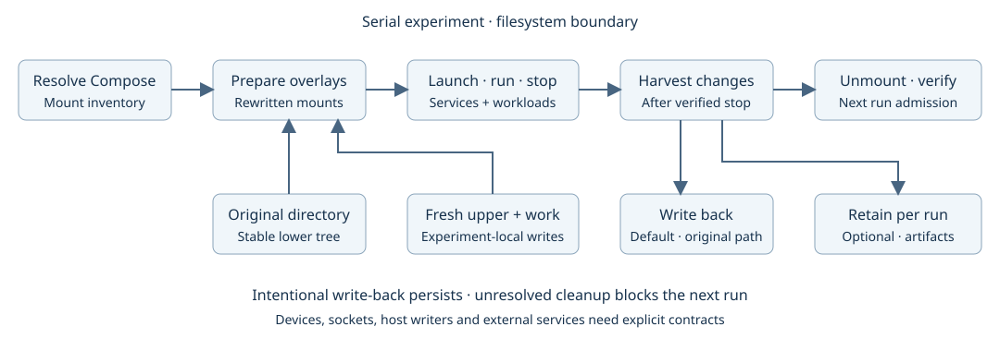

# Docker experiment isolation

Created: 2026-10-26. Design proposal; overlay support is not implemented.
Scope: preventing unintended state carryover between serial experiments.

## Milestones and validation

- [x] M1: Document filesystem policy, workflow changes and remaining isolation domains.
- [ ] M2: Qualify OverlayFS on supported x86_64 and ARM64 hosts; evaluate dependencies before implementation.
- [ ] M3: Implement mount planning, preparation, harvesting and verified unmount steps.
- [ ] M4: Validate two consecutive experiments with write-back and retained-output policies.
- [ ] M5: Qualify failure cleanup, shared/overlapping mounts and metadata preservation.

M1 evidence: this proposal and its companion SVG describe the selected defaults,
exceptions, failure handling and qualification cases. Local Markdown links and SVG
XML were validated; `git diff --check` passed. Implementation milestones
remain open; existing Compose validation does not establish overlay correctness.

## Policy

Each experiment owns fresh processes, first-party monitors, recording sessions
and eligible writable filesystem views. Only orchestration and its self-monitor
persist. Persistent services require explicit exceptions.

Default harvest policy is **write back**: apply additions, modifications and
deletions to the original host directory after writers stop. The next experiment
intentionally inherits these changes. This preserves final persistent-file behavior;
host processes see writes only at harvest time.

Optional **retain per experiment** keeps the original unchanged and preserves the
experiment view/delta under its artifact directory. A retained delta depends on its
lower tree; portable results require materializing selected outputs or preserving
an immutable lower snapshot. OverlayFS alone does not freeze that lower tree.

Onboarding supplies mount-policy exceptions. The procedural Rust workflow consumes
prepared inputs and resolved Compose mounts; service additions require no new steps.

## Filesystem mechanism

For each eligible directory tree, prepare a read-only lower reference, a fresh upper
and work directory, and a merged mount. Bind the merged path into containers at the
original destination. Upper and work reside on the same supported filesystem;
work starts empty. Keep all experiment artifacts outside the lower tree.

| Resolved mount | Proposed treatment |
| --- | --- |
| Writable ordinary directory | Experiment overlay; write-back default |
| Read-only directory | Preserve read-only bind; record identity |
| Same source across services/projects | Share one merged view per experiment |
| Parent/child sources | Plan one compatible overlay tree; preserve each target's access mode |
| Conflicting policies on shared/overlapping sources | Reject before launch; resolve during onboarding |
| Dedicated outputs already configured by user | Fresh ordinary experiment directory |
| Single-file bind | Initial explicit exception; parent-overlay support needs alias/permission qualification |
| Named volume | Separate policy: fresh experiment volume; external/reused volumes are declared carryover |
| Device, socket, procfs or sysfs | Preserve required semantics and record exception; exclude from overlay traversal |

Use Compose's normalized model for paths, overrides, profiles and interpolation.
Canonicalize source aliases and inspect file types before planning. Nested mounts,
symlinks, hardlinks across roots and unsupported backing filesystems need explicit
qualification; never silently split a shared workspace or claim full isolation.
Read-only access through one container path does not prevent writes through another
alias or from the host.

Overlay reads reuse lower files. Writes may copy an entire existing file into the
upper layer, including a large model. Prefer read-only model/dataset mounts where
known. The lower tree must remain stable while overlays are mounted; external host
writers are incompatible with that assumption. Avoid modifying Docker's own storage
layers: these are separately managed host overlays exposed through bind mounts.

## Workflow and step boundaries

Keep the workflow ordinary async Rust. Step instances receive injected mount and
filesystem services; inputs/outputs remain serializable references to plan/artifact
files. No pipeline declaration format or orchestration context is introduced.

1. Resolve Compose and inventory all projects' mounts together.
2. **Prepare overlays:** validate policies, prepare mounts, persist ownership records,
   and generate execution manifests with substituted source paths.
3. Start fresh first-party services, then foreign projects; observe the experiment.
4. Stop foreign projects, then first-party services; verify all writers have exited.
5. **Harvest changes:** inventory the delta and write back or retain according to policy.
6. **Cleanup overlays:** unmount, verify absence, then remove disposable scratch.
7. Admit the next experiment only when cleanup and harvest disposition are resolved.

First-party MCAP/artifact output paths use dedicated experiment directories.
Harvest runs after the recorders finalize; lifecycle telemetry covers these steps.
Capture disposable container-layer changes before removing containers. Any future
volume harvesting must also precede volume removal; current stop/down behavior
will need that ordering split when volume harvesting is added.

## Harvest semantics and failure handling

- Enumerate upper-layer additions/changes and interpret whiteouts, opaque directories
  and metadata correctly. A raw recursive copy of upper is insufficient.
- Apply deletions as well as writes. Preserve supported ownership, modes, symlinks,
  hardlinks and extended attributes; report unsupported semantics explicitly.
- Use bounded traversal/concurrency and metadata manifests; no default content hashing.
  Record unreadable paths, exclusions and incomplete scans. Metadata checks cannot
  prove content identity or eliminate concurrent-write races.
- Check the original against captured baseline metadata before write-back. Detected
  conflicts stop automatic write-back and preserve evidence; stable/exclusive source
  access remains the precondition for reliable application.
- Write-back across a directory tree is not atomic. Record per-operation outcomes;
  preserve upper data on partial failure and require resolution before another run.
- A workload failure still reaches harvest after verified shutdown, preserving normal
  write-back semantics. Failed preparation unwinds only resources already owned.
- If writers cannot be stopped, skip harvest and retain resources for resolution.
  Failed unmount blocks admission. Do not use lazy unmount as proof of cleanup.
- Retained results survive cleanup. Remove an upper directory only after successful
  write-back or verified materialization and the selected retention policy permits it.

No automatic crash-resume mechanism is planned. Manual recovery may be necessary
for abandoned mounts; a fresh manager must refuse collisions with existing resources.

## Other isolation domains to explore

Serial execution removes concurrent experiments, but residual state still matters.

| Priority / domain | Pollution examples | Boundary to qualify |
| --- | --- | --- |
| P0: process ownership | Escaped children, host launchers, restart loops | Stop owned process trees/cgroups; verify emptiness and disabled restart |
| P0: filesystem beyond binds | Named volumes, container layers, temp files, build/model caches | Fresh storage by default; explicit carryover and output retention |
| P0: IPC and middleware | Host shared memory, semaphores, ROS/DDS participants, retained broker messages | Private IPC where possible; fresh domains/services or scoped draining/reset |
| P0: recorder/session state | Buffered messages, stale subscriptions, reused counters | Fresh recorders, drain/finalize, associate every stream with the current run |
| P1: networking | Host listeners, bridges, firewall rules, external connections | Owned network teardown; baseline/delta checks for host-network exceptions |
| P1: host configuration | CPU affinity/governor, cgroups, sysctls, GPU clocks/power settings | Record before; restore only owned changes; verify postconditions |
| P1: devices and robot state | GPU contexts, camera settings, controller modes, pose, simulator state | Workload-specific stop/reset/readiness hooks; require readiness before next run |
| P1: external services | Remote robot servers, databases, queues, object-store writes | Run namespaces or explicit reset contracts; track persistent exceptions |
| P2: measurement conditions | Warm caches, thermal throttling, GPU allocator/compiler caches | Observe and declare warm/cold policy; cooldown gates when needed |

Host IPC/network and privileged containers weaken automatic cleanup guarantees.
Prefer private namespaces when compatible; preserve required robotics semantics
and expose exceptions. Do not delete global IPC objects, flush host caches or reset
shared devices indiscriminately. Physical robot state requires application-specific
contracts; container shutdown alone cannot establish it.

Suggested sequence: filesystem overlays → process/IPC/recording qualification →
host configuration restoration → device/external-service hooks → measurement baselines.

## Qualification cases

- [ ] Two runs: write-back persists changes; retention leaves the original unchanged.
- [ ] Add/edit/delete/rename, opaque directories, symlinks, modes, xattrs and hardlinks.
- [ ] Two projects sharing a source; parent/child mounts and mixed read-only targets.
- [ ] Large untouched model incurs no eager copy; modification copy-up cost is measured.
- [ ] Source changes, permission failures, full disk and partial write-back preserve evidence.
- [ ] Partial preparation/launch, failed writer shutdown and busy unmount block unsafe reuse.
- [ ] Retained artifacts remain usable after unmount; delta dependency is recorded.
- [ ] Linux capability tests on x86_64 and ARM64; build unprivileged, elevate only tests.
- [ ] Real Compose adoption fixtures plus native CPU/MCAP services across consecutive runs.

## References

- [Linux OverlayFS semantics and backing-filesystem requirements](https://www.kernel.org/doc/html/latest/filesystems/overlayfs.html)
- [Docker overlay storage and copy-up behavior](https://docs.docker.com/engine/storage/drivers/overlayfs-driver/)
- [Docker bind mounts](https://docs.docker.com/engine/storage/bind-mounts/)
- [Current Compose workflow and validation](102626-compose-workflow.md)
