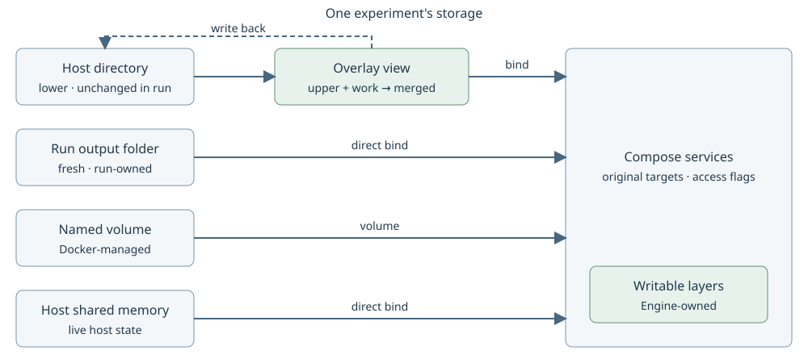
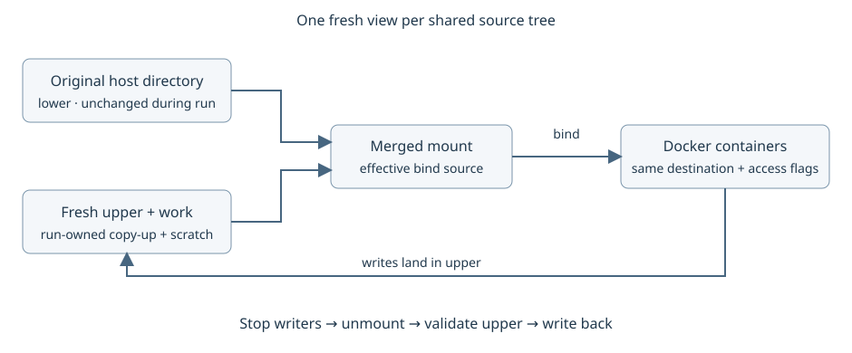

# Docker experiment isolation

Created: 2026-10-26. Updated: 2026-11-12.

Serial experiments start from known storage. Each run gets fresh writable views of
host directories, and its changes reach the host only after its writers stop.

## Components

| Component | Owner | Role |
| --- | --- | --- |
| Compose resolution | `compose-apps` | Classifies mounts across all projects; freezes read-only inputs into `inputs/`; rewrites bind sources to views |
| Overlay views | `host_filesystem::overlay` | One upper, work and merged mount per shared source tree; strict unmount; write-back |
| Change collection | `host_filesystem::changes`, `docker-engine` | Category-preserving change report; see [metadata collection](102626-filesystem-metadata.md) |
| Workflow steps | `workload-docker` | Prepare views, collect changes, finalize views, remove containers |
| Run lifecycle | [Shared-Dora plan](102926-shared-dora-experiment.md) | Teardown and reset between runs |

## Policy

- Each experiment owns fresh processes, monitors, recordings and writable views. Only orchestration persists.
- **Write back** (default): apply the run's additions, changes and deletions to the original directory. The next run inherits them.
- **Retain per experiment**: keep the original unchanged and copy the full merged view into the run's artifacts.
- Runs are serial. Users and host services must leave owned processes, paths and mount sources alone during a run.
- Host readers see overlay writes only after write-back. Workloads that need live host access use a direct mount.

## Storage cases

| Write location | Handling |
| --- | --- |
| Writable host directory | Overlay view; write back after stop |
| Read-only bind | Keeps access flags; shares the view when it aliases a writable tree |
| Run output folder | Direct bind; listed in place |
| Container writable layer | Engine diff recorded; layer discarded with the container |
| Named volume | Existing Docker lifecycle; reported as untracked |
| Host shared memory | Direct and live at every path |
| Single file, device, socket, pseudo-filesystem, nested mount | Direct, with a coverage reason |

## Host contract

- The manager and Docker daemon share a mount namespace. Mounts need `CAP_SYS_ADMIN` and an OverlayFS-capable upper filesystem.
- Lower trees stay unchanged while views are mounted. Unsafe overlaps and unpreservable propagation or SELinux options fail before any mount.
- Write-back uses rsync after strict unmount and is not atomic. Failure keeps the upper and blocks the next run.
- With `redirect_dir=off`, renaming a lower directory can return `EXDEV`. Modifying a large file copies it whole into the upper.
- Run records: `overlays/plan.json`, `prepared.json`, `filesystem/report.pb`, `unmounted.json`, `results.json`.

## Other isolation domains

| Priority | Domain | Boundary to qualify |
| --- | --- | --- |
| P0 | Process ownership | Owned process trees and cgroups stopped; restarts disabled |
| P0 | IPC and middleware | Private IPC where possible; fresh DDS domains or scoped reset |
| P0 | Recorder state | Fresh recorders, drained and tied to the current run |
| P1 | Networking | Owned networks removed; host-network exceptions checked |
| P1 | Host configuration | Only owned changes restored |
| P1 | Devices and robot state | Workload reset and readiness hooks |
| P1 | External services | Run namespaces or explicit reset contracts |
| P2 | Measurement conditions | Declared warm or cold policy |

## M1 — Mount planning and preparation

### Work items

- [x] Inventory writable directory binds across projects; share overlapping trees.
- [x] Create fresh upper/work/merged paths and rewrite generated execution manifests.
- [x] Verify Docker mount-namespace compatibility; reject unsupported sources before launch.
- [x] Persist original/effective mount mappings and unwind partial preparation.

### Validation

- [x] Real Docker writes reach merged views; original host bytes unchanged.
- [x] Shared and overlapping paths keep aliases and read-only access.
- [x] Preparation failure starts no workload and never falls back to passthrough.

## M2 — Harvest and teardown

### Work items

- [x] Unmount after writers stop, then write back to the original tree.
- [x] Preserve deletions, directory replacement and supported metadata; offer retained output.
- [x] Block further admission on incomplete harvest or unmount and keep recovery evidence.

### Validation

- [x] Two serial runs: default write-back and retained-output isolation.
- [x] Whiteouts, opaque directories, renames, symlinks, hard links and sparse files.
- [x] Busy unmount, source conflict and partial preparation failure keep evidence and block reuse.

## M3 — Workflow and observability

### Work items

- [x] Wire preparation and finalization steps around launch and stop/collect/remove.
- [x] Keep host-bind, container-layer and volume categories with original source identities.
- [x] Show original/effective launch changes, isolation state and harvest outcome.

### Validation

- [x] Native MCAP and failure cleanup tests with enforced overlays.
- [ ] ARM64 native overlay tests.
- [ ] Standard ARM64 suite on final source.
- [x] Local strict Clippy, core tests and frontend production build.

## M4 — Further filesystem and hardware qualification

### Work items

- [ ] Measure large-model copy-up, peak metadata memory and disk usage.
- [ ] Qualify more backing filesystems and rootless or private-namespace daemons.
- [ ] Add explicit policies for single-file and device binds and live host readers.
- [ ] Qualify vEDGAR/AnywhereVLA workloads on their GPU and robot hardware.

### Validation

- [ ] Disk exhaustion and partial write-back.
- [ ] Large-model benchmark.
- [ ] Unsupported semantics fail visibly on each new host configuration.
- [ ] Real robotics runs with readiness and reset contracts.

## References

- [Linux OverlayFS](https://www.kernel.org/doc/html/latest/filesystems/overlayfs.html)
- [Docker OverlayFS storage driver](https://docs.docker.com/engine/storage/drivers/overlayfs-driver/)
- [Docker bind mounts](https://docs.docker.com/engine/storage/bind-mounts/)
- [Docker container diff](https://docs.docker.com/reference/cli/docker/container/diff/)
- [Direct upper write-back](102726-direct-overlay-writeback.md)
