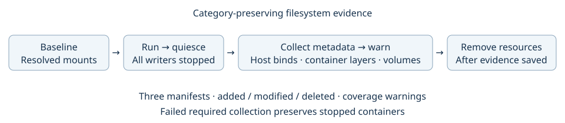

# Filesystem metadata collection

Created: 2026-10-26. Scope: observe changes while preserving their storage category.

- [x] Implement category-preserving baseline and collection steps; separate quiescence from removal.
- [x] Validate host and named-volume transitions, container Engine diffs and serial-run baselines with real Docker.
- [x] Validate collection-failure preservation, scan exceptions, local checks and ARM64 CI.

Implementation evidence: `compose/filesystem.rs`, `QuiesceCompose`, `RemoveCompose`
and the recorded Compose workflow. No OverlayFS mounting/write-back is implemented
by this milestone. Existing host bind semantics remain in effect. No new dependencies.

## Contract

`CaptureFilesystemBaseline` inventories resolved Compose mounts across all projects.
`CollectFilesystemChanges` runs after all writers stop, before any project removal.
It returns three separate manifest references: host binds, container writable layers,
and named volumes. Each row preserves added/modified/deleted kind, source identity,
consumer associations and available metadata. Engine diffs have no stat metadata.

Expected changes and coverage gaps emit warning summaries; they do not fail a run.
The manifest and run report retain detailed coverage notes. Required Engine diff or
artifact-write failure preserves stopped resources and blocks the runner. Removal
telemetry depends on collection; collection depends on baseline and quiescence.

## Coverage and resource usage

- Host scans cover writable binds; read-only, pseudo-filesystem and overlapping
  managed-artifact roots are recorded as exclusions. No symlink traversal or content reads.
- Exact shared sources are deduplicated. Overlapping parent/child roots remain separate
  observations; there is no claim of cross-root deduplication or atomic snapshots.
- Named volumes support direct metadata reads for local-driver volumes without mount
  options on this local daemon host. Other drivers, inaccessible mountpoints and missing
  baselines produce explicit warnings. Fresh-volume additions include image-seeded files.
- Traversal is sequential async I/O with no entry, path-byte, depth or time cutoff.
  `MetadataWalk::next_entry` yields entries incrementally, with directory handles
  proportional to depth. Special entries are stat'ed without opening their contents.
  Nested filesystems and I/O failures are explicit gaps;
  incomplete scans produce no inferred deletions or empty successful diffs.
- Diff indexing uses dynamically allocated metadata maps for one source's before/after
  state. Memory grows with tree size; baseline records are streamed to protobuf. This is
  not a bounded-memory full-tree comparison. Docker/Bollard materializes its complete
  Engine diff response without an additional application cutoff.
- Change artifacts are written incrementally. `FileChanges::next_change` reads one
  length-delimited protobuf record at a time without a row/byte cap. Logging shows the first ten changes
  per category, then full counts and the manifest path. Frontend previews remain
  explicitly labeled previews; full artifacts retain all collected changes.
- Metadata comparison is approximate; it can miss restored timestamps/content and
  attributes not represented by stat. No hashes, content exports, hooks or reset policy.
- Quiesce/remove are independently callable steps. The compatibility `StopCompose`
  operation still performs both; callers needing evidence use the split sequence.

## Validation evidence

[Validation record](102626-filesystem-validation.json): seven real Docker scenarios
passed in 36.56 seconds; native MCAP readback passed for all runs. Metadata categories,
change kinds, fresh serial baselines, shared binds, read-only inputs, dependency events
and evidence-failure preservation were checked. Artifacts:
`/tmp/doramcap-filesystem-e2e-102626-3`.

19 local tests, strict Clippy, Rustdoc and formatting passed. ARM64 job 144 succeeded at 19:36 PDT, snapshot
`3caac51201a34617a8a0b5921e3fcccd`; full log:
`/tmp/doramcap-filesystem-arm64-144.log`. This evidence predates the uncapped traversal revision below.
Development run 1 exposed Docker's successful null/empty diff representation;
run 2 exposed an outdated StopCompose event assertion after the stage split.
Both were corrected before successful run 3.

## Uncapped traversal revision

- [x] Remove entry, path-byte, depth, scan-time and container-diff cutoffs.
- [x] Expose incremental traversal and change readers; limit change logs to ten paths/category.
- [x] Validate a tree exceeding all former size/depth caps and full change readback.
- [x] Rerun Docker integration: all seven scenarios passed; `/tmp/doramcap-uncapped-e2e-102626`.
- [x] ARM64 CI job 146 succeeded; snapshot `896fc53397f145a1a6b07d107821fe8d`, log `/tmp/doramcap-uncapped-arm64-146.log`.

Local validation: four unit tests passed, including 10,142 entries at depth 140, over 4 MiB of relative paths, complete JSONL readback and malformed-record error propagation. Strict Clippy, Rustdoc and formatting passed.
