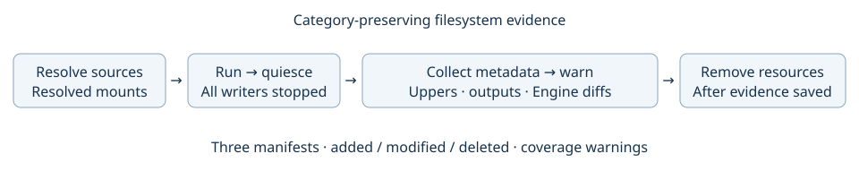

# Filesystem metadata collection

Created: 2026-10-26. Updated: 2026-11-12.

Records what a run changed in each storage category. Reads metadata only; file
contents are never read or exported.

## Components

| Component | Owner | Role |
| --- | --- | --- |
| Source classification | `host_filesystem::changes` | Classifies every mount once for Review and the run |
| Upper reader | `host_filesystem::overlay` | Reads stopped OverlayFS uppers; write-back uses the same reader |
| Output lister | `host_filesystem::changes` | Lists fresh run output folders, minus owner-declared private records |
| Container diff | `docker_engine::filesystem` | Engine diff of stopped containers |
| Change writer | `host_filesystem::changes` | Writes three manifests and the synced `report.pb` checkpoint |
| Console | `console/server` | Bounded preview of the report, with full download |

## Storage categories

| Mount | Evidence | Metadata per row |
| --- | --- | --- |
| Host directory behind an overlay | Upper entries | Type, mode, owner, mtime, size, symlink target |
| Run output folder | Direct listing, all added | Same as above |
| Container writable layer | Engine diff | Path and change kind only |
| Named volume, single file, special or nested mount | Coverage note with reason | None |
| Host shared memory, any path or alias | Excluded; shared-memory observation owns it | None |

## Contract

- Rows keep source, consumers, path, change kind and before/after metadata.
- Copy-ups with unchanged metadata are omitted; equal metadata does not prove equal content.
- Deleted folders expand into individual deleted paths.
- The report is published before unmount, write-back and container removal.
- Coverage gaps are informational. A collection failure keeps evidence and blocks removal.
- Memory grows with the upper and deleted lower subtrees; there are no entry or depth cutoffs.

## Related

- [Experiment isolation](102626-docker-experiment-isolation.md)
- [Direct upper write-back](102726-direct-overlay-writeback.md)
- [File-change implementation plan](../../../console/docs/111026-file-change-report-impl.md)
