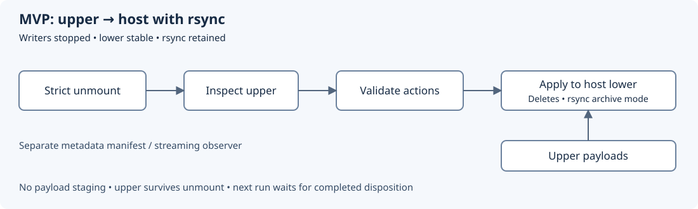

# Upper-driven write-back MVP with rsync

Created: 2026-10-27. Updated: 2026-10-27. Status: implemented; qualification in progress.

## Goal and scope

Remove payload staging from default host-directory write-back. Inspect the upper
backing directory after unmount, interpret its overlay markers, and use installed
rsync for ordinary file transfers. Keep orchestration and adapter code in Rust with
existing dependencies. Go helpers, new merge libraries and kernel work stay deferred.

This MVP prioritizes contents, paths, deletions and symlink preservation. Basic
attributes use rsync archive mode. Advanced metadata fidelity is explicitly
unqualified and does not itself fail a run. Unsupported filesystem semantics fail
loudly before lower mutation. No custom metadata reconstruction is required.

Current implementation/research: [backend design](102726-overlay-writeback.md).
The default write-back path now uses this implementation. Retain mode continues to
stage a full merged view.
This revision supersedes the earlier merged-view inspection and hardlink-reconstruction plan.

## Proposed flow

1. Stop and verify all writers; keep original host sources stable through finalization.
2. Strictly unmount all owned overlays and verify absence.
3. Traverse upper and validate a complete action list before changing any host source.
   Use targeted lower lookups for existing object types, path safety and hardlink checks.
4. Apply deletions/type replacements, create directories, and rsync selected ordinary
   upper entries directly to their original host paths.
5. Record disposition; admit the next run only after successful application and cleanup.

Upper/work remain accessible after unmount. Runtime merge planning does not inspect
the merged view, enumerate lower to discover changes, or read/hash file payloads.
Opaque-directory deletion necessarily visits affected destination subtrees. Existing
baseline/conflict checks and separate provenance scans retain their own costs; this
change does not claim those scans disappear.

## Supported operations and limits

| Upper entry | MVP action |
| --- | --- |
| Regular file | Copy complete contents once from upper to host. Selected paths bypass size/mtime skipping. |
| Ordinary directory | Create/merge it, preserving existing children absent from upper. |
| Symlink | Preserve the link and its target text, including dangling links; do not dereference it. |
| Whiteout | Delete the corresponding host path, including a directory subtree; never transfer the marker. |
| Opaque directory (opaque=y) | Clear hidden lower children, then populate from upper. Handle opaque root too. |
| Directory marked opaque=x | Treat as whiteout-scan optimization, not whole-directory deletion. |
| Type replacement | Remove the incompatible destination object before installation. |
| Redirect/metacopy marker | Reject with path and feature before mutation. |
| Unsupported special file | Reject with path/type; recognized whiteout device markers are handled as deletions. |
| Hardlink ambiguity | Reject upper multi-link files and affected lower multi-link replacements that cannot be safely represented. No alias discovery or reconstruction in MVP. |

Support both kernel whiteout representations: character device 0:0 and regular-file
whiteout xattr. The current mount uses `trusted.overlay.*`; only that namespace
is interpreted as markers. Ordinary `user.overlay.*` application attributes are
not actions. Fail if required semantic metadata cannot be read; `userxattr` mounts
are not supported by this adapter. Do not confuse metadata-only copy-up
with ordinary chmod/chown changes on complete upper files.

Validate effective mount configuration and reject dependent features; directory
redirect following can depend on kernel settings even with `redirect_dir=off`.
Hardlink checks must account for index bookkeeping conservatively: an ambiguous
link count produces an explicit unsupported error, never silently split aliases.
This restriction can reject valid workloads and must be visible in onboarding/docs.

Keep paths confined to each planned source. Inspect symlinks without following them;
reject unsafe destination-ancestor traversal. Validate all roots before applying any.
Use existing shared-tree planning for overlapping binds and read-only aliases.

## Rsync and metadata contract

Use archive mode as the baseline (`-a`, optionally `-v` for diagnostics), retaining
numeric IDs and deliberate `--ignore-times` for selected payloads. Keep sparse-file
support where already available. Specify NUL-delimited selected paths and exclude
whiteouts; no blanket `--delete` or recursive transfer of unvalidated upper entries.

`-a` preserves symlinks plus basic modes, ownership and modification times where
permissions allow. `-L` follows symlinks and copies their referents, so it is excluded
from this MVP. Archive mode does not include `-H`, `-A` or `-X`.

Do not require ACL, xattr/capability, hardlink-topology or exact directory-metadata
fidelity. Avoid `-A/-X` in the initial direct path so overlay implementation attrs
cannot be copied blindly. Document the limitation and emit one coverage notice per
run, rather than failing merely because advanced attributes exist. Existing target
attributes may persist or change; no fidelity guarantee is implied. Rsync errors
and partial-transfer exit statuses remain failures, including basic attribute errors.

Choose and document the final invocation in M2. Copy from upper without consuming
it. A small private action list suffices; no comprehensive metadata snapshot, generic
merge engine, or extra workflow abstraction is required. Memory can grow with the
list; do not introduce entry/depth/time cutoffs. Warning previews remain bounded.

## Failure and result boundaries

- No lower mutation before successful unmount and complete semantic validation.
- Busy/failed unmount blocks application; lazy unmount is not proof of cleanup.
- Cooperative/exclusive source access remains required. Metadata checks cannot
  detect every content edit or eliminate races with external writers.
- Apply is non-atomic. Errors/cancellation preserve upper, action records and logs,
  mark disposition incomplete, and block the next run. No automatic retry/resume.
- Preserved upper contains changed payloads; it cannot restore already deleted
  lower-only files. Old upper/work must not be remounted over the modified lower.
- Metadata observation stays separate, with host-bind/container-layer/volume categories.
  Optional future streaming consumers do not become application prerequisites.
- Current retain mode still materializes a full independent view; changing its
  lifetime/storage model is outside this MVP. Reclamation remains explicit.

## M1 — Validate upper and build a small action list

### Work items

- [x] Scan upper after strict unmount; classify whiteouts, opacity, entries and replacements.
- [x] Perform targeted lower checks; reject unsupported semantics before any root changes.
- [x] Persist actions/paths safely, including non-UTF-8 filenames; remove merged-view dependency.

### Validation

- [x] Cover both whiteouts, opaque=y/x, ordinary directories, opaque root, type replacements,
  dangling symlinks, unusual names and unsafe destination ancestors.
- [x] Reject redirect/metacopy, unsupported special files and ambiguous hardlinks visibly.
- [x] Prove no payload copies/hashes, merged traversal or new full lower discovery scan occurs.
- [x] Verify rejected plans leave all host sources unchanged; record evidence before checking items.

Evidence: x86_64 native test executable, built unprivileged and run via sudo: 12/12
real OverlayFS tests passed. `direct_writeback_preserves_files_symlinks_and_whiteouts`,
`opaque_upper_root_hides_lower_children_without_copying_internal_xattrs`,
`xattr_whiteout_deletes_and_opaque_x_preserves_other_children` (including an
ordinary `user.overlay.whiteout` attribute), and
`unsupported_upper_entries_reject_before_any_writeback` exercise the stated cases.
Hardlink tests cover existing lower aliases and newly created aliases. Source review
confirms planning walks upper and performs targeted lower lookups without payload I/O.
The independent baseline/observation scanner now preserves Unix path bytes in
[protobuf streams](102726-filesystem-protobuf.md).

## M2 — Apply with rsync directly from upper

### Work items

- [x] Execute deletes/replacements and selected archive-mode transfers without staging payloads.
- [x] Document exact flags and basic-attribute behavior; exclude symlink dereferencing and markers.
- [x] Expose advanced-metadata coverage notice and preserve diagnostics/transfer statistics.

### Validation

- [x] Match supported contents, names, deletions and symlinks against fixture expectations.
  A merged-view oracle is optional in tests only; no runtime dependency is introduced.
- [x] Same-size/same-mtime edits transfer; untouched payloads remain uncopied.
- [x] Verify basic modes/mtime and privileged ownership; symlink targets outside the tree
  are never copied. Advanced attrs do not trigger a compatibility failure by themselves.
- [x] Verify no internal overlay attrs reach host, all mounts are absent before writes,
  and rsync/copy/delete failures produce incomplete disposition.
- [x] Record evidence before checking items.

Evidence: the same 12 native tests passed, including same-size/same-mtime edits,
external symlink targets, root opacity, metadata warning, a real 4 MiB tmpfs destination with rsync ENOSPC, and an 8 MiB recording
transferred without staging an untouched 8 MiB model. `apply.log` contains selected paths and excludes
untouched files; staging is empty. Invocation uses `-aS --numeric-ids --super
--ignore-times --itemize-changes --stats`, `--no-recursive --dirs --from0
--files-from`, and does not use `-L`, `-H`, `-A` or `-X`.

## M3 — Docker, serial-run and failure qualification

### Work items

- [x] Wire direct apply into existing finalization with no new customer configuration.
- [x] Update demo/docs with upper-driven phases, metadata coverage and unsupported cases.
- [x] Preserve current retain behavior and separate filesystem-diff categories.

### Validation

- [x] Two real Compose runs prove host source stays unchanged during execution, changes
  appear after finalization, and run two intentionally inherits successful write-back.
- [x] Shared writable/read-only aliases retain a consistent managed view.
- [ ] Exercise source conflicts, busy unmount, disk exhaustion, permission errors and
  interrupted application; evidence survives and the next run is blocked.
- [x] Relevant existing native/Docker/frontend checks pass; unsupported hardlink cases
  become explicit negative tests rather than being silently removed from coverage.
- [ ] Record evidence before checking items.

Evidence: native `two_serial_writebacks_inherit_prior_results` verifies two serial
real-overlay runs and isolation before finalization. Conflict, busy mount, ENOSPC,
and cross-root validation tests passed. `cargo test -p workload-docker --all-targets`,
strict Clippy, and the orchestrator demo frontend production build and tests passed. The demo
shows the coverage warning; per-phase telemetry is still a single finalization step.
Real Docker `multi_project_lifecycle` passed using an existing monitor image and
unique test-owned resources: two serial runs, shared read-only alias, recording,
and failure scenarios. Evidence: `/tmp/doramcap-direct-compose-pnmmPT/summary.json`;
test-owned containers, volumes, networks and mounts were cleaned afterward.
Interrupted apply remains untested; detailed performance and Jetson evidence remain open.

## M4 — Performance and platform qualification

### Work items

- [ ] Compare staged and direct paths with recordings, resumed datasets, untouched models,
  many small files and basic metadata edits.
- [ ] Measure transfer bytes, wall time, peak memory, temporary disk use and physical I/O
  where available; separate baseline/provenance scans and workload copy-up costs.
- [ ] Qualify ext4 x86 and ARM/Jetson, including a 4 GB memory configuration.

### Validation

- [ ] Demonstrate one payload transfer per selected regular file and no staging copy;
  document rsync temporary-file overhead and actual runtime improvement.
- [x] Run ARM CI per AGENTS.md; record native-capability/hardware qualification separately.
- [ ] Record remaining gaps without claiming universal filesystem/metadata compatibility.

ARM64 WSL job 175 passed the standard worker suite on the production-code snapshot.
The worker did not run these ignored OverlayFS capability tests; native ARM/Jetson
mount qualification is still open. The final 8 MiB local test was added after the
worker snapshot. See [validation record](102726-direct-overlay-validation.json).

## Planning validation

Implementation evidence is recorded beside each milestone. Documentation evidence
(2026-10-27): local links,
SVG XML and phase labels, milestone structure and whitespace checks passed;
`git diff --check` passed. SVG raster preview was not run. This paragraph validates documentation only.

## References

- [Existing isolation contract](102626-docker-experiment-isolation.md)
- [Current finalization](../src/compose/overlay.rs)
- [Linux OverlayFS semantics](https://docs.kernel.org/filesystems/overlayfs.html)
- [rsync options](https://download.samba.org/pub/rsync/rsync.1)
