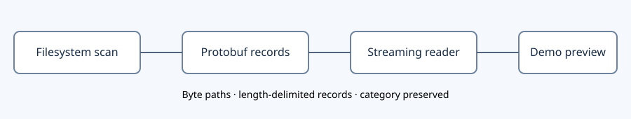

# Streaming filesystem protobuf

Created: 2026-10-27. Status: implemented and locally validated.

Use length-delimited protobuf records for filesystem snapshots, change manifests
and write-back actions. Paths and symlink targets are bytes. Public change readers
remain incremental. Baseline comparisons still use in-memory indexes; changing that
algorithm is separate work. Compose control/configuration and small result documents
remain JSON.

## M1 — Schema and streaming I/O

### Work items

- [x] Define protobuf records in the workload Docker component using existing prost tooling.
- [x] Stream length-delimited records for snapshots, changes and action journals.
- [x] Support non-UTF-8 filesystem paths and symlink targets end to end.

### Validation

- [x] Verify protobuf roundtrips, empty streams, partial/truncated/corrupt records and arbitrary path bytes.
- [x] Exercise large/deep metadata trees and incremental consumers without artificial limits.
- [x] Record evidence before checking items.

Evidence: `cargo test -p workload-docker --all-targets` passed five unit tests,
including malformed frames, truncated snapshots, byte-safe roundtrips and a tree
with more than 10,000 entries and depth 140. Readers yield individual records.

## M2 — Workflow, UI and integration

### Work items

- [x] Convert baseline persistence and all category-specific change readers to protobuf.
- [x] Convert overlay baseline and action records while retaining rsync's NUL path lists.
- [x] Decode records for the demo preview; preserve storage categories and warnings.

### Validation

- [x] Run real OverlayFS serial experiments including non-UTF-8 paths and symlink targets.
- [x] Run real Docker Compose workflow and frontend build/tests.
- [x] Run crate tests, strict lint and ARM CI; record capability-specific limitations.

Evidence: all 12 real x86_64 OverlayFS tests passed with the final buffered writers;
the two serial runs and protobuf action-plan assertions include non-UTF-8 names
and symlink targets. Crate tests, strict Clippy, demo server check, frontend build
and frontend tests passed.
Real Docker Compose lifecycle passed with the final build: two serial runs, byte-safe
host changes, storage categories and failure scenarios. Evidence: `/tmp/doramcap-protobuf-compose-zs0iNV`;
fixture resources were cleaned. An earlier ownership scenario failed before creating
its outsider; two subsequent full runs passed, so its cause remains unconfirmed.
ARM64 WSL job 203 succeeded on snapshot `dbfec5c8f09a4e38a7976fb5ba1a8d46`.
The worker suite did not run the ignored privileged OverlayFS/Docker tests; native
ARM/Jetson OverlayFS qualification remains open.
