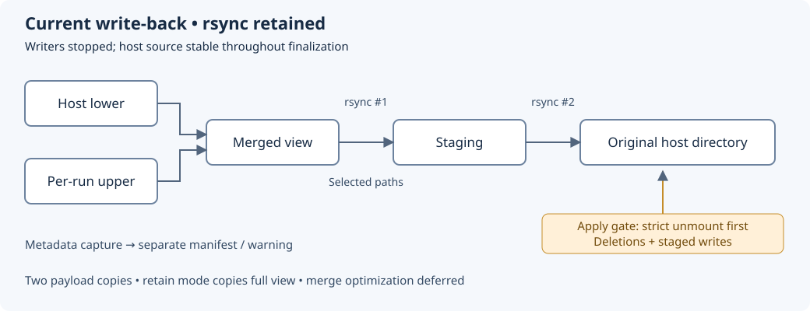

# OverlayFS write-back backend

Created: 2026-10-27. Status: historical staged-backend design; direct write-back implemented.

Current behavior and qualification: [upper-driven MVP](102726-direct-overlay-writeback.md).

## Decision

Keep the existing Rust orchestration and installed rsync backend for now. Introduce
no Go helper, new dependency, custom merge engine or kernel extension in this change.
Direct upper-to-host application is now covered by the
[upper-driven rsync MVP plan](102726-direct-overlay-writeback.md), with explicit
unsupported-case failures and advanced metadata fidelity unqualified. The direct path is implemented; its qualification status is recorded there.
Other backend changes stay deferred.

Write-back remains the default for eligible writable host-directory binds. After
verified shutdown and finalization, users access results at their original paths.
The next run intentionally inherits those results. This is deferred persistence;
host readers see the previous state during execution. It is not a clean-baseline
policy or an atomic filesystem transaction.

See [isolation and supported mounts](102626-docker-experiment-isolation.md) for
cooperative host access, shared views, namespace requirements and storage categories.
Container-layer diffs and named-volume observations retain their separate categories.

## Previous staged implementation

Source: [overlay.rs](../src/compose/overlay.rs), especially `prepare`, `finalize`
and the private `rsync` helper. This section records the staged implementation reviewed on 2026-10-27;
it has since been replaced by the direct path.

| Phase | Current behavior |
| --- | --- |
| Prepare | Capture lower metadata; create fresh upper/work/merged/staged directories; copy root directory metadata only into upper; mount original host source as lower. |
| Quiesce | Workflow stops writers before finalization; source must remain stable through harvest. |
| Select | Enumerate upper paths through the merged view, expand affected hardlink aliases, and scan lower against merged to identify deletions/type replacements. |
| Stage | Rsync selected paths from merged into staging. Linux resolves whiteouts and opaque directories through the merged view. Root metadata is transferred separately. |
| Unmount | Recheck lower metadata, strictly unmount all owned views, verify absence, then record `unmounted.json`. |
| Apply | Recheck lower; explicitly delete removed/replaced paths; rsync staging into original host directory. Record `results.json` on success. |

The transfer helper invokes rsync directly, using:

```text
-aHAXS --numeric-ids --super --ignore-times --itemize-changes --stats
```

Selected-path staging additionally uses `--no-recursive --dirs --from0 --files-from`
with a NUL-delimited list. Root-only transfer excludes children. Apply recursively
copies the staged tree. There is no blanket `--delete`; absent staged paths often
represent untouched lower files. Explicit deletion handling belongs to finalization.

`--ignore-times` deliberately bypasses size/mtime skipping for selected paths.
A file represented in upper may have identical bytes to lower; no content hash or
byte comparison removes that transfer. Untouched lower-only payloads stay out of
write-back staging, except aliases required to preserve an affected hardlink group.

## Costs and failure contract

- Selected payloads are copied twice: merged → staging → host. There is no rename
  or reflink fast path. Staging also consumes disk space.
- Metadata enumeration may cover entire lower/merged trees. Dynamic metadata maps
  scale with tree size; no arbitrary entry cutoff is introduced.
- Existing-file copy-up can copy a whole large file during the workload itself.
- Current `retain` materializes the entire merged tree, including unchanged payloads.
  Delta-only retention is deferred; it needs a lower-version/lifetime contract.
- Upper and staging remain after finalization. Automatic artifact reclamation is
  separate future work; successful write-back currently does not reclaim them.
- Lower checks compare recorded metadata. They cannot detect every content change
  or prevent races; exclusive/cooperative access remains a precondition.
- Apply is non-atomic. Failure can leave a partially updated host; block further
  admission and retain evidence for manual resolution. No automatic resume is promised.
- `apply.jsonl` records completed deletions; rsync logs describe transfers. These are
  diagnostic records, not a durable transaction log or automatic rollback mechanism.

Evidence artifacts include `baseline.json`, `changed.paths0`, `deleted.json`,
`stage.log`, `apply.log`, `apply.jsonl`, `unmounted.json` and `results.json`.
The metadata-observation step remains separate from merge execution; optional future
streaming consumers do not become prerequisites for write-back. Warning previews
can show the first ten entries while the complete manifest stays available.

## Why preserve host results

Source review supports compatibility-oriented write-back:

- [vEDGAR Compose](https://github.com/TUMFTM/vEDGAR/blob/main/docker-compose.yml)
  mounts recordings and its service source tree writable.
- [AnywhereVLA recording](https://github.com/SelfAI-research/AnywhereVLA/blob/main/src/gpu_part/hermesbot-smolvla/scripts/record_data_leader.sh)
  explicitly resumes a dataset under its writable mounted Hugging Face directory.
- [Event-Orin recorder](https://github.com/tudelft/event_orin_drone/blob/main/ros/src/eo_drone/launch/drone_flight_recorder.launch.py)
  writes MCAP bags under its workspace layout.
- [OpenTeach collector](https://github.com/aadhithya14/Open-Teach/blob/main/openteach/components/initializers.py)
  writes demonstration directories; Docker wrapping is additional integration work.

These are source observations, not runtime or hardware qualification. Live host
interfaces such as sockets/devices require their own compatibility treatment.
All services sharing a source must see the same managed view, including read-only aliases.

## Researched alternatives — deferred

| Candidate | Reusable capability | Qualification gap |
| --- | --- | --- |
| [containerd archive](https://github.com/containerd/containerd/blob/main/pkg/archive/tar.go) | Streamed OCI changeset application into a directory | Overlay exporter; metadata fidelity and tolerated xattr failures; changed payload copying. |
| [containers/storage](https://github.com/containers/storage/tree/main/pkg/archive) | Overlay whiteout conversion, streaming archive generation and layer application | Selective metadata export; hardlink aliases, feature coverage and failure behavior. |
| [umoci](https://github.com/opencontainers/umoci/tree/main/oci/layer) | Overlay-aware export and ordinary-directory layer application | Timestamp truncation and xattr filtering; non-atomic apply. |
| [BuildKit merger](https://github.com/moby/buildkit/blob/master/snapshot/diffapply_linux.go) | Filesystem diff/apply with hardlink/copy optimizations | Managed-snapshot assumptions, internal APIs and metadata-error policy. |
| [Ciel Rust merger](https://github.com/AOSC-Dev/ciel-rs/blob/9e73c8464965c3a64c90ada0aa1a5434075d3db2/src/overlayfs.rs) | Direct move-based merge-down | Unfinished redirect handling and ineffective permission synchronization in inspected code. |
| [overlayfs-tools](https://github.com/kmxz/overlayfs-tools) | Direct merge using moves or rsync | Documented hardlink and metadata limitations. |
| [ostrya](https://docs.rs/ostrya/latest/ostrya/transaction/struct.Transaction.html), [fstool](https://docs.rs/crate/fstool/latest), [overlayfs_fuse](https://docs.rs/crate/overlayfs_fuse/latest) | Rust implementations of related merge operations | Object-store destination, full tar materialization, or different FUSE runtime respectively. |

A future streamed changeset can avoid disk staging, but still transfers changed
payloads. Same-filesystem rename could avoid payload copies while consuming upper
progressively. Preserving an independent upper and consuming it are different policies.
Reusing libraries remains preferable to assuming a new implementation is correct.
Go-based candidates are recorded for research only; adoption is deferred by decision.

## Kernel and storage alternatives — deferred

- [OverlayFS](https://docs.kernel.org/filesystems/overlayfs.html): research found no
  documented upstream merge-down operation suitable for this task. Changing lower
  while mounted remains unsupported. Docker commit/export does not write back our binds.
- [Device-mapper snapshot merge](https://docs.kernel.org/admin-guide/device-mapper/snapshot.html):
  existing kernel support merges changed blocks into an origin device. Requires
  volume-level ownership and provisioning; investigate for dedicated experiment storage.
- [Btrfs snapshots](https://btrfs.readthedocs.io/en/latest/Subvolumes.html): snapshot
  publication offers a different persistence model requiring subvolume-based storage.
- [FICLONE](https://man7.org/linux/man-pages/man2/ioctl_ficlone.2.html) and
  [copy_file_range](https://man7.org/linux/man-pages/man2/copy_file_range.2.html):
  existing acceleration primitives. Probe filesystem support; in-kernel copying
  does not guarantee elimination of physical I/O or interpret overlay deletions.

A custom kernel extension is a research option only after measurements demonstrate
an unmet need. It would require its own correctness, durability, kernel-version and
Jetson qualification. No storage migration or persistent host configuration is authorized.

## M1 — Record current decision

### Work items

- [x] Document existing rsync staging/apply, result policies and deferred alternatives.
- [x] Link this decision from the isolation design and crate README.

### Validation

- [x] Verify the sequence and flags against current source.
- [x] Check local links, SVG XML syntax and whitespace.

Evidence (2026-10-27): read current `prepare`, `finalize` and `rsync` source;
verified local Markdown targets; parsed SVG with Python ElementTree;
`git diff --check` and new-document whitespace validation passed. No runtime code
changed and no new runtime tests were run. SVG raster preview was unavailable in
this session; browser/renderer availability does not establish visual verification.

## M2 — Qualify current costs and failure behavior (future)

### Work items

- [ ] Measure scans, transferred bytes, wall time, peak memory and temporary disk use.
- [ ] Exercise large recordings, resumed datasets, large untouched models and metadata-only edits.
- [ ] Exercise disk exhaustion and partial apply while preserving current admission rules.

### Validation

- [ ] Record results on ext4 x86 and supported ARM hardware; include a 4 GB memory target.
- [ ] Verify untouched payloads stay unstaged and record both selected-payload transfers.
- [ ] Verify failures preserve evidence and prevent starting the next run.

## M3 — Revisit backend only when justified (deferred)

### Work items

- [ ] Compare library adapters, rsync-based improvements and same-filesystem moves using M2 evidence.
- [ ] Specify independent-retention and partial-failure semantics before changing application.
- [ ] Evaluate dedicated-volume snapshots or kernel work only if directory-level options are inadequate.

### Validation

- [ ] Match expected results for whiteouts, opacity, type replacement, hardlink aliases,
  symlinks, sparse files, ownership, modes, ACLs, xattrs and timestamp precision.
- [ ] Verify two serial experiments and failure injection before claiming compatibility.
- [ ] Publish fidelity/performance results and present dependencies for evaluation before adoption.
