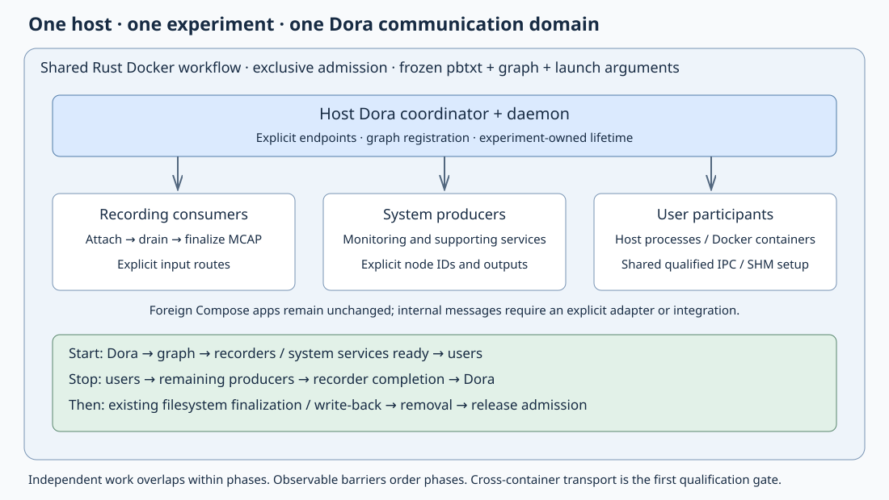

# Shared Dora runtime per experiment

Created: 2026-10-29. Status: agreed architecture; implementation pending.

## Contract

One host runs one experiment at a time. Each experiment owns one Dora coordinator
and daemon, shared by all its Dora participants, including host and container
processes. The shared Docker workflow owns their lifecycle. The gallery calls
that workflow and owns browser sessions and inactivity policy.

Participants use explicit node IDs and snapshotable launch settings. Prefer CLI
arguments and read-only configuration files over environment variables. Keep
foreign applications unchanged; small initialization changes in our Dora nodes
are permitted. Ordinary Compose applications need no Dora integration to run
and be observed, but their internal messages require explicit integration.

Start Dora, then recording/support services, then user workloads. Stop users,
then remaining producers, drain/finalize recorders, and stop Dora. Existing
filesystem finalization, write-back and resource removal follow this barrier.

Use the existing Rust executor and dependencies. Keep independent operations
concurrent with awaited futures inside each dependency phase. No detached cleanup,
production shell supervisor, custom broker, or new general workflow framework.

## Scope decisions

| Concern | Initial implementation |
|---|---|
| Runtime | Host coordinator and daemon; qualify one local Linux arrangement |
| Lifetime | One prepared experiment; no cross-experiment runtime sharing |
| Membership | Resolve the complete participant graph before launch |
| Identity | Explicit experiment, participant and node IDs; reject duplicates |
| Routing | Explicit edges in one experiment graph; shared IPC alone creates no routes |
| Recording | Experiment-owned recording outputs and observable finalization |
| Admission | Host-wide cooperative exclusive lock plus unresolved-run check |
| Gallery | One active hosted experiment; additional viewers may join that same run |
| Concurrent app starts | Different experiment requests receive a clear busy response |
| Multiple apps | Declare them as participants of one prepared experiment |
| Out of scope | Live graph editing, automatic discovery, distributed Docker, global recorder |

The gallery mapping deliberately avoids an indefinitely growing experiment. If
interactive addition of unrelated apps to a running experiment is required later,
design that separately. Preserve independent application binaries and images.

Host networking is a candidate for Dora participants because the pinned dynamic
node client connects to localhost. Select it only after M1 qualifies port handling,
shared-memory access and proxy reachability. Foreign services retain their existing
networking unless they explicitly participate in Dora. Shared IPC means a working
common communication domain; do not claim zero-copy from namespace settings alone.

## Execution rules for implementers

- Read repository instructions, acquire/reuse a lease, and preserve existing edits.
- Inspect the actual branch before applying this plan: the source currently has
  uncommitted workflow regrouping and recovery fixes that must be retained.
- Complete milestones in order. M1 is a feasibility gate, not permission to build
  around an unsupported Dora behavior with a new broker or environment hack.
- Before adding a dependency or custom infrastructure, present suitable maintained
  libraries as required by AGENTS.md. Prefer reuse of existing dependencies.
- Update work and validation checklists separately. Record concise acceptance
  evidence in the relevant milestone before checking it; omit raw logs/history.
- Keep API contracts in Rustdoc and configuration in generated protobuf types.
- Commit by milestone or coherent concern; do not mix unrelated cleanup.

## M1 — Qualify external attachment and common IPC

**Work items**

- [ ] Inspect pinned Dora 1.1.0 source and deployed CLI version together. Verify
  dynamic-node configuration, endpoint selection, startup barriers, input closure,
  reconnect behavior and shared-memory implementation; do not rely on newer docs.
- [ ] Build a minimal host producer, container consumer and recording consumer
  using existing crates. Give each an explicit node ID and daemon port through
  arguments/configuration. Avoid `DORA_NODE_CONFIG` as our integration contract.
- [ ] Register the complete graph before launching its externally owned processes.
  Confirm that a waiting user producer does not prevent system consumers becoming
  ready. Separate graph registration, attachment readiness and data readiness.
- [ ] Qualify the host network/IPC/shared-memory arrangement. Record exact Compose
  fields, mount paths, UID/GID permissions, capacity and endpoint bindings here.
  Host IPC alone must not be assumed to share the required POSIX SHM files.
- [ ] Check host-network port collisions and Caddy connectivity. Resolve required
  service ports explicitly in the prepared plan; bind Dora control endpoints to
  the qualified local interface and detect pre-existing listeners.
- [ ] Identify the smallest supported node initialization change. If the public
  API cannot express required settings explicitly, report the precise gap before
  introducing patched Dora, hand-built internal configuration or a proxy.

**Validation**

- [ ] Host→container, container→host and container→container exchange succeeds
  through the same experiment runtime with explicit IDs and routes.
- [ ] Large-payload testing identifies the actual transport; shared-memory behavior
  is demonstrated if claimed, including cleanup of experiment-owned allocations.
- [ ] Two consumers attach before producer launch without a startup deadlock.
- [ ] Producer exit yields observable input closure; recorder drains queued input
  and finalizes a readable file with known message counts.
- [ ] Duplicate ID, occupied endpoint and incompatible permissions fail clearly.
- [ ] Record the selected topology and any unavoidable upstream environment use,
  including its derivation from snapshotted settings. No silent fallback transport.

Evidence: pending.

## M2 — Explicit configuration, snapshots and admission

**Work items**

- [ ] Replace the container-service-bound `DoraFlow` contract in
  `proto/system_apps.proto` with experiment runtime and participant configuration.
  Use generated types directly; introduce no parallel configuration structs.
- [ ] Define runtime executable/version, explicit endpoints, graph path, deadlines,
  shared-memory settings and private runtime/artifact paths. Pin resolved binaries
  and container image identities using existing preparation conventions.
- [ ] Define participant ID, node IDs, role, host/Compose launch binding, arguments,
  configuration files, readiness condition, shutdown phase and output ownership.
  A process may contain multiple nodes only when explicitly declared.
- [ ] Resolve app-owned descriptor fragments into a frozen experiment graph with
  deterministic IDs and validated routes. Reject dangling edges, duplicate IDs,
  cyclic shutdown dependencies and contradictory launch ownership before launch.
- [ ] Snapshot the effective pbtxt, native Dora descriptor, arguments, resolved
  Compose manifests and allocated paths/ports privately before side effects.
  Native Dora YAML remains valid upstream input; avoid a redundant schema for it.
- [ ] Acquire one host-wide cooperative experiment lock before resource mutation.
  Use one documented lock location shared by gallery and standalone callers.
  Check unresolved ownership records before admitting a new run after a crash.
- [ ] Reuse existing file locking facilities where appropriate; document scope,
  permissions and limitations against unrelated Docker clients. Do not create
  persistent system configuration automatically.

**Validation**

- [ ] Invalid configuration fails before any process, container or mount starts.
- [ ] Effective settings are reconstructible from private snapshots without reading
  the launcher's environment. Necessary foreign-app environment remains captured.
- [ ] Two independent caller processes cannot start simultaneous experiments.
- [ ] A crashed owner releases its OS lock but unresolved resources still block
  admission until verified recovery. A stale PID alone proves no ownership.

Evidence: pending.

## M3 — Reusable runtime and lifecycle steps

**Work items**

- [ ] Refactor `src/workflows/dora.rs` into focused runtime/graph operations under
  a small module directory if needed. Keep `recorded_compose/mod.rs` procedural.
- [ ] Add or adapt reusable steps for runtime start/readiness, graph registration,
  participant attachment checks, runtime inspection and runtime stop. Register
  factories through `workflows/steps.rs` and reuse `LocalExecutor`.
- [ ] Launch host coordinator/daemon with explicit arguments, working directories
  and private logs. Establish recoverable ownership before acknowledging readiness;
  account for crashes between spawn and checkpoint publication.
- [ ] Integrate phases in `recorded_compose/{preparation,projects,observation}.rs`:
  preparation → runtime → graph → consumers/support → users → observation.
  Keep filesystem preparation before affected processes start.
- [ ] Await independent sibling starts/stops concurrently. Preserve every attempted
  resource for cleanup even when another sibling fails or cancellation arrives.
- [ ] Observe host runtime and participant/container health. Daemon failure fails
  the experiment; do not transparently restart and claim continuous recording.
- [ ] Plain Compose callers without Dora participants retain a simple path without
  an unnecessary Dora process. Mixed experiments use the one shared runtime.

**Validation**

- [ ] Step events show runtime readiness before participant attachment and system
  readiness before user launch. Independent starts overlap within each phase.
- [ ] Partial launch, unavailable runtime, participant early exit and cooperative
  cancellation all enter awaited cleanup and preserve individual failures.
- [ ] Killing the daemon produces an explicit failed result and cleans or retains
  owned resources consistently; no false successful recording status.
- [ ] A non-Dora Compose experiment still works without Dora installed/running.

Evidence: pending.

## M4 — Observable drain, shutdown and recovery

**Work items**

- [ ] Replace the current all-flow-stop-before-project-stop behavior in
  `recorded_compose/projects.rs` with participant dependency barriers: users,
  remaining producers, draining consumers, runtime, existing finalization/removal.
- [ ] Define consumer completion as input closure plus queue consumption and
  successful writer finalization. Reuse existing recorder behavior where sound;
  add a minimal explicit completion result if process exit alone is ambiguous.
- [ ] Distinguish attached, ready, quiesced, finalized and failed states. Ensure
  startup readiness does not require output from a user producer not yet launched.
- [ ] Keep deadlines explicit. Forced termination or missing drain acknowledgement
  marks recording incomplete; never write a clean-completion marker on timeout.
- [ ] Capture runtime, graph and process identities in existing private recovery
  records. Validate ownership against PID reuse and unrelated Dora processes.
- [ ] Adapt `workflows/recovery.rs` to perform the same ordered shutdown after a
  launcher crash. Recovery is idempotent and retains incomplete artifacts.
- [ ] Feed stopped-writer/finalization outcomes into existing filesystem gates.
  Preserve OverlayFS capture/write-back implementation and its failure policies.
- [ ] Release admission after cleanup is verified; retain unresolved ownership
  records when cleanup cannot be proven complete.

**Validation**

- [ ] A finite producer emits a known sequence; immediate stop still yields every
  accepted message in the finalized MCAP, with explicitly reported drops/failures.
- [ ] A stalled consumer hits its deadline and reports incomplete recording.
- [ ] Recovery works after failures at runtime start, participant launch, drain,
  and partial removal; repeat recovery does not touch unrelated resources.
- [ ] Runtime stays alive until recording completion. Filesystem finalization
  starts only after writers stop and retains its existing write-back guarantees.

Evidence: pending.

## M5 — Migrate application deployments and gallery

**Work items**

- [ ] CPU Viewer: split monitor, viewer and recorder into explicit process/container
  participants. Keep BPF capabilities and host observation mounts on the monitor.
  Preserve snapshots/dictionary routes and recorder backpressure settings.
- [ ] MCAP Recorder: preserve its application logic; add explicit attachment inputs
  and finalized-output status needed by M4. Exercise its standalone deployment.
- [ ] Fault Demo and Fault Watchdog: migrate every existing Dora registration,
  including OTEL and MCAP profiles, and preserve their routes and result behavior.
- [ ] System Monitor: explicitly distinguish its existing embedded recording mode
  from Dora publication. Do not duplicate CPU collectors or record the same stream
  twice accidentally. Keep ordinary embedded recording available where used.
- [ ] Inventory all `dora_flows`, `dora.yaml` and forced-env initialization references
  before declaring migration complete. Other apps retain their deployment behavior.
- [ ] Keep Compose and registration files in each app's `deploy/`. Launch app
  binaries directly; remove bundled per-app coordinator/daemon services.
- [ ] Update gallery registry/workflow/runtime integration to pass prepared settings
  into shared workflow steps. Remove gallery-owned Dora or namespace setup.
- [ ] Surface host busy state clearly; multiple viewers may share the active run,
  while launching a different experiment waits for explicit completion/cleanup.
  Preserve session idle-stop behavior and generation-safe browser URLs.
- [ ] Delete obsolete `libs/workload-docker/deploy/dora.yaml` and container-exec
  flow management only after all callers migrate. Remove obsolete proto fields
  and app-specific log parsing where explicit completion replaces it.

**Validation**

- [ ] Launch migrated apps through their app-owned deployments and the gallery;
  verify real UI data, routes, downloads and readable finalized results.
- [ ] A mixed host/container multi-app experiment uses exactly one coordinator
  and daemon and shows intended cross-participant message delivery.
- [ ] Concurrent gallery start requests cannot bypass shared host admission.
- [ ] Browser disconnect/idle expiry triggers the complete ordered shutdown.
- [ ] A representative unchanged foreign Compose workload runs and stops correctly.

Evidence: pending.

## M6 — Qualification and concise documentation

**Work items**

- [x] Replace `ComposePhases` with sequential execution and local step outputs.
- [x] Use generated protobuf contracts and owned service declarations; preserve
  adopted Compose documents through native Compose normalization.
- [x] Move Compose merging, IPC wiring and policies into the embedded TypeScript
  planner, with generated protobuf output and native Docker JSON export.
- [ ] Keep meaningful lifecycle/transport regressions in existing Rust test suites.
  Remove disposable feasibility tooling; add no maintained deployment scripts.
- [ ] Update workflow SVGs, API docs and minimal app deployment instructions to
  show the qualified topology, explicit configuration and one-experiment rule.
- [ ] Replace the older target section in `102626-compose-workflow.md` with a short
  link to the implemented contract; avoid contradictory parallel designs.
- [ ] Review diff for duplicated lifecycle logic, stale per-app infrastructure,
  hidden environment configuration and unused dependencies.

**Validation**

- [x] Test TypeScript rules and the embedded protobuf boundary, including
  native null networks, exact numbers, file snapshots, cancellation and limits.
- [ ] Pass affected Rust tests, formatting, strict Clippy and Rustdoc checks.
- [ ] Run real Docker lifecycle, failure/recovery and shared-IPC tests on this host.
  Build unprivileged; elevate only capability-required test executables as allowed.
- [ ] Verify CPU/BPF apps with real monitoring; qualify CUDA separately if touched.
  ARM64 remains deferred by user instruction; never claim CUDA on that worker.
- [ ] Host the SPA and verify migrated UI apps in a browser, including busy state,
  stop/restart, recordings and absence of leaked processes/containers.
- [ ] Render architecture SVGs and verify links. All checked validations have
  concise milestone-local evidence and no unsupported transport/losslessness claims.

Evidence (2026-10-31): 14 TypeScript tests and bundle synchronization pass;
46 library and 3 protobuf-contract tests pass in default/all-feature modes.
Affected library/caller Clippy, Rustdoc, formatting and boundaries pass. Native
Docker startup/reset and Dora SHM/adopted-IPC tests pass on the final implementation.
Production Rust decreases by 210 lines; maintained production source is 404 lines
below `origin/main`, including TypeScript/protobuf and excluding tests/generated code.
Full workspace CI and ARM64 were deferred. The last full run's 11 Console failures
still require the separate registration/graph inputs from #29/#15.
