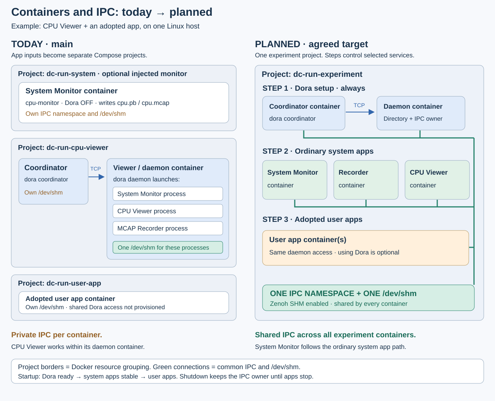
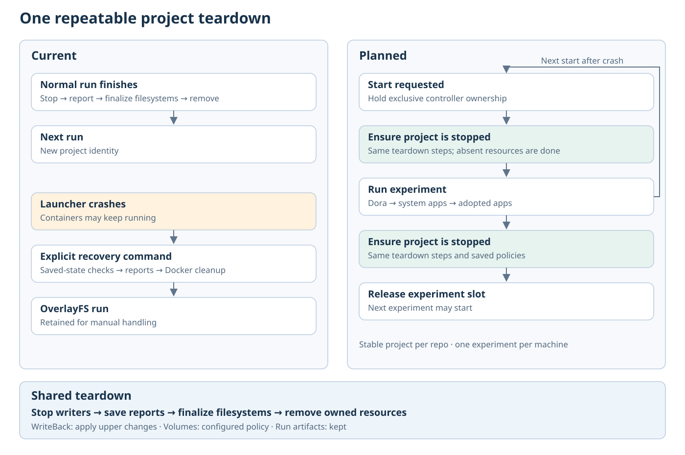

# Shared Dora daemon per experiment

Created: 2026-10-29. Status: M1–M6 complete. PR39 ARM64 passes; topology ARM64 deferred.
Acceptance requires **strictly fewer production-code LOC than main**.

## Contract

- Keep user-supplied `compose.yml` inputs. Assemble **one Compose project per
  repository**, with identity derived from its explicit canonical root; reject naming conflicts.
- Every experiment supplies coordinator/daemon; apps may ignore Dora.
- Steps own startup: **coordinator/daemon ready → system apps ready/stable →
  adopted user apps**. Control selected services within the shared project.
- System Monitor is an ordinary system app supplied through its deployment
  Compose file. Remove its special configuration, preparation and launch path.
- Every container joins one IPC namespace and the same `/dev/shm` backing store.
  Enable Zenoh SHM. Give all apps the same daemon connection settings; use is optional.
- Applications retain their Compose commands, mounts, dependencies and health checks.
  The Dora setup step owns communication services; workload steps own all app services.
- Stop adopted apps, stop system apps, stop Dora, then
  finalize filesystems, remove resources and release repository admission. Different repositories
  may run concurrently; gallery apps have separate repository identities. Forced stops leave recording status incomplete.
- Preserve protobuf/pbtxt settings, native Dora graphs, immutable inputs, embedded
  recording and the MCAP writer's `seccomp=unconfined` setting.

## M1 — One project and shared IPC test: complete

Evidence (2026-10-30): `tests/shared_ipc.rs::one_project_qualifies_zenoh_shm_and_adopted_ipc`
passed locally in 13.05 s. Five containers shared their IPC namespace and shm mount;
20 payloads ≥256 KiB used `/dev/shm` and finalized MCAP in order (0–19).
An adopted app opened the same segment. Endpoint ownership rejection, interrupted
startup and verified cleanup passed. Dora 1.1 uses its daemon/TCP path for backpressure
routes; the SHM test uses `drop_oldest`. Recording routes retain backpressure.

**Work items**

- [x] Test one native Compose project with coordinator, daemon, a system
  producer/consumer pair and an adopted container. Start each group through steps.
- [x] Use a shareable IPC owner, join every app to it, size `/dev/shm` once and
  enable Zenoh SHM. Preserve matched permissions, memlock and backpressure.
- [x] Test this placement before replacing application launch paths.

**Validation**

- [x] All containers have the same IPC namespace and shared-memory backing;
  an adopted container sees and opens a segment created by a system container.
- [x] Prove actual Zenoh shared-memory payload delivery, retain the full accepted
  sequence and finalize MCAP. A successful TCP fallback does not satisfy this check.
- [x] Verify setup ordering, endpoint collision rejection, cancellation and cleanup.

## M2 — Ordinary apps and one resolved experiment: complete

Evidence: native Compose inputs, immutable files, image pins, conflict rejection
and mixed volume policies pass. System Monitor uses ordinary app inputs.

**Work items**

- [x] Resolve supplied Compose inputs with their own paths/environment, assemble a
  single experiment model and reject service/resource naming conflicts before launch.
- [x] Remove `CpuMonitor`, special `PrepareSystemApps` handling and hidden monitor
  injection. Supply System Monitor through the ordinary system app list.
- [x] Remove the extra participant roles/phases/bindings, host process manager and
  duplicated validation/recovery. Use native graph and Compose service identities.
- [x] Preserve private input snapshots and existing filesystem/removal gates.

**Validation**

- [x] Native Compose files, overrides, relative paths, environment, networks and
  volumes preserve their declared behavior; conflicts fail without side effects.
- [x] Inputs are immutable and images pinned. System Monitor follows the same
  preparation, launch, readiness and shutdown operations as another system app.

## M3 — Explicit startup, drain and cleanup: complete

Evidence (2026-10-31): public workflow tests pass: exact 20-message drain,
cancellation, failed launch, daemon death, forced-stop incompleteness and launcher
kills at three boundaries. The native group passes in 118 s.

**Work items**

- [x] Launch selected Dora services, register the native graph, launch/stabilize
  system services, then launch user services. Await attempted starts on failure.
- [x] Supply daemon settings, default node IDs and IPC/SHM to every adopted app.
  Preserve declared IDs, commands, health checks and dependencies; Dora use is optional.
- [x] Apply the contract's shutdown order; keep the IPC owner until its users stop.
  M6 resets the repository ownership scope before the next run.

**Validation**

- [x] Events prove daemon ready → every system app stable → user starts, including
  slow startup. Earlier-stage failure/cancellation prevents user startup.
- [x] Plain Compose apps and apps that ignore Dora run and stop normally.
- [x] Final accepted messages survive drain. Forced workload stop and daemon death
  report incomplete recording and await cleanup.
- [x] Interrupted runs preserve ownership and outputs; M6 resets their disposable
  resources before another experiment starts.

## M4 — Deployments and final acceptance: complete

Evidence (2026-10-31): standalone local CI passes: boundaries,
formatting, default/all-feature Clippy and workspace tests (87 executables each),
doctests, storage without defaults (13 executables), builds and snapshots.
Six gallery deployment profiles pass in 62.43 s. Public runtime, volume, reset
and interrupted-copy-back tests pass. PR39 also passes ARM64 worker job 535.

Review: [library foundation #41](https://github.com/Cutuy/doramcap/pull/41),
then [application cutover #45](https://github.com/Cutuy/doramcap/pull/45).

Complete feature versus starting main `d105d65`:

| Category | LOC delta |
| --- | ---: |
| Production Rust | −694 |
| Production TypeScript | −43 |
| Protobuf schema code | −21 |
| Production total | **−758** |
| Tests/tooling | +3,510 |
| Deployment/build configuration | −181 |
| Documentation | −666 |

Production excludes tests/examples, build tooling, generated/vendor code, comments
and blanks. Other categories count nonblank lines; inherited edits are excluded.

**Work items**

- [x] Integrate CPU Viewer, MCAP Recorder, Fault Demo and Watchdog variants as
  ordinary app inputs. Preserve embedded recording, controls, viewers and results.
- [x] Remove stale deployment/runtime paths and align code docs and diagrams.
- [x] Reserve the actual daemon before mounts/startup. Hold exclusive controller
  ownership through cleanup and execution; use the stable repository project.
  Remove the disabled-Dora branch.
- [x] Run shared-Dora/reset scenarios through the local test launcher;
  preserve failed-run outputs and volumes.

**Validation**

- [x] All six gallery registrations pass live data, controls, downloads, finalized
  MCAP/OTLP outputs, join/idle-stop/restart and leak-free failed startup.
- [x] Production LOC is **strictly below starting main `d105d65`** with identical counting:
  exclude tests, generated/vendor code, docs, blanks and comments; count every
  shipped helper. Moving/compressing code or deleting tests cannot satisfy this.
- [x] Report production, tests, deployment/configuration and docs separately;
  exclude unrelated inherited work.
- [x] Run final public workflow tests and full local CI from `AGENTS.md`, including
  affected Rustdoc. ARM64 is deferred.
- [x] Commit/rebase onto current main; preserve inherited edits and account for the goal branch.

## M5 — Generated Compose contracts

Evidence (2026-10-31): protobuf text/binary/local-step serialization and missing
input checks pass. Volume deletion defaults off; incomplete scans retain data.
Preparation, cancellation and ordering tests pass. Default workers and flexible
runtime versions pass startup/drain; build-time image pins remain. M6's direct and
partial-removal reset tests replace the old recovery retests.

**Work items**

- [x] Define the Compose model types in protobuf and use generated Rust directly.
- [x] Preserve launch, readiness and cleanup behavior; remove handwritten models.
- [x] Default volume deletion off; require complete saved volume-change reports before workflow deletion.

**Validation**

- [x] Test protobuf/step serialization and missing/invalid input rejection.
- [x] Test deletion permission defaults, per-volume policy and incomplete-scan retention.
- [x] Run startup/drain, experiment exclusion, shared IPC tests and full local CI.
- [x] Recheck direct/partial-removal cleanup through M6 reset tests. ARM64 deferred.

## M6 — Idempotent pre-run cleanup: complete

Pre-run cleanup discards previous uppers. Users salvage old data before starting.

Evidence (2026-10-31): strict reset retries, same-repository exclusion,
concurrent repositories, isolated reset and retained-volume policies pass.
Launcher kills at three boundaries reset successfully. Interrupted real rsync
changes the first host directory; repeated discard leaves the second unchanged.
Six gallery deployment profiles finalize results and leave no owned containers,
networks or volumes. Full local CI passes; earlier tests cover full OverlayFS
and Console runs.

**Work items**

- [x] Use an explicit repository root for a stable Compose project; keep per-run outputs.
- [x] Hold exclusive controller ownership across cleanup, execution and teardown;
  reserve the actual daemon under a name derived from the canonical repository root.
- [x] Add `ResetExperiment` before preparation: stop/verify owned writers,
  unmount owned overlays, delete old upper/work directories, remove disposable Docker
  resources and release the old reservation. Already absent resources are done.
- [x] Require old containers, disposable networks, overlay mounts and upper/work
  directories to be absent before success. Keep permitted outputs/volumes. Any
  unexpected action or inspection error returns failure and blocks preparation.
- [x] Reuse normal cleanup primitives. Keep copy-back for compatibility; pre-run
  cleanup selects discard regardless of the previous policy. Remove full-tree `Retain`.
  Future per-mount preservation selects copy-back; no new diff-export format.
- [x] Reset leaves original host files, output directories and retained volumes alone.
  Interrupted copy-back may have changed host files; reset neither finishes nor undoes it.
- [x] Use exact saved project/ownership labels and owned overlay paths. Delete the
  separate recovery engine/command, anchors, report reconstruction and naming inference.
- [x] Keep Console hosting outside the experiment slot; inner runs and gallery
  experiments use the same workflow. Interrupted runs never become successful runs.

**Validation**

- [x] Test same-repository exclusion, concurrent repositories and isolated reset.
- [x] Test clean, dirty and skipped prior teardown; repeating reset reaches the same state.
- [x] Kill the launcher during startup/execution and before removal; interrupt real copy-back.
  Retry partial removal. Reset discards remaining uppers without replaying writes.
- [x] Test absent/partly removed resources, stopped writers and strict unmounts;
  failed cleanup blocks launch. Preserve host files, outputs and unrelated resources.
- [x] Retest normal copy-back, volume policies, sequential Console and gallery runs.
- [x] Show production LOC reduction; run focused checks first and full local CI on
  final source. ARM64 deferred.
