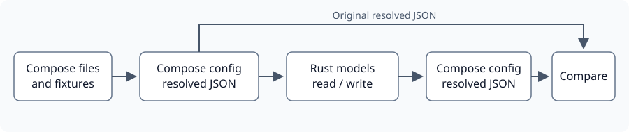

# Evaluate strongly typed Compose models

Created: 2026-11-08. Baseline: `2b900e5691a3c65467162682396c29b6467985c9`.
[Probe and validation](110826-compose-types-impl.md).

## Finding

`docker-compose-types` shows continuing community maintenance. Neither evaluated
crate is currently suitable for replacing the entire resolved Compose document:
both reject valid fields, and serialization changes matter to our existing
consumers. A narrower typed migration is worth considering after selecting its
compatibility contract. This PR evaluates that choice; application code and
production dependencies are unchanged.

The boundary is `docker compose config --format json`. Docker Compose resolves
YAML, interpolation, profiles, includes and short syntax before
`NormalizedCompose.model` becomes `serde_json::Value`. A type migration must keep
Compose responsible for that resolution.

## Maintenance evidence

Checked 2026-11-08 against published packages and upstream history.

| Candidate | Evidence | Assessment |
| --- | --- | --- |
| `docker-compose-types` 0.24.0 | [June 2 release and device-count fix](https://github.com/stephanbuys/docker-compose-types/commit/4d3051dcfbe8bd18f4212d631e1578468c0f4db9); [March 26 ulimit fix](https://github.com/stephanbuys/docker-compose-types/commit/b919e1178d4a260317fc2c6b7f72e967d310befb); [YAML backend maintenance](https://github.com/stephanbuys/docker-compose-types/pull/58) | Better recent release cadence; small community project with concrete schema gaps. MIT/Apache-2.0. |
| `compose_spec` 0.3.0 | [Published release dated October 16, 2024](https://github.com/k9withabone/compose_spec_rs/blob/7ff87d7b50a568c0e9936a7e7887372b432180fd/CHANGELOG.md); [January 27, 2026 maintenance merge](https://github.com/k9withabone/compose_spec_rs/pull/44) | Repository maintenance continues, but the published schema is older. MPL-2.0. |

Activity establishes maintenance, not complete Compose compatibility. The probe
uses released versions. `docker-compose-types` selects its `norway` backend;
`compose_spec` 0.3.0 still depends on deprecated `serde_yaml`.

## Dynamic model inventory

Repository-wide Rust searches for `Value`, JSON construction and Compose consumers
identified these production paths. Test helpers are listed separately.

| Owner / path | Dynamic use | Type opportunity and constraint |
| --- | --- | --- |
| [configuration.rs](../src/compose/adapter/configuration.rs): `NormalizedCompose.model`, `normalize`, `resolve` | Owns resolved document; scopes resources, pins images, applies labels/restart policy; saves and hashes launch JSON | Central migration boundary. Preserve native fields, explicit defaults, ordering and diagnostics. `policy_changes` is a separate evidence payload. |
| [configuration.rs](../src/compose/adapter/configuration.rs): `app_overlay` | Builds a partial service from generated app protobuf; escapes literal dollars | Typed construction could help. Preserve absent versus empty command/entrypoint and avoid unintended overlay defaults. |
| [preparation.rs](../src/workflows/recorded_compose/preparation.rs): `resolve`, `freeze_files`, `PrepareRun::prepare` | Assembles documents, extracts/reinserts Dora services, freezes bind/config/secret paths, writes manifest, rereads binds | Share the Compose model owner. Keep missing-bind checks at execution preparation and preserve config/secret failure diagnostics. |
| [preparation/model.rs](../src/workflows/recorded_compose/preparation/model.rs) | Merges five maps; applies profiles, volume policy, MCAP security/ulimits, IPC/environment/mounts, stop grace; validates dependencies and graph | Highest concentration of string-key mutations. Preserve naming conflicts, default-network equality and warnings for omitted top-level fields. |
| [dora.rs](../src/workflows/dora.rs): `DoraApps.services` | `BTreeMap<String, Value>`; argv, coordinator/daemon selection and host binds | Candidate for typed service access. Public Rust/Serde API; audit consumers together. Preserve array-only argv validation and longest matching bind. |
| [shared_dora.rs](../src/workflows/shared_dora.rs) | Mutates Dora argv/environment; adds graph bind | Use the same service type as `DoraApps`. Preserve automatic ports and native launch behavior. |
| [compose/model.rs](../src/compose/model.rs): `ResolvedBind::from_manifest` | Extracts binds into existing generated protobuf | Keep protobuf as internal contract. Preserve absent `create_host_path` meaning and traversal order. |
| [filesystem.rs](../src/compose/filesystem.rs): `capture` | Reads frozen manifests, binds and named volume identities | Typed reads can help; retain digest validation, external resources and volume-name lookup. |
| [overlay.rs](../src/compose/overlay.rs): preparation | Retains a vector of dynamic manifests; rewrites bind sources and rehashes JSON | Preserve everything outside rewritten paths and maintain propagation/SELinux checks. |
| [preparation/snapshot.rs](../src/workflows/recorded_compose/preparation/snapshot.rs) | Removes generated identities, rewrites paths/ports and compares configurations | JSON remains useful for generic traversal and comparison. Prove equality before changing serialization. `@artifacts` placeholders are comparison values. |

`PreparedRun`/`ResolvedRun` and `experiment::ExperimentOwner` carry `DoraApps`;
`DoraSession` consumes it. Tests in `compose/model.rs`, `compose/adapter/tests.rs`,
`preparation/tests.rs`, `preparation/snapshot.rs`, `tests/docker.rs` and
`tests/compose_contract.rs`, plus `compose::adapter::fixture_model` and
`workflows::dora::fixture`, exercise these paths or construct incomplete/error
inputs. A migration must update them with the owning APIs.

Other `Value` uses represent Docker HTTP fixtures, Dora status, event/evidence
payloads or UI responses. Those are separate schemas. `workload-docker` currently
has no direct YAML parser dependency.

## Initial measured compatibility

Ten fixtures rendered by Docker Compose 5.6.0, then read/written through each crate
and rendered again. A raw JSON control passed for every fixture.
[Recorded observations](../evaluations/compose-types/results.json) include all
changed JSON pointers. Additional isolation probes are pending.

| Case | `docker-compose-types` | `compose_spec` |
| --- | --- | --- |
| Repository Dora coordinator and daemon | Both pass normalized comparison | Both pass normalized comparison |
| Core policy, empty commands, extensions | Parses; network attachment shape changes | Pass normalized comparison |
| Config resources | Rejects `configs` | Rejects normalized config `name` |
| GPU requests; lifecycle hooks | Rejects `gpus` / `post_start` | Rejects `gpus` / `post_start` |
| Bind, volume and tmpfs options | Rejects mount fixture | Drops explicit `bind.create_host_path: false` |
| External resources | Network attachment shape changes | Rejects normalized external resource |

Shape changes are not automatically Docker runtime behavior changes. Network
`null`/object differences affect exact snapshot comparisons. Omitting
`create_host_path: false` changes our current `ResolvedBind` extraction, which
interprets an absent value as true. Neither crate preserves every original JSON
spelling, even where Compose restores an equivalent document.

## Recommendation for a follow-up

Keep the native resolved document authoritative while evaluating typed access to
services, mounts, resources and dependencies. Full-document replacement is blocked
by measured compatibility gaps. `x-*` maps are not a general escape hatch: both
crates reject unfamiliar non-extension fields.

Options to decide before production implementation:

1. **Recommended: scoped typed access with explicit preservation.** Start with
   Dora service access and bind extraction; retain the native manifest outside
   that scope. First prove preservation of unknown nested fields and explicit
   defaults. No custom model or compatibility wrapper is selected here.
2. **Upstream fixes, then a crate-owned full model.** Add missing fields and
   serialization fixes upstream; rerun probes and lifecycle tests across supported
   Compose versions before adoption.
3. **Keep `Value` for now.** Retain native configuration and the existing typed
   protobuf projections until an option passes the compatibility checks.

Preserve native semantics (D-04), one Compose owner (D-03), review/execution
consistency (D-09), and persisted behavior (I-03). Production dependencies and any
added abstraction remain user decisions.
