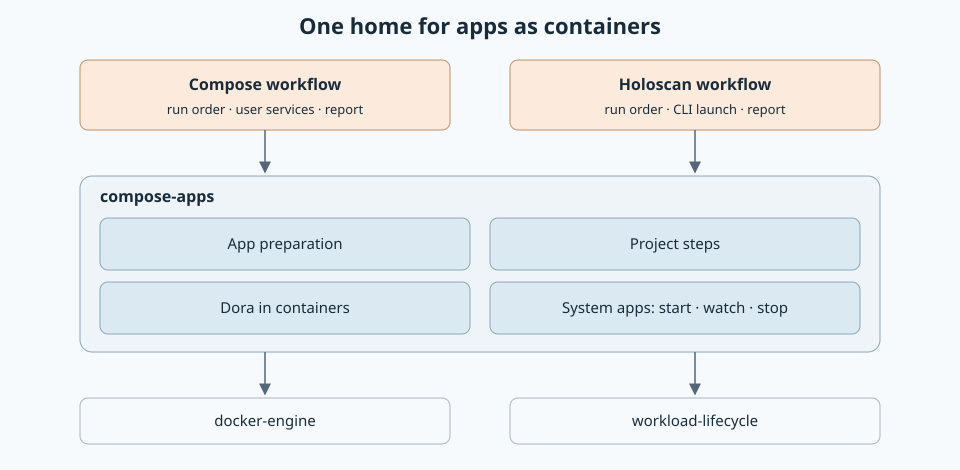
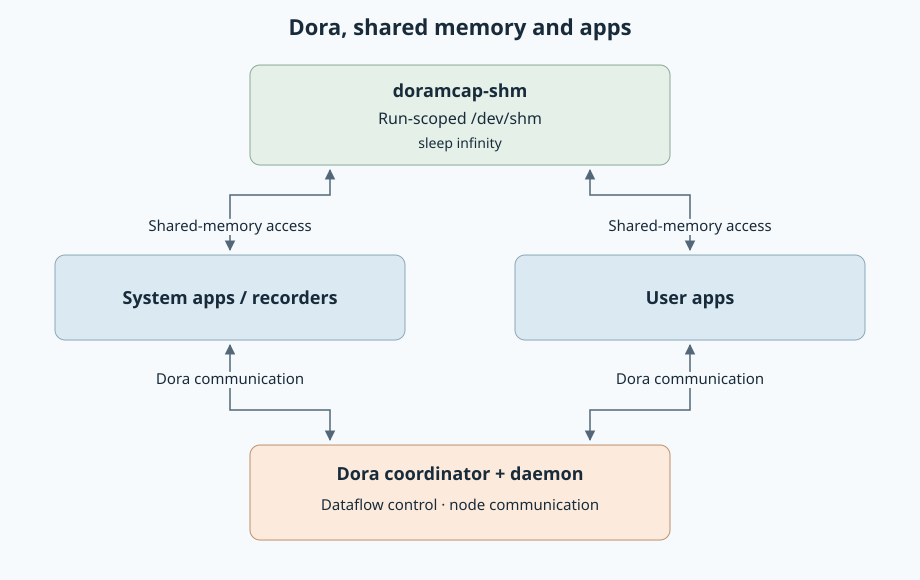

# Shared crate for apps as containers

Created November 11, 2026. Status: milestones 1–3 complete; milestone 4 in progress.
[Implementation plan](111126-compose-apps-crate-impl.md).

Running Dora apps and Console's system apps as containers moves from
`workload-docker` into a shared crate, `compose-apps`. The Compose workflow and
the Holoscan workflow both use it. Each keeps only its own run order.

## Why

- The Holoscan workflow starts the same Dora and system apps as containers, then
  launches its own application through the Holoscan CLI. It needs the pieces and
  has its own order.
- The Compose workflow gains a named boundary: a run order on top of pieces with
  their own contracts.

## Boundary

| Moves to `compose-apps` | Contents | State today |
| --- | --- | --- |
| Project steps | Resolve, start, inspect, stop, quiesce and remove services in a Compose project. | A separate module with no references into the workflow. |
| Dora in containers | Start the Dora runtime, register the graph, stop it, and the Dora wiring. | Separate from the Compose workflow. |
| App preparation | Turn app groups into one configured project: merge, shared memory, cgroup placement, Dora wiring, pinned images and snapshot. | Inside the workflow module, taking the Compose run's whole input. |
| System apps: start, watch, stop | The ordered sequences for the system part of a run, and the rule for which container is removed last. | Inline in the Compose workflow. |

| Stays in each workflow | Compose | Holoscan |
| --- | --- | --- |
| Run order | Yes | Yes |
| User application | Start and stop the user's services. | CLI dry run, launch, supervision and stop. |
| Report and finalization | Yes | Yes |

## Rules of the boundary

- `compose-apps` depends on `docker-engine` and `workload-lifecycle`. It depends on
  no workflow crate.
- App preparation takes app groups: Dora apps, system apps and an optional extra
  group. Compose passes its user projects. Holoscan passes none.
- Watching takes the list of services to check.
- The start and stop order of the system part exists once, in the shared crate.

## Points checked against the code

Three places looked unclear when the boundary was drawn. Each already has the
shape the boundary needs.

| Point | What the code shows | Result |
| --- | --- | --- |
| Compose puts user services in the same project and checks across groups. | Preparation takes Dora apps, system apps and user projects as three lists. The cross-group check takes two lists and does nothing when the user list is empty. | The optional extra group matches how preparation is written. |
| Monitoring checks the whole project's health in one call. | The start path already checks system apps alone: it inspects the project, narrows the result to the system services and asks whether those are ready. | Watching a chosen list of services is an existing pattern. |
| Reset decides which container is removed last. | Reset does three things: stop and remove by ownership label, discard leftover views, and pick the Dora experiment owner to remove last. The first is two calls in `docker-engine`. The second moves with the capture work. | Only the third belongs here. |

Reset keeps a fixed order: stop the containers, discard the views, then remove
the containers. The shared crate therefore offers the rule for picking the last
container, and each workflow runs the three steps in order.

The SHM holder starts before participants join its namespace and stops with the
other system apps. SHM change auditing is outside this work. The stopped Dora
experiment owner retains the repository reservation until other cleanup succeeds.

These were checked by reading the code. Nothing has been built or run. The
snapshot comparison in milestone 3 of the plan is where a hidden coupling would show.

## Expected behavior

The extraction preserves step identities, Review snapshots, saved records and
report formats. The SHM holder joins ordinary system-app shutdown before the
Dora runtime stops; it has no separate inspection or retention phase. This
simplification was agreed on November 12, 2026.

## Order

Milestones 1 to 3 can start now, in parallel with the
[admission lock](https://github.com/Cutuy/doramcap/pull/315) and the
[capture move](https://github.com/Cutuy/doramcap/pull/316). All three move code
out of `workload-docker`, which means ordinary code conflicts.

The capture move is merged in [PR #318](https://github.com/Cutuy/doramcap/pull/318).
Milestone 4 can now extract the shared sequences and reset rule from that shape.

The [Holoscan runner](https://github.com/Cutuy/doramcap/pull/264) needs
milestone 4 before it starts system apps.

Applicable rules: D-01, D-02, D-03, D-06, D-09, D-12, D-13 and D-14 in the
[design guide](../../../docs/design-guide.md).
