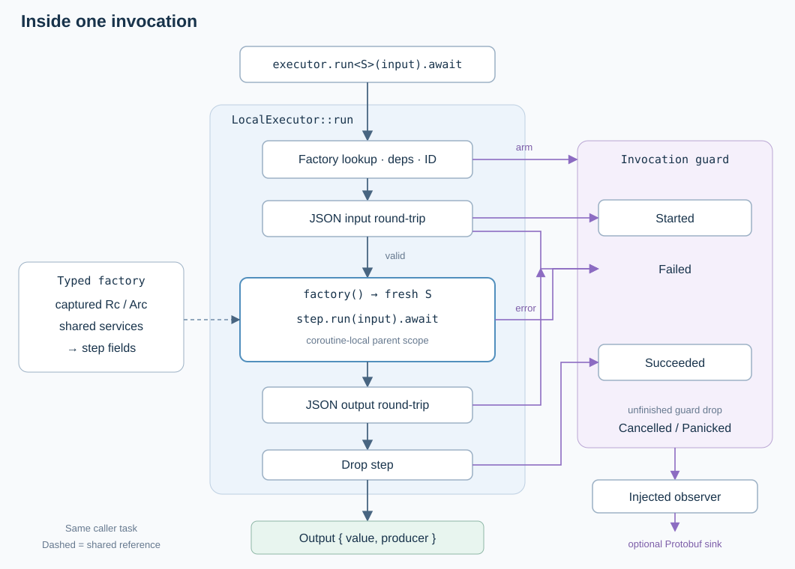

# Workflow steps

Created: 2026-11-08.

A workflow chooses order, branches, waits and cleanup. An orchestrator step records
one meaningful operation through typed inputs, outputs and terminal events. These
rules apply to both Docker Compose and systemd workflows.

## At a glance

Choose a step for a coherent, substantial unit of machine work whose effects and
possible failure are worth observing; see [design principle D-14](../../../../docs/design-guide.md).
Helpers inside a step share its boundary. Direct calls from `Running::start`,
`stop` or `remove` provide no step observation.

| Operation group | Typical step boundary |
| --- | --- |
| Resolve configuration or query external state used by the run | An inspection or preparation step |
| Create, mount, load, start, stop or remove owned resources | A setup, execution or cleanup step |
| Capture, finalize or publish run evidence | A capture, finalization or reporting step |
| Parse values, select phases or evaluate a cleanup permit | Ordinary workflow/helper code; preserve the enclosing operation's coverage |

Reuse an existing step when the operation shares its purpose, inputs, result and
failure boundary. Introduce a step when a separately meaningful operation would
otherwise execute between observed steps.

Choosing boundaries

A step should answer a useful execution question: which resources were prepared,
which applications started, or whether cleanup completed. Group the backend calls
needed to answer that question inside the same step.
Keep its input/output contract suitable for `LocalExecutor` now and a possible
remote executor later.

Pure validation and configuration transforms belong inside their existing
inspection/preparation step. Workflow decisions consume results and choose the
next step. Keep an unconfirmed-shutdown guard in that coordination code.

Docker's shm container uses an additional `StartCompose` invocation. Its validation
belongs to `PrepareRun`, and its shutdown/removal use existing Compose steps.
Systemd's native shm setup has its own runtime step because it loads units, writes
drop-ins, reloads the manager and mounts a filesystem after input preparation ends.

Inputs, outputs and observation

Invoke operations through `LocalExecutor::run`. Each call records identity,
dependencies, timing and success, failure, cancellation or panic. Payload capture
is optional; inputs and outputs must always support serialization. Inject live
services through step factories. Exclude secrets from recorded data.

Carry `Output` provenance into dependent inputs with `.after(...)`; equal paths or
chronological order alone do not establish a dependency. Resource setup returns
the identifiers needed by later cleanup. Preserve useful partial-failure diagnostics.

Ownership, failure and cancellation

The lifecycle handle must own attempted resources before the first side effect.
A successful output cannot be the only way to find resources left by a failed or
cancelled setup. Record a terminal event and keep the identifiers required for cleanup.

The workflow awaits stop and cleanup after startup fails or is cancelled. Cleanup
verifies shutdown before removal, accepts already-absent owned resources and
reports anything retained. Step cancellation does not undo external changes.

Current systemd application

`systemd.prepare` captures inputs. `systemd.runtime.prepare` then loads native shm
settings and creates run memory, returning the owned namespace. After apps stop,
`systemd.runtime.remove` verifies shutdown and removes runtime files and memory.
The cleanup step also serves explicit operator cleanup.

These steps cover runtime resources. Existing direct systemd application start/stop
calls remain a separate observation gap; this refactor does not establish full
workflow coverage.

See the [implementation and validation plan](../../../workload-systemd/docs/110826-runtime-steps-impl.md).

See the [orchestrator contract](../../../orchestrator/docs/102626-function-steps.md)
for execution details and the [shared lifecycle](../../../workload-lifecycle/src/run.rs)
for shutdown and removal ownership.
