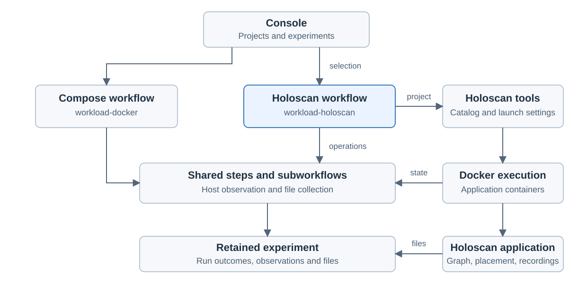

# Holoscan adoption in Console

Created November 9, 2026. Updated November 14, 2026: documents regrouped into this
hub, five stages and one implementation plan. Status: architecture agreed;
implementation not started.

Console opens a Holoscan project, discovers its applications, builds and runs a
selected application and keeps the results. `workload-holoscan` owns this workflow.
Holoscan keeps the application's graph, placement and sensor recording.

## Documents

| Document | Covers |
| --- | --- |
| [Discovery](110926-holoscan-discovery.md) | The application catalog from the project's Holoscan CLI. |
| [Build](110926-holoscan-build.md) | The Build request and what Prepare checks against it. |
| [Launch](111026-holoscan-launch.md) | How Console steers the CLI, the Review snapshot, limits and conflicts. |
| [Run and recovery](110926-holoscan-run.md) | Admission, cleanup, ready and ended. |
| [File changes and logs](110926-holoscan-file-changes.md) | Overlays, the change list, the write policy and the journal. |
| [Runner plan](111126-holoscan-runner-impl.md) | Code-level design and milestones, including acceptance. |
| [Web app](111126-holoscan-web-app.md) | The journey and screens; planned after the run works. |

## Owners

| Owner | Responsibility |
| --- | --- |
| Console | Project selection, Review, run controls, results and comparisons. |
| `workload-holoscan` | Discovery, Build, Prepare, the run, recovery and its report. |
| Holoscan project and CLI | Application definitions, build rules, launch settings and graph execution. |
| `docker-engine` | Docker client, cleanup of owned resources and the container filesystem diff. |
| `host-filesystem` | Overlays, the change list and the write policy, shared with Compose and systemd. |
| `workload-lifecycle` | The shared run sequence and the repository admission lock. |

`workload-holoscan` has no dependency on `workload-docker`.

## Decisions

| Area | Decision |
| --- | --- |
| Execution | Docker first; host-native execution later. |
| Workflow | Cleanup, Build, Prepare (Review), Start. |
| Discovery | The project's Holoscan CLI lists applications, languages and modes. |
| Build | Its own Console request. Source commit and clean state are recorded and compared at Prepare and Start. |
| Admission | One lock per repository, shared by Compose, systemd and Holoscan runs and by Holoscan Build. |
| Launch | Console mounts overlays and passes the project folder's overlay directory to the CLI as its project root. A Docker stand-in is the fallback. |
| Container | The CLI builds and launches; Console stops, inspects and removes the container through the Docker Engine API. |
| Review | One snapshot of the expected launch must match at Start. |
| Supervision | The container is the source of truth for ready and ended, read through Engine events. |
| File changes | Shared overlays, change list and write policy. Mounts not tracked are listed at Review and in the result; Start is allowed. |
| Recordings | No recording check. The change list is the result. |
| Limits and conflicts | Selected limits travel as Docker options inside the Review snapshot. Prepare warns or fails on supported conflicts. |
| Logs | Container output goes to the host journal unless the project sets its own log driver. |
| System apps | Console's system apps, including Dora, run as containers beside a Docker project. Built after the application-only run. |
| Configuration | `form: HOLOSCAN` selects the backend; a `holoscan` block names the CLI. |
| Acceptance | Automated checks on every pull request, plus `endoscopy_tool_tracking` and `bci_visualization` on an x86 GPU machine. ARM64 GPU devices later. |

## Order of work

Status checked November 14, 2026. Every prerequisite is merged except
[#364](https://github.com/Cutuy/doramcap/pull/364).

| Piece | Where |
| --- | --- |
| Admission lock | [#315](https://github.com/Cutuy/doramcap/pull/315) |
| Apps crate and system apps | [#317](https://github.com/Cutuy/doramcap/pull/317), [#324](https://github.com/Cutuy/doramcap/pull/324) |
| Overlays and the change list | [#316](https://github.com/Cutuy/doramcap/pull/316) milestones 1 to 3: [#318](https://github.com/Cutuy/doramcap/pull/318), [#326](https://github.com/Cutuy/doramcap/pull/326), [#320](https://github.com/Cutuy/doramcap/pull/320) |
| systemd overlays | #316 milestone 4: plan [#353](https://github.com/Cutuy/doramcap/pull/353); stack 380, with [#364](https://github.com/Cutuy/doramcap/pull/364) open |
| Keep files with the run | #316 milestone 5: stack 362, [#354](https://github.com/Cutuy/doramcap/pull/354), [#358](https://github.com/Cutuy/doramcap/pull/358) |
| Journal logging and export | [#314](https://github.com/Cutuy/doramcap/pull/314); stacks 368 and 369, [#355](https://github.com/Cutuy/doramcap/pull/355), [#356](https://github.com/Cutuy/doramcap/pull/356), [#360](https://github.com/Cutuy/doramcap/pull/360); [#372](https://github.com/Cutuy/doramcap/pull/372) |

| Next | Waits for |
| --- | --- |
| Probes, discovery, Prepare and Review (runner milestones 1 to 3) | Nothing |
| Build (milestone 4) | Nothing |
| Run (milestone 5) | Build |
| System apps and acceptance (milestones 6 and 7) | Run |
| Web app screens and saved application logs | Run |

Applicable rules: D-01 to D-04, D-06 to D-10, D-12 to D-14 in the
[design guide](../../../docs/design-guide.md). Upstream baseline: Holoscan CLI 5.0.0
([run][cli-run], [discovery][cli-discovery]).

[cli-run]: https://github.com/nvidia-holoscan/holoscan-cli/blob/v5.0.0/src/holoscan_cli/commands/run.py
[cli-discovery]: https://github.com/nvidia-holoscan/holoscan-cli/blob/v5.0.0/src/holoscan_cli/commands/info.py
