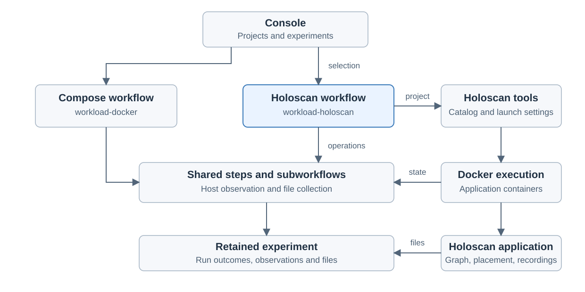
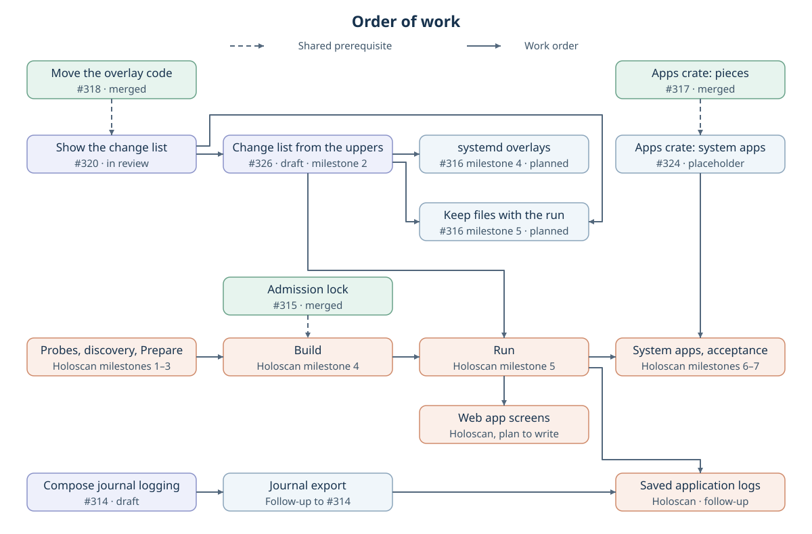

# Holoscan adoption in Console

Created November 9, 2026. Updated November 11, 2026: order of work and terms aligned with the overlay plan. Status: architecture agreed across all seven stages; implementation not started.

Console opens a Holoscan project, discovers its applications, runs a selected
application and retains the results. `workload-holoscan` owns this adoption
workflow. Holoscan remains responsible for the application's graph and sensor
processing.

The Console integration remains to be implemented. The CLI tests used a fake
Docker command. Our tests have not run a real Holoscan application through Console.

## Component ownership

| Owner | Responsibility |
| --- | --- |
| Console | Project selection, review, run controls, results and comparisons. |
| `workload-holoscan` | Holoscan discovery, build, preparation, execution, recovery and output collection. |
| Holoscan project and tools | Application definitions, build rules, launch settings and graph execution. |
| `docker-engine` | Docker client, cleanup of owned resources and the container filesystem diff for Compose and Holoscan. |
| `host-filesystem` | Overlays, the change list and the write policy for Compose, systemd and Holoscan. |
| Shared steps and subworkflows | Reusable host observation and other operations with matching contracts. |
| `workload-docker` | The existing Compose adoption workflow. |

`workload-holoscan` has its own domain model and lifecycle. It has no dependency
on `workload-docker`. Both depend on `docker-engine` and `host-filesystem` for the
[operations they have in common](110926-holoscan-outputs.md#owners).

## User workflow

1. Select a project and its configured Holoscan tools.
2. Choose an application, language variant, run mode and execution environment.
3. Select resource controls, observations and intended outputs.
4. Clean up lingering owned runs and verify the cleanup result.
5. Build through the existing Holoscan workflow as a separate operation.
6. Save a snapshot of the built application's expected launch for Review.
7. On Start, require the same snapshot, mount overlays and launch the application.
8. Stop, collect results and inspect execution, recordings and cleanup outcomes.

Review and execution use the same resolved inputs. A changed project or environment
requires renewed preparation when it affects the reviewed run.

## Discovery and execution

A project is the source checkout and upstream configuration used to describe and
launch its applications. An installed SDK supplies development/runtime libraries;
the application catalog comes from the selected project.

Console delegates catalog discovery to the project's Holoscan tools. The catalog
identifies applications, implementations and named modes. Libraries and other
build-only entries remain distinguishable from runnable choices. Preserve the
project's native metadata and search configuration.

Discovery preserves empty catalogs, unavailable CLI capabilities and failed queries
as different outcomes. Dependency installation and application builds belong to the
explicit Build operation before Prepare.

**Docker is optional.** Holoscan supports both execution environments:

| Environment | Workload ownership |
| --- | --- |
| Docker | Application containers, associated owned resources and output files. |
| Host native | Application processes, associated owned resources and output files. |

The application and execution environment are separate choices. Initial adoption
targets Docker to simplify testing and reuse proven operations. Host-native
execution means building and launching application processes in the selected
environment; support belongs to a later stage.
[Upstream launch behavior][cli-run] and [catalog discovery][cli-discovery] establish
these boundaries.

## Existing placement and recording

First adoption preserves the application's Holoscan placement and recording controls.

| Capability | Holoscan responsibility | Console responsibility |
| --- | --- | --- |
| CPU and GPU placement | Internal worker placement, scheduling and GPU execution settings. | Observe the run and manage explicitly selected outer resource budgets. |
| Host allowance | Request resources within the available environment. | Show effective limits and known conflicts before execution. |
| Sensor recording | Existing application recorders, formats and capture settings. | Retain native files and report available recording outcomes. |
| Console observations | Application outputs available for observation. | Own its host telemetry, workflow logs and supporting services. |

One owner controls each placement setting and recorded output. An override or an
additional recorder is an explicit choice shown during review.

Compare declared Holoscan and Console settings where a reliable check is practical.
Warn about overlapping controls and fail preparation when the settings cannot work
together. Keep deeper inspection of application-internal placement and recording
as future work. Each supported check needs a clear boundary so users can see which
conflicts Console can detect.

Declared launch settings and application-provided execution descriptions explain
internal controls. Recording availability and recording validity are reported
separately.

## Run lifetime and recovery

`workload-holoscan` tracks resources from their first creation, including partial
startup. Stop and recovery operate on the resources owned by that run. Cancellation
and a controller interruption preserve ownership information for the next run's
repeatable cleanup. Lingering owned runs must stop before Build/Prepare; output
retention during recovery is best effort.

Stopping the application, finishing recorders, collecting files and confirming
cleanup have independent outcomes. Useful evidence remains available when another
part of the run fails. A repeated run receives a new identity.

The workflow delegates substantial machine operations to observable steps. Shared
subworkflows retain their lifecycle and failure meaning across callers. Helpers
and ordinary coordination stay within the owning operation.

## Design discussions

Discuss one stage at a time in the proposed order below. The agreed scope remains
the baseline. Later stages stay open until their discussion starts.

| Stage | Discussion | Decision needed to finish |
| --- | --- | --- |
| 1. [Discovery contract](110926-holoscan-discovery.md) | Existing CLI/project context, reported applications and diagnostics. | Adopt existing setup; retain valid entries and diagnostics; validate the selected application. |
| 2. [Build and preparation](110926-holoscan-preparation.md) | Separate Build from Prepare and preserve the selected native settings. | Build is its own Console request before Prepare. |
| 3. [Conflicting controls](110926-holoscan-controls.md) | Preserve native placement/recording and compare practical declared settings. | Warn or fail clearly for supported comparisons; defer deeper application inspection. |
| 4. [Execution and recovery](110926-holoscan-execution.md) | Owned run resources, repeatable pre-run cleanup and interruption recovery. | Stop lingering owned runs and verify cleanup before Build/Prepare; output retention is best effort. One admission lock per repository; the container signals ready and ended. |
| 5. [File changes and logs](110926-holoscan-outputs.md) | Reuse the shared overlays, change list and write policy, host observations and native recording outputs. | Overlays on the project folder and extra data folders; [launch design](111026-holoscan-launch-handoff.md) agreed and probed with a fake Docker. |
| 6. [Backend acceptance](111126-holoscan-acceptance.md) | Which existing projects and environments establish supported behavior. | Automated checks on every pull request, plus two real applications on an x86 GPU machine. ARM64 GPU devices later. |
| 7. [Console UI](111126-holoscan-web-app.md) | Present discovery, application selection, preparation, controls, diagnostics and results through the web app. | Today's journey with Build as an added step: searchable application list, build state, Review with notes, Result with the exit code. |

### Discussion process

- Start with the user workflow, expected outcomes and the unresolved decision.
- Present a recommendation and meaningful alternatives; wait for the user's answer.
- Keep a focused architecture document for each stage when its discussion starts.
  Lead it with an SVG and link it from this overview.
- Record agreed decisions and deferred work in that stage's document before moving on.
- Write the separate implementation plan after the stage architecture is agreed.
  Give each implementation milestone **Work items** and **Validation** checklists.

Source APIs, configuration fields, chosen mechanisms and individual workflow steps
belong in implementation plans. Share operations after establishing matching
purpose, inputs, results and failure behavior.

### Current discussion

Stages 1–4 record the agreed discovery, build, control and cleanup boundaries.
Stage 5 adopts the shared overlays, change list and write policy.

**Current step: implementation planning.** The shared
[`docker-engine` crate](111026-docker-engine-crate-impl.md) has landed on `main`.
Build placement, run admission, run supervision, recording checks and mounts
that are not tracked are agreed and recorded in their stage documents. The
[shared admission lock](https://github.com/Cutuy/doramcap/pull/315) is merged. The
[Holoscan runner](111126-holoscan-runner-impl.md) plan is drafted. The runner plan starts by
proving the launch on a real container and has one open item. System apps
are agreed and built after the application-only run.
A [probe with a fake Docker](111026-holoscan-launch-handoff.md#probe-result)
supports the launch design. Real-container qualification remains.

Resource limits and application logs are agreed as well. The workflow-level
decisions are complete.

Backend acceptance is agreed in stage 6 and the web app journey in stage 7. All
seven stages are agreed.

## Order of work

Work runs in parallel wherever the pieces only risk ordinary code conflicts. It
is serial only where one piece decides the shape another builds on.

Merged:

| Piece | Where |
| --- | --- |
| Admission lock | [#315](https://github.com/Cutuy/doramcap/pull/315) |
| Apps crate pieces: project steps, Dora in containers, app preparation | [#317](https://github.com/Cutuy/doramcap/pull/317) milestones 1 to 3 |

In review:

| Piece | Where |
| --- | --- |
| Move the overlay code to `host-filesystem` | [#318](https://github.com/Cutuy/doramcap/pull/318), [#316](https://github.com/Cutuy/doramcap/pull/316) milestone 1 |
| Show the change list in Console | [#320](https://github.com/Cutuy/doramcap/pull/320), #316 milestone 3 |
| Apps crate: system apps sequences | [#324](https://github.com/Cutuy/doramcap/pull/324), #317 milestone 4 |
| Journal log driver for Compose | [#314](https://github.com/Cutuy/doramcap/pull/314) |

Can start now:

| Piece | Where |
| --- | --- |
| Holoscan probes, discovery, Prepare and Review | Runner milestones 1 to 3 |
| Holoscan Build | Runner milestone 4. The lock it needs is merged. |

These wait for another piece:

| Piece | Waits for | Reason |
| --- | --- | --- |
| Change list from the uppers (#316 milestone 2) | Move the overlay code | It replaces the before/after folder walks in the moved code. |
| systemd overlays (#316 milestone 4) | Change list from the uppers | systemd starts on the final change list. |
| Keep files with the run (#316 milestone 5) | Change list from the uppers, show the change list | It keeps the uppers and uses the download route. |
| Log dump (#314) | Journal log driver, keep files | The dumped files are listed and downloaded through the run-file route. |
| Holoscan run (runner milestone 5) | Holoscan Build, change list from the uppers | The run uses the final overlay code, and an extra data folder needs an overlay directory that carries its name. |
| Holoscan system apps and acceptance (runner milestones 6 and 7) | Holoscan run, apps crate system apps sequences | They start system apps with the shared pieces. |
| Holoscan web app screens | Holoscan run | Their plan is written once the run works. |

Expected code conflicts, to be handled as they come:

- The overlay code move and the apps crate's system apps sequences both reshape the Compose run sequence.
- The change list from the uppers edits the code that the overlay move relocates.
- Holoscan's Prepare and the change-list report both extend Console's execution contract.

## Agreed scope

| Decision | Initial scope |
| --- | --- |
| Crate boundary | Separate `workload-holoscan`; share proven operations at step/subworkflow level. |
| Execution | Docker first, with host-native support deferred. |
| Discovery | Projects described by the supported upstream Holoscan CLI. |
| Build | A separate Console request that runs the Holoscan CLI build. Source commit and clean state are recorded at Build and compared at Prepare and Start. |
| Admission | One lock per repository in `workload-lifecycle`, shared by Compose, systemd and Holoscan runs and by Holoscan Build. |
| Recovery | Repeat cleanup before the new run proceeds; stop lingering owned runs and attempt output retention. |
| Launch | Console mounts overlays and passes the project folder's overlay directory to the Holoscan CLI as its project root. A Docker stand-in is the fallback. |
| Container ownership | The CLI discovers, builds and launches. Console manages the container through the Docker Engine API, including stop. |
| File changes | Reuse the shared overlays, change list and write policy from `host-filesystem`. Each launch kind keeps its own mount handling. |
| Run supervision | The container is the source of truth for ready and ended, read through Docker Engine events. |
| Recordings | Console runs no recording check. The result is the change list. |
| Mounts not tracked | Listed at Review and in the result. Start is allowed. |
| Review | One snapshot of the expected launch must match at Start, as for Compose and systemd. |
| Resource limits | Limits the user selects travel as Docker options on the launch, inside the Review snapshot. Prepare checks them against the project's own options. |
| Application logs | Container output goes to the host journal. A project that sets its own log driver keeps it. |
| Configuration | `form: HOLOSCAN` selects the backend. A `holoscan` block names the CLI executable. |
| System apps | Console's system apps, which include the Dora apps, follow the project's environment: Docker containers for a Docker project, systemd units for a host project. `workload-holoscan` owns pairing them with the application. Built after the application-only run works. |
| Placement and recording | Preserve Holoscan controls; Console manages runs, its own observations and retained outputs. |
| Conflicts | Warn or fail clearly for supported checks of conflicting declared settings. Defer costly inspection of application internals. |

## Design basis

Applicable rules: D-01, D-02, D-03, D-04, D-06, D-07, D-08, D-09, D-10, D-12, D-13 and D-14 in the
[design guide](../../../docs/design-guide.md). Shared operations follow the
[workflow-step guidance](../../orchestrator/docs/102626-function-steps.md#choosing-workflow-steps).

- Upstream baseline: Holoscan CLI 5.0.0 project discovery and Docker/native launch paths.
- Runtime adoption, placement interaction and recording behavior remain to be qualified on the selected Docker projects.

[cli-run]: https://github.com/nvidia-holoscan/holoscan-cli/blob/v5.0.0/src/holoscan_cli/commands/run.py
[cli-discovery]: https://github.com/nvidia-holoscan/holoscan-cli/blob/v5.0.0/src/holoscan_cli/commands/info.py
