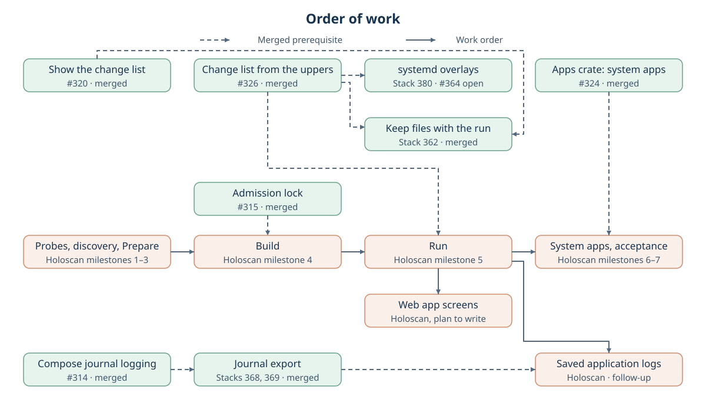

# Holoscan adoption in Console

Created November 9, 2026. Updated November 16, 2026. Status: architecture agreed;
lifecycle probes and discovery implemented in ready pull requests. Build and the
runner remain to be implemented.

Console discovers, builds and runs applications from existing Holoscan Application
and Module projects and keeps the results. `workload-holoscan` owns this workflow.
Holoscan retains native project files and YAML, graph execution, CPU/GPU placement
and sensor recording.

## Documents

| Document | Covers |
| --- | --- |
| [Discovery](110926-holoscan-discovery.md) | The application catalog from the project's Holoscan CLI. |
| [Build](110926-holoscan-build.md) | The Build request and what Prepare checks against it. |
| [Launch](111026-holoscan-launch.md) | How Console steers the CLI, the Review snapshot, limits and conflicts. |
| [Run and recovery](110926-holoscan-run.md) | Admission, cleanup, ready and ended. |
| [File changes and logs](110926-holoscan-file-changes.md) | Overlays, the change list, the write policy and the journal. |
| [Runner plan](111126-holoscan-runner-impl.md) | Code-level design and milestones, including acceptance. |
| [Web app](111126-holoscan-web-app.md) | The journey and screens; planned after the run works. |

## Owners

| Owner | Responsibility |
| --- | --- |
| Console | Project selection, Review, run controls, results and comparisons. |
| `workload-holoscan` | Discovery, Build, Prepare, the run, recovery and its report. |
| Holoscan project and CLI | Application definitions, build rules, launch settings and graph execution. |
| `docker-engine` | Docker client, cleanup of owned resources and the container filesystem diff. |
| `host-filesystem` | Overlays, the change list and the write policy, shared with Compose and systemd. |
| `workload-lifecycle` | The shared run sequence and the repository admission lock. |

`workload-holoscan` has no dependency on `workload-docker`.

## Decisions

| Area | Decision |
| --- | --- |
| Execution | Application Build/Run in Application and Module projects, through Docker first. Module defaults use the existing locked `toml` crate. |
| Workflow | Cleanup, Build, Prepare (Review), Start. |
| Discovery | The project's Holoscan CLI lists applications, languages and modes. |
| Build | Its own Console request. Source commit and clean state are recorded and compared at Prepare and Start. |
| Admission | One lock per repository, shared by Compose, systemd and Holoscan runs and by Holoscan Build. |
| Launch | Console mounts overlays and passes the project folder's overlay directory to the CLI as its project root. A Docker stand-in is the fallback. |
| Container | The CLI builds and launches; Console stops, inspects and removes containers through the Engine API. Native Docker routing and Console must select the same local daemon. |
| Review | One snapshot of the expected launch must match at Start. |
| Supervision | Engine events determine container readiness and completion. The existing Rust execution owner retains CLI children until they are reaped. |
| File changes | Shared overlays, change list and write policy. Mounts not tracked are listed at Review and in the result; Start is allowed. |
| Recordings | No recording check. The change list is the result. |
| Limits and conflicts | Selected limits travel as Docker options inside the Review snapshot. Prepare warns or fails on supported conflicts. |
| Logs | Container output goes to the host journal unless the project sets its own log driver. |
| System apps | Console's system apps, including Dora, run as containers beside a Docker project. Built after the application-only run. |
| Configuration | `form: HOLOSCAN` requires `holoscan { cli }` with an absolute CLI path; other forms reject the block. Native routing is read through configuration and Unix sockets; inherited environment stays unchanged. |
| Acceptance | Initial lifecycle uses the official SDK `first_pipeline`. Milestone 7 keeps `endoscopy_tool_tracking` and `bci_visualization` on an x86 GPU machine; ARM64 GPU devices follow later. |

## Order of work

Shared admission, apps, filesystem and journal prerequisites are merged.
The implementation stack is open; these pull requests are ready:

| Work | Pull request |
| --- | --- |
| Shared successful completion | [#442](https://github.com/Cutuy/doramcap/pull/442) |
| Milestone 1: lightweight lifecycle | [#444](https://github.com/Cutuy/doramcap/pull/444) |
| Milestone 2: catalog and configuration | [#443](https://github.com/Cutuy/doramcap/pull/443) |
| Native Docker socket routing | [#446](https://github.com/Cutuy/doramcap/pull/446) |

Prepare and Build follow discovery. Run depends on Build; system apps and final
acceptance follow Run. The web app keeps its separate plan.

Reuse the existing repository/run hierarchy with system and user application
groups and repeatable owned-resource cleanup. Capture and write-back run once.
Private IPC policy, unknown source freshness and admission ownership after
controller loss remain open.

Applicable rules: D-01 to D-04, D-06 to D-10, D-12 to D-14 in the
[design guide](../../../docs/design-guide.md). Upstream baseline: Holoscan CLI 5.0.0
([run][cli-run], [discovery][cli-discovery]).

[cli-run]: https://github.com/nvidia-holoscan/holoscan-cli/blob/v5.0.0/src/holoscan_cli/commands/run.py
[cli-discovery]: https://github.com/nvidia-holoscan/holoscan-cli/blob/v5.0.0/src/holoscan_cli/commands/info.py
