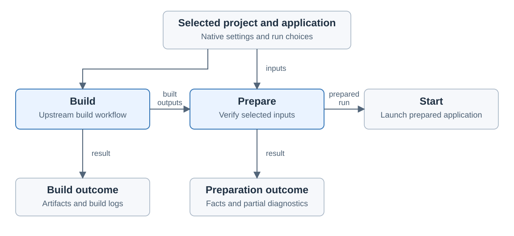

# Holoscan build

Created November 9, 2026. Updated November 16, 2026. Status: agreed;
Console's Build request remains milestone 4.
[Adoption overview](110926-holoscan-adoption.md).

Build is a separate Console request before Prepare. Cleanup of earlier owned runs
comes first, as the [run document](110926-holoscan-run.md#admission-and-cleanup) describes.

| Operation | Does | Result |
| --- | --- | --- |
| Build | Runs the Holoscan CLI build for the selected application. | Build record, native artifacts and build log. |
| Prepare | Checks the selection and the build record; saves the [Review snapshot](111026-holoscan-launch.md#review-snapshot). | Review, or a clear failure. |
| Start | Launches through the CLI path that skips builds. | The run. |

Project, application, language, mode and native settings stay the same across all three.
Holoscan owns build rules and incremental builds. Application and Module projects
use their native settings; the existing locked `toml` crate reads Module defaults.

## Build request

- Holds repository admission and verifies native Docker daemon identity before side effects.
- Reuses existing application placement; retains and reaps the CLI child.
- Streams progress and reports its own result.
- Records the source commit and whether the tree was clean. A dirty tree is allowed;
  Review then says the build cannot be verified against the current source.

| At Prepare or Start | Outcome |
| --- | --- |
| No image or build record | "Not built"; the user runs Build. |
| Source commit or clean state differs | "Rebuild needed". |
| Launch inputs differ from Review | Prepare again. |

A failed Build keeps its log and blocks Prepare. A failed Prepare keeps the Build
result. Native outputs and build caches stay with the project.

## Evidence

CLI 5.0.0 dry runs show the build path generating image and application build
commands, and the launch path skipping both. A build with no base image reports a
configuration error. The [initial lifecycle probe](111026-holoscan-launch.md#probe-result)
demonstrates a real `first_pipeline` build and its artifact through an overlay root.

Applicable rules: D-01 to D-04, D-06, D-07, D-09, D-13 and D-14. Upstream:
[build][build], [run][run].

[build]: https://github.com/nvidia-holoscan/holoscan-cli/blob/v5.0.0/src/holoscan_cli/commands/build.py
[run]: https://github.com/nvidia-holoscan/holoscan-cli/blob/v5.0.0/src/holoscan_cli/commands/run.py
