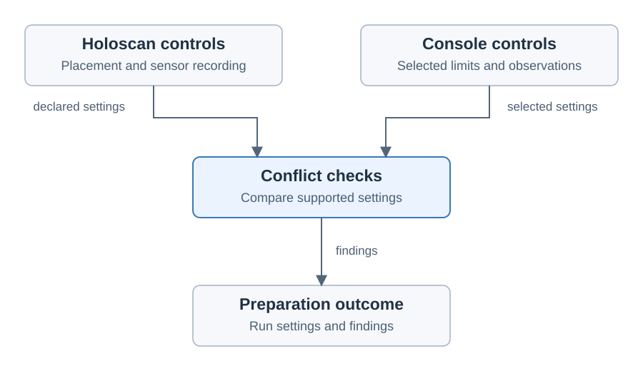

# Holoscan controls and conflicts

Created November 9, 2026. Stage 3 architecture: agreed ownership and bounded checks.
[Adoption overview](110926-holoscan-adoption.md).

Holoscan retains application placement and sensor recording. Console manages its
selected outer resource limits, host observations and retained files.

## Initial boundary

| Area | Initial behavior |
| --- | --- |
| Application CPU/GPU placement | Preserve native settings and application behavior. |
| Console resource limits | Apply only the explicitly selected limits. Compare declared settings where a practical check exists. |
| Sensor recording | Preserve the application's recorders, capture settings and formats; collect their output files. |
| Console observations | Retain host telemetry and workflow logs under Console ownership. |

Each control and output has an owner. Supporting an additional sensor recorder or
overriding application placement requires a separate design decision.

## Conflict outcomes

| Available evidence | Behavior |
| --- | --- |
| Comparable settings are compatible | Continue preparation. |
| Declared controls overlap and need attention | Warn with the settings involved and the consequence. |
| Declared settings cannot work together | Fail preparation with the cause. |
| Application settings are unavailable for comparison | Keep that check unverified; deeper inspection is deferred. |

Checks cover settings available through supported project and Console inputs.
Their implementation plan must identify the comparisons actually supported.
Messages retain their evidence and the settings involved for the later UI stage.

## Deferred work

Inspection of arbitrary application code, comprehensive CPU/GPU interaction
analysis and automatic rewriting of native recording settings remain future work.
Initial adoption uses practical declared-setting checks within the agreed scope.

The implementation plan will pair each supported comparison with its observable
acceptance case. Runtime placement and recording behavior require backend
qualification on the selected applications.

Applicable rules: D-02, D-03, D-04, D-07, D-12 and D-13.
