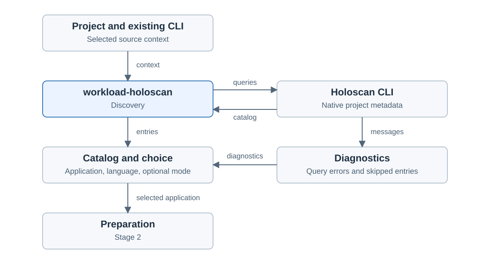

# Holoscan discovery

Created November 9, 2026. Stage 1 architecture: agreed adoption boundaries.
[Adoption overview](110926-holoscan-adoption.md).

Discovery reads an existing project's application catalog through its working
Holoscan CLI. It supplies application choices and diagnostics to the later
preparation workflow.

## Agreed boundaries

- Use the existing CLI and project setup.
- Keep valid application entries alongside diagnostics about skipped metadata.
- Validate the selected application before preparation.
- Discuss Console presentation and saved selections in the final UI stage.

## Ownership and information

| Owner | Responsibility |
| --- | --- |
| Holoscan CLI | Project search rules, metadata interpretation, application lookup and mode descriptions. |
| `workload-holoscan` | Invoke discovery in the selected project context, interpret supported responses and retain diagnostics. |
| Preparation | Recheck the selected application and resolve build, launch and environment requirements. |

The discovery input is the selected source project and its existing CLI execution
context. Use the same context for catalog and application queries. Keep the
project's search settings in their native format.

The catalog carries application names, source locations, language variants and
declared modes. Keep other component types distinguishable from applications.
A selection identifies its source project, application, language variant and any
requested mode. An application with no declared modes retains the upstream default.

## Outcomes

| Observation | Discovery outcome |
| --- | --- |
| Supported catalog response with applications | Return application choices and their origin information. |
| Supported response with no applications | Return an empty catalog. An ordinary folder can produce this result. |
| Valid entries with metadata errors | Retain the entries and upstream diagnostics; validate the chosen application before preparation. |
| Missing CLI or unavailable required queries | Report discovery unavailable with the cause. |
| Failed query or unreadable response | Report discovery failure and retain the process output. |

A catalog entry describes an application available for selection. Build and
runtime requirements are assessed during preparation. Discovery diagnostics stay
associated with the project query that produced them.

## Observed upstream behavior

Verified against Holoscan CLI 5.0.0 using its real discovery commands. The source
application project was NVIDIA's [Holoscan applications repository][applications].
Failure cases used temporary folders.

| Probe | Observed result |
| --- | --- |
| Project catalog | Application names, source locations, languages and mode names in structured output. |
| Application modes | Descriptions and native build/run settings. |
| Existing empty folder | Successful empty catalog. |
| Missing project folder | Failed query with a directory error. |
| Missing application or requested language | Failed query identifying the unavailable selection. |
| Valid and malformed metadata together | Successful catalog containing the valid entry, plus an error naming the malformed file. |

This establishes discovery behavior. Docker execution and GPU/sensor behavior
remain for later stages. CLI 5.0.0 is the evidence baseline; the acceptance stage
will define the supported release range.

## Implementation planning

The implementation document will define invocation, response handling and checks
for these outcomes after architecture review. It will preserve native metadata and
keep query results tied to the context used for preparation. APIs, data structures
and workflow-step boundaries remain to be designed there.

Applicable rules: D-01, D-02, D-03, D-04, D-07, D-09 and D-13.

[catalog]: https://github.com/nvidia-holoscan/holoscan-cli/blob/v5.0.0/src/holoscan_cli/commands/info.py
[metadata]: https://github.com/nvidia-holoscan/holoscan-cli/blob/v5.0.0/src/holoscan_cli/metadata/gather_metadata.py
[applications]: https://github.com/nvidia-holoscan/holoscan-applications

Upstream evidence: [catalog and mode queries][catalog],
[metadata error handling][metadata].
