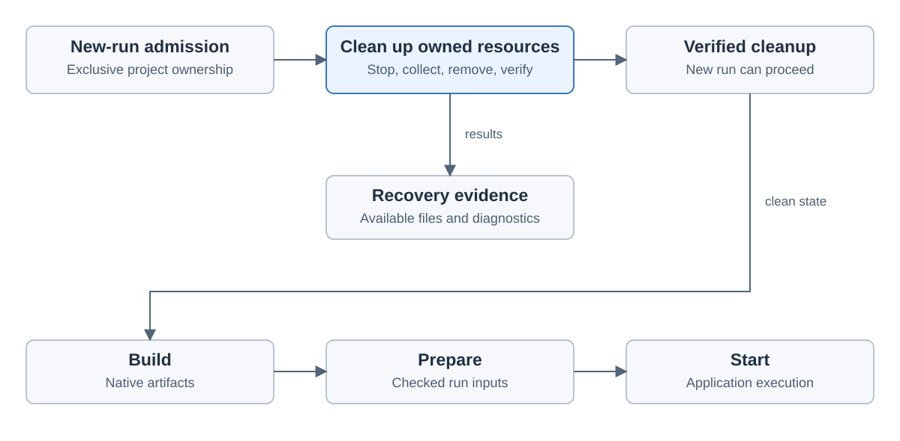

# Holoscan execution and recovery

Created November 9, 2026. Updated November 10, 2026. Stage 4 architecture: agreed pre-run cleanup, admission lock and run supervision.
[Adoption overview](110926-holoscan-adoption.md).

A new run must clear lingering owned resources before proceeding. The workflow is
**cleanup → Build → Prepare → Start**. Cleanup is repeatable and succeeds when
previous resources are already absent.

## Admission and cleanup

1. Validate the basic request and acquire exclusive ownership of the project.
   A live controller holding that ownership prevents a competing run.
2. Find lingering resources belonging to prior runs in this ownership scope.
3. Stop their writers and verify termination.
4. Attempt to retain available output files and record recovery diagnostics.
5. Remove owned temporary resources and verify the cleanup result.
6. Proceed to Build and Prepare after the required cleanup succeeds.

Stopping lingering runs is mandatory. Output retention is best effort: a failed
copy is recorded and resource cleanup continues. Failed or unverified stopping or
removal blocks the new run.

Ownership is one lock per repository root. It lives in `workload-lifecycle` and
is shared by Compose, systemd and Holoscan runs and by Holoscan Build. The second
caller is refused. Each workflow keeps its own cleanup and its own behavior after
a crash. The lock lands as a separate change before the Holoscan runner.
`workload-supervisor` takes no repository and has no callers outside its own
tests today, so it does not take the lock.

The interrupted run remains recorded as interrupted. A new run receives its own
identity. Cleanup runs as part of the next-run workflow. Normal finalization owns
write-back; pre-run cleanup discards old filesystem views after best-effort salvage.

## Resource ownership

`workload-holoscan` takes the shared admission lock and owns resource tracking
and the cleanup policy.
Track resources from their first creation, including Build, partial preparation
and partial startup. Apply cleanup only to resources with verified ownership.

Native source files, build caches and existing data retain their current owners.
Cleanup removes the temporary runtime resources owned by the interrupted run.
Ownership information must survive the controller interruption that cleanup is
intended to recover from.

Console stops the container through the Docker Engine API with its own deadline.
The CLI process ends when the container ends. The runner follows the shared run
sequence in [`workload-lifecycle`](../../workload-lifecycle/src/run.rs): start,
observe, stop, check recordings, remove.

## Ready and ended

The container is the source of truth. Console subscribes to Docker Engine events
for its run label and waits on them.

| Step | Signal |
| --- | --- |
| Start | Console starts the CLI and waits for a labelled container to be created. If the CLI exits first, Start fails with the CLI's output. |
| Check | Console compares the container's image ID, view mounts and labels with the Review snapshot. A mismatch stops the container and fails Start. |
| Ready | The container is running and passed the check. |
| Ended | The Engine reports the container stopped, with its exit code. |
| CLI exits early | Recorded as a note. The run continues. |

Ready means the container is running. Holoscan applications give no signal that
their pipeline is processing data.

Normal Stop, cancellation and failed startup also stop writers before finalizing
outputs and removing temporary resources. Execution, recording recovery and
cleanup keep separate outcomes. Detailed stop deadlines, evidence storage and
backend operations belong in the implementation plan.

## Existing repository behavior

| Backend | Current source behavior |
| --- | --- |
| Compose | Acquires project ownership, resets prior resources and then prepares. Reset stops and verifies writers, removes temporary resources and verifies removal. |
| systemd | Acquires project ownership and blocks admission while prior resources remain. Explicit cleanup stops/removes owned runtime resources and leaves artifacts intact. |
| Holoscan decision | Run repeatable cleanup as part of the new-run workflow before Build/Prepare; block progression until required cleanup succeeds. |

Compose and systemd hold separate locks today, so their runs on one repository
can overlap. The shared lock closes that.

The common principle is verified cleanup before admission to a new execution.
Holoscan owns its workflow. Cleanup of owned resources by label moves to the
[shared Docker crate](110926-holoscan-outputs.md#shared-docker-crate), where both
backends use it.

## Evidence and acceptance

Source reviewed at repository revision `935212e1`:

- [Compose ordering](../../workload-docker/src/workflows/recorded_compose/mod.rs)
  and [reset](../../workload-docker/src/workflows/recorded_compose/reset.rs).
- [Docker ownership and removal](../../workload-docker/src/compose/adapter/scope.rs).
- [systemd admission and cleanup](../../workload-systemd/src/runner.rs)
  and [runtime removal](../../workload-systemd/src/runtime.rs).

Backend acceptance must cover partial startup, cancellation, controller loss,
repeated cleanup, failed stopping, failed output recovery and failed removal.
A competing live controller and unrelated resources must retain their ownership.

Applicable rules: D-01, D-02, D-03, D-06, D-07, D-08, D-10, D-12, D-13 and D-14.
