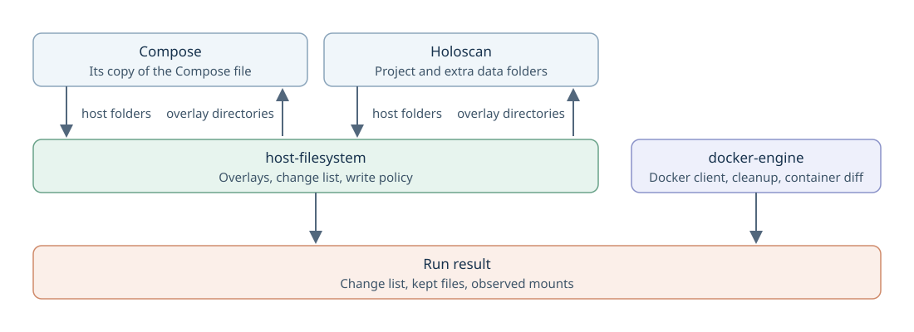

# Holoscan file changes and logs

Created November 9, 2026. Updated November 16, 2026. Status: agreed.
[Adoption overview](110926-holoscan-adoption.md). Terms follow the
[overlay term list](../../../console/docs/111026-file-change-report.md#terms).

A Holoscan run gets the same overlays, change list and write policy as Compose and
systemd runs. `workload-holoscan` names the host folders to overlay and passes their
overlay directories to the CLI; `host-filesystem` does the rest through the shared steps.

## What a launch mounts

| Storage | Overlay | Change list |
| --- | --- | --- |
| Project folder | Yes | From the upper |
| Extra data folder | Yes | From the upper |
| Mount set in the project's own Docker options | No | Not tracked |
| Docker named volume | No | Not tracked |
| The container's own filesystem | No | Docker's diff |
| Devices, host IPC, host networking | No | Not tracked |

Review identifies the overlays Console supplies; other launch mounts remain
unknown. The result labels observed mounts outside the overlays as untracked.

The CLI places the project folder at `/workspace/holohub` and an extra data folder
at `/workspace/volumes/` plus its host folder's name, so each overlay directory
carries that name.

## Run sequence

1. Clean up earlier owned runs; leftover overlays are discarded.
2. Build. Its output lands in the lower before overlays are mounted.
3. Prepare saves the Review snapshot.
4. Start mounts the overlays and launches with the overlay directories.
5. Stop the application and read the uppers into the change list.
6. Save the report, unmount and apply the write policy: write back (default), keep
   with the run, or discard.

There is no recording check; the change list is the record of what the application
wrote. A recording cut short is not detected.

## Logs

Initial Review leaves the effective log driver unknown. Keep the CLI's output as
launch diagnostics and retain application log evidence available from the runtime.
Application log files enter the change list when they land in an overlaid folder.
The initial lifecycle probe demonstrates journald output and Engine log tails;
Run qualification covers their availability for the selected application.

Applicable rules: D-02 to D-04, D-06, D-07, D-09, D-11 to D-14. Upstream:
[container launcher][launcher].

[launcher]: https://github.com/nvidia-holoscan/holoscan-cli/blob/v5.0.0/src/holoscan_cli/container/core.py
