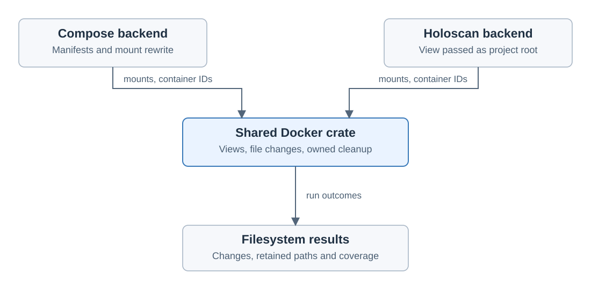

# Holoscan file changes and logs

Created November 9, 2026. Updated November 11, 2026: aligned with the overlay plan in
[Cutuy/doramcap#316](https://github.com/Cutuy/doramcap/pull/316).
Stage 5 architecture: agreed.
[Adoption overview](110926-holoscan-adoption.md).

A Holoscan run gets the same overlays, change list and write policy as a Compose run.
Console mounts an overlay on the project folder and on each extra data folder, then
passes the overlay directories to the Holoscan CLI in place of the host folders.

Terms follow the
[overlay plan's term list](https://github.com/Cutuy/doramcap/blob/codex/console-file-change-design/console/docs/111026-file-change-report.md#terms):
host folder, overlay, lower, upper, overlay directory, run folder, output folder,
change list, write policy and not tracked.

## Owners

| Owner | Responsibility |
| --- | --- |
| `workload-holoscan` | Name the host folders to overlay, pass their overlay directories to the Holoscan CLI and supply its container IDs. |
| `workload-docker` | Read the Compose file and point its copy for the run at the overlay directories. |
| `host-filesystem`, ordered by `workload-lifecycle` | Overlays, the change list and the write policy. |
| `docker-engine` | Docker client, cleanup of owned resources by label and the container filesystem diff. |
| Holoscan application | Its own sensor recording and file formats. |

The overlay code started in `workload-docker`, moved to `docker-engine`, and moves to
`host-filesystem` in [Cutuy/doramcap#318](https://github.com/Cutuy/doramcap/pull/318),
so systemd can use it too. The earlier move is recorded in the
[`docker-engine` plan](111026-docker-engine-crate-impl.md).

## What a Holoscan launch mounts

| Storage | Overlay | Change list |
| --- | --- | --- |
| Project folder | Yes | From the upper |
| Extra data folder | Yes | From the upper |
| Mount the project sets in its own Docker options | No, the project's host folder is used as is | Not tracked |
| Docker named volume | No | Not tracked |
| The container's own filesystem | No | Read through Docker's diff |
| Devices, host IPC, host networking | No | Not tracked |

Review lists every mount that is not tracked, and Start is allowed. The run result
repeats the list.

### Folder names

The Holoscan CLI decides where each folder appears in the container.

- The project folder always appears at `/workspace/holohub`, whatever its host path.
- An extra data folder appears at `/workspace/volumes/` plus the last part of its host
  path. Its overlay directory therefore carries the host folder's name.

## Run sequence

1. Clean up lingering owned runs.
2. Build through the existing Holoscan workflow.
3. Prepare saves the Review snapshot.
4. Start mounts the overlays.
5. Start runs the application with the overlay directories in place of the host folders.
6. Stop the application and read the uppers into the change list.
7. Save the report, unmount the overlays and apply the write policy.

Build completes before the overlays are mounted, so build output is in the lower.
Console keeps its host observations, workflow logs and the change list under the same run.

## Write policy

The project's write policy applies to a Holoscan run as it does to Compose and systemd:
write back (the default), keep with the run, or discard. Write back never fails the run.

Cleanup of an interrupted earlier run stops its applications and discards leftover overlays.

## Recordings and results

The Holoscan runner passes an empty recording list to the shared run sequence.
Console runs no validity check on the application's own recordings. The change list is
the record of what the application wrote.

A recording cut short is not detected. Checking MCAP files found in the change list is
a possible later addition.

Showing the change list in the web app is implemented in
[Cutuy/doramcap#320](https://github.com/Cutuy/doramcap/pull/320).

## Logs

Container output goes to the host journal, where systemd applications already
log. Console sets Docker's journal log driver as a launch option.

| Case | Behavior |
| --- | --- |
| Project sets no log driver | Console sets the journal driver. |
| Project sets its own log driver | The project's choice stays. Review shows that the log is set by the project. Console collects nothing for that container. |
| Application writes its own log files | Unaffected. The files appear in the change list when they land in an overlaid folder. |

Console's setting takes precedence over a host-wide Docker default. On failure,
Console reads the container's last lines through the Engine for the error
message, as Compose does. The CLI's own output is saved to a launch log file.

Planned: at the end of a run, Console dumps each program's full output from the
journal into an output folder, where it is kept with the run's other files. That work
and the same change for Compose are tracked in
[Cutuy/doramcap#314](https://github.com/Cutuy/doramcap/pull/314).

The journal driver has not been tested here. Real-container qualification must
confirm it, including reading back the last lines.

## Qualification

The [launch document](111026-holoscan-launch-handoff.md) records the agreed
launch design and the designs it was compared with. The folder-name rule comes from
its test of the real CLI with a fake Docker.

Still to qualify on a real container: an application running from overlay directories,
an extra data folder appearing at the same path as without Console, the project's own
mounts, and device and shared-memory access.

The [upstream container launcher][launcher] generates the mounts from the project
folder it receives.

Applicable rules: D-02, D-03, D-04, D-06, D-07, D-09, D-11, D-12, D-13 and D-14.

[launcher]: https://github.com/nvidia-holoscan/holoscan-cli/blob/v5.0.0/src/holoscan_cli/container/core.py
