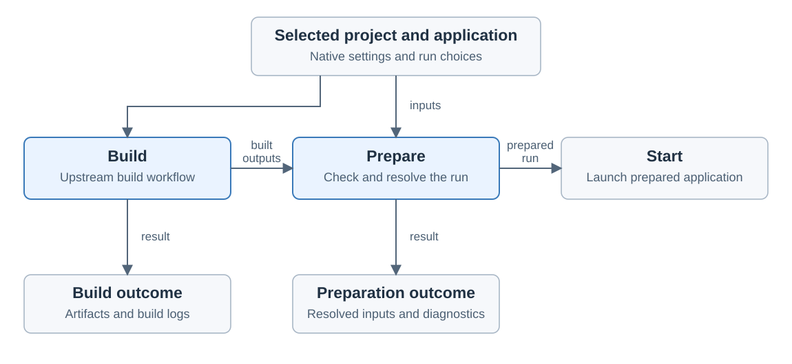

# Holoscan build and preparation

Created November 9, 2026. Stage 2 architecture: agreed build boundary.
[Adoption overview](110926-holoscan-adoption.md).

Build is a separate, observable operation before Prepare. The Holoscan workflow
orders these operations. If a caller requires one preparation workflow, Build
remains an isolated child operation with its own outcome.

For a new run, the [cleanup gate](110926-holoscan-execution.md) precedes Build.
Lingering owned resources must be stopped and cleaned before the workflow proceeds.

## Operation ownership

| Operation | Responsibility | Result |
| --- | --- | --- |
| Build | Delegate container-image and application builds to the existing Holoscan CLI. | Build outcome, native artifacts and build logs. |
| Prepare | Check the selected application, built outputs and run requirements; resolve launch settings and prepare filesystem views. | Prepared run inputs, owned filesystem views and diagnostics, or a clear failure. |
| Start | Launch the prepared application using the upstream path that skips builds. | Application execution, owned by the execution stage. |

The selected project, application, language, optional mode and native settings
remain consistent across these operations. Holoscan owns its build rules and
incremental build behavior. `workload-holoscan` owns ordering and operation outcomes.

Prepare can identify missing configuration or artifacts and direct the caller to
Build. Build work remains in the Build operation. Resource-control checks are
defined in stage 3; detailed run ownership and cancellation are defined in stage 4.

## Reviewed inputs and changes

Console's current Prepare request produces Review. Runtime preparation and
filesystem mounting occur inside Start. A Build that affects image or launch
identity must complete before the Review snapshot; the native runner then
rechecks that snapshot before creating filesystem views.

Review explains the selected inputs and the expected build and preparation work.
Build, Prepare and Start use the same project context.

Review saves one snapshot of the expected launch, and Start requires the same
snapshot. The [launch document](111026-holoscan-launch-handoff.md#review-and-start)
lists what the snapshot covers.

A meaningful change invalidates the affected result. Build-input changes require
Build again; launch-input changes require Prepare again. Start uses the prepared
selection and artifacts. The implementation plan must define how build-input
changes are detected.

An application can be started repeatedly while the relevant prepared inputs and
artifacts remain valid. The native build system continues to decide which build
work can be reused.

## Failures and retained work

- A failed Build retains its diagnostics and prevents dependent Prepare and Start.
- A failed Prepare retains the Build outcome and explains what prevents execution.
- Temporary resources created by either operation have an explicit owner through
  cleanup, including cancellation and partial failure.
- Native project outputs and build caches remain with their existing owner.
- Build and preparation outcomes remain separate from application execution.

## Evidence and remaining qualification

Source inspection and CLI 5.0.0 dry runs establish the intended operation split:

- The separate build path generates image-build and application-build commands.
- The launch path can skip both builds and invoke the application in Docker.
- A build with no configured base image reports a configuration error.
- The successful build dry run used an explicit fixture image reference.

These checks cover command generation. Building a real image and launching its
application with the same settings remain backend acceptance work.

Applicable rules: D-01, D-02, D-03, D-04, D-06, D-07, D-09, D-13 and D-14.
Individual steps, shared operations and artifact checks belong in the separate
implementation plan.

Upstream evidence: [build behavior][build] and [launch behavior][run].

[build]: https://github.com/nvidia-holoscan/holoscan-cli/blob/v5.0.0/src/holoscan_cli/commands/build.py
[run]: https://github.com/nvidia-holoscan/holoscan-cli/blob/v5.0.0/src/holoscan_cli/commands/run.py
