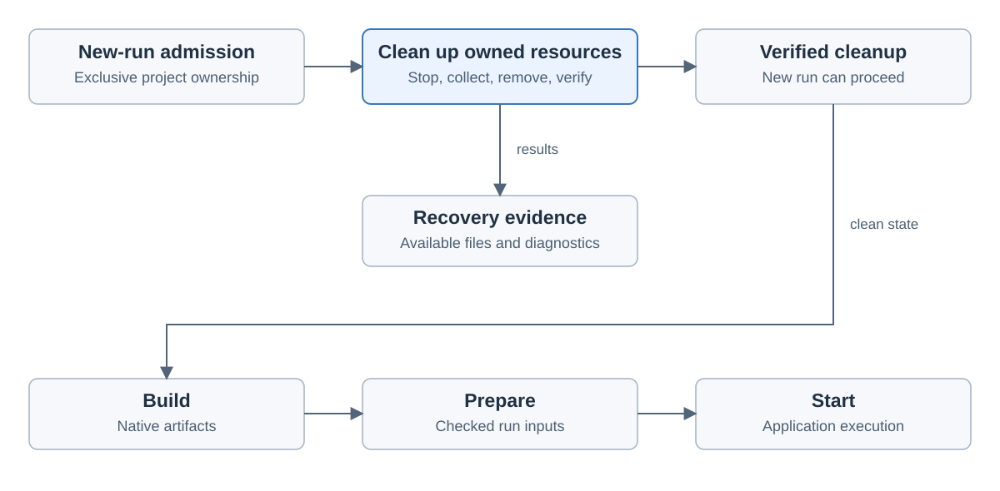

# Holoscan run and recovery

Created November 9, 2026. Updated November 14, 2026: renamed from execution and
trimmed. Status: agreed.
[Adoption overview](110926-holoscan-adoption.md).

A run follows the shared sequence in [`workload-lifecycle`](../../workload-lifecycle/src/run.rs):
start, observe, stop, check recordings (an empty list), remove.

## Admission and cleanup

1. Take the repository admission lock, shared with Compose, systemd and Holoscan Build.
   A second caller is refused.
2. Find containers and overlays left by earlier runs, by label and run folder.
3. Stop their writers and verify termination.
4. Try to keep their output files; a failure is recorded and cleanup continues.
5. Remove owned resources, discard leftover overlays and verify removal.
6. Proceed to Build and Prepare.

Stopping and removal must succeed; output retention is best effort. Cleanup
succeeds when nothing is left. An interrupted run stays recorded as interrupted,
and the next run gets its own identity.

Ownership is tracked from the first resource a run creates, including during
Build and partial startup, and survives a controller crash. Cleanup touches only
resources with verified ownership.

## Ready and ended

The container is the source of truth. Console subscribes to Engine events for its
run label before starting the CLI.

| Step | Signal |
| --- | --- |
| Start | A labelled container is created. If the CLI exits first, Start fails with its output. |
| Check | Image ID, overlay mounts and labels match the Review snapshot; otherwise the container is stopped and Start fails. |
| Ready | The container is running and checked. Holoscan gives no pipeline-ready signal. |
| Ended | The Engine reports the container stopped, with its exit code. |
| CLI exits early | A note; the run continues. |

Console stops the container through the Engine with its own deadline; the CLI
process ends with it. Stop, cancellation and failed startup all stop writers
before outputs are finalized. Execution, recording and cleanup keep separate outcomes.

Applicable rules: D-01 to D-03, D-06 to D-08, D-10, D-12 to D-14.
