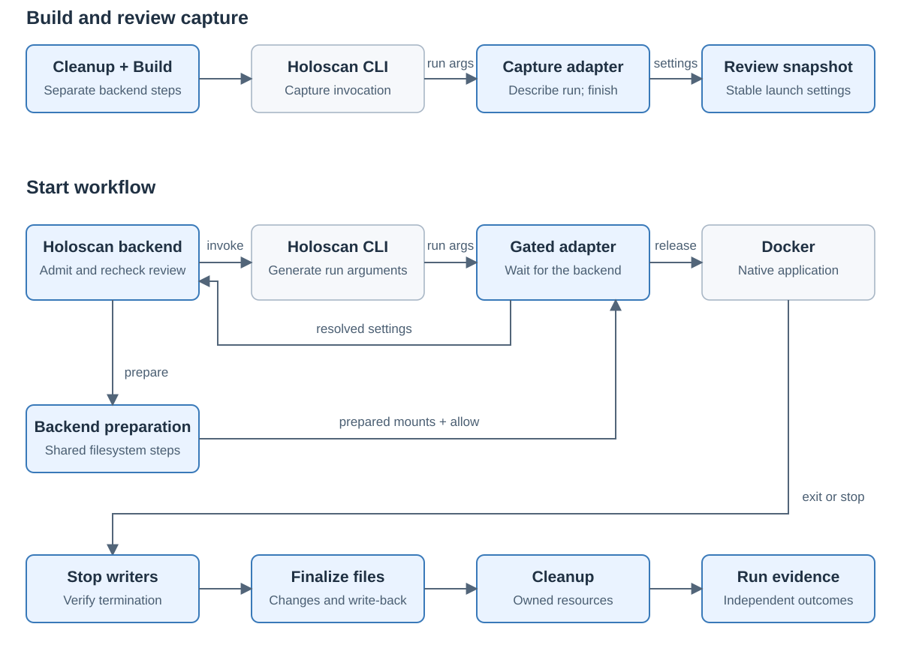

# Holoscan launch handoff

Created November 10, 2026. Status: option 1 feasibility investigated; architecture choice open.
[Adoption overview](110926-holoscan-adoption.md).
[Comparison of both alternatives](111026-holoscan-launch-handoff.svg).

## Finding

The existing CLI hook supports the proposed handoff for the tested Docker-mode
fixture. The real CLI reached a recording Docker stand-in, supplied its complete
argument list, waited at the handoff and propagated results.

The proposed Console adapter is a backend-owned executable entry point invoked
where Holoscan normally invokes Docker. It exchanges launch settings with
`workload-holoscan`. The backend owns shared filesystem work and run lifetime.

## Exact adapter responsibilities

| Point | Adapter action |
| --- | --- |
| Image inspection | Forward supported inspection requests so the native CLI can resolve image behavior. |
| Review capture | Return the generated run arguments to the backend and complete the capture operation. |
| Runtime handoff | Send the current launch settings to the backend and wait for its decision. |
| Launch release | Substitute approved host mount sources, attach run ownership and invoke Docker with the remaining native arguments preserved. |
| Execution | Forward output and exit status. Native CLI signal handling and backend stop verification remain part of the run lifetime. |

The backend supplies the owned container-identity file through Holoscan's native
options before invoking the CLI. The CLI and backend can then refer to the same
container during stop and recovery.

The adapter sends mount descriptions to the backend. The backend calls shared
filesystem operations, checks their result and authorizes launch with the prepared
source mappings. Shared operations retain their existing finalization semantics.

## Fit with the existing Console workflow

Console's existing `prepare()` operation produces Review. During `start()`, the
native runner acquires ownership, cleans up prior resources, rechecks Review and
creates filesystem views before application launch.

For Holoscan, the agreed separate Build must complete before the image and launch
snapshot it affects. This keeps Build before the review-producing preparation.

| Phase | Proposed Holoscan behavior |
| --- | --- |
| Cleanup and Build | Stop lingering owned runs and perform the separate upstream Build operation. |
| Prepare / Review | Use capture mode with builds disabled; retain expected launch settings and image identity. |
| Start | Reacquire admission, repeat required cleanup and invoke the native CLI through the runtime adapter. |
| Runtime preparation | Compare current settings with Review, create shared filesystem views and release container creation. |
| Running | Observe the native CLI/container and expose the normal run events. |
| Stop and finalization | Stop writers, verify termination, collect changes, finalize outputs and remove owned resources. |

The runtime pause stays inside the backend Start workflow. Review capture and
runtime execution are separate CLI invocations. Stable settings must match;
generated runtime values need explicit handling.

## Probe evidence

The probe used the real Holoscan CLI 5.0.0, a recording Docker stand-in and a
toolkit-version and display-authentication command fixtures. It exercised
headless launch and native display-file setup.

| Case | Observed result |
| --- | --- |
| Review capture | The CLI issued image inspections and supplied a run argument list. Capture completed successfully. |
| Gated runtime launch | The CLI waited for release. Project/data mounts were remapped using both `-v` and `--mount`; container destinations and unrelated arguments were preserved. |
| Output and status | The injected exit status 37 and stdout/stderr reached the CLI caller. |
| Cancellation before creation | The CLI terminated on SIGTERM; the gated run was never released. |
| Cancellation after simulated creation | The CLI used the supplied identity file and invoked its configured Docker stop path. |
| Forced Docker mode | A mode configured for local execution reached the Docker hook when the process-level Docker setting was applied. |
| Display-file lifetime | The CLI created an authentication file before the handoff and removed it on exit. Separate invocations used different paths. |

The headless fixture produced identical Review/runtime arguments. Display
arguments matched after replacing their generated authentication paths with a
common marker. This demonstrates the need for stable-versus-runtime comparison.
The probe left no recording helper processes running.

This validates command handoff. Real Docker creation, OverlayFS mounts, GPU work
and sensor execution remain unqualified.

## Remaining design and qualification

- Docker mode must be enforced before capture; local execution bypasses the hook.
- Compare image identity and stable launch settings across Review and Start.
- Qualify full mount syntax, additional data sources and shared aliases.
- Preserve temporary resource lifetimes. The native CLI creates display
  authentication files and removes them when its launch invocation ends.
- Qualify controller loss, process ownership and native cancellation with real
  containers and filesystem views.

The adapter is a two-mode process bridge with a private backend control
connection. Its packaging, connection contract and supported argument grammar
remain implementation-design work.

## Assessment

The executable handoff is feasible for the tested fixtures. A production adapter
includes capture and runtime modes, launch comparison, mount-argument handling,
a backend control connection and owned process cleanup.

A complete upstream export could provide the same reviewable launch information
through an explicit interface. Its contract would also need to cover temporary
resource lifetimes. Comparing that route is recommended before accepting the
adapter's maintenance and configuration cost.

## Configuration approval

The investigated production route would use two upstream process settings:

| Setting | Intended managed value |
| --- | --- |
| `HOLOSCAN_CLI_DOCKER_EXE` | The Console-owned adapter entry point. |
| `HOLOSCAN_CLI_BUILD_LOCAL` | `0`, to enforce the agreed Docker execution target. |

Production use requires explicit approval under [AGENTS.md](../../../AGENTS.md).
The experiment used temporary child-process settings; it added no Console
configuration interface or production implementation.

## Source basis

- [Console review and execution service](../../../console/server/src/service.ts).
- [Native backend admission and observation](../../../console/server/native/src/execution.rs).
- [Shared runtime lifecycle](../../workload-lifecycle/src/run.rs).
- [Compose preparation and filesystem ordering](../../workload-docker/src/workflows/recorded_compose/mod.rs).
- Upstream [container launcher][launcher], [run path][run] and
  [execution-mode precedence][mode].

Applicable rules: D-01, D-02, D-03, D-04, D-05, D-06, D-09, D-10, D-12, D-13 and D-14.

[launcher]: https://github.com/nvidia-holoscan/holoscan-cli/blob/v5.0.0/src/holoscan_cli/container/core.py
[run]: https://github.com/nvidia-holoscan/holoscan-cli/blob/v5.0.0/src/holoscan_cli/commands/run.py
[mode]: https://github.com/nvidia-holoscan/holoscan-cli/blob/v5.0.0/src/holoscan_cli/utils/holohub.py
