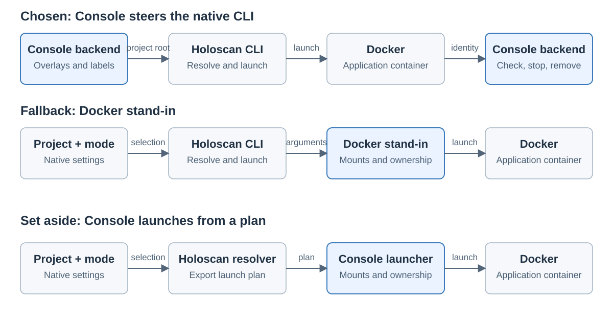

# Holoscan launch handoff

Created November 10, 2026. Status: design discussion; ownership choice open.
[Adoption overview](110926-holoscan-adoption.md).

## Problem and required behavior

Prepare needs the actual container mounts so shared filesystem operations can
create the run's views. Start must launch the application using those prepared
settings. Holoscan currently constructs the Docker invocation in its launch path.

Both choices keep native project interpretation in Holoscan and give Console
responsibility for run ownership, stopping and pre-run cleanup.

## Alternatives

| Choice | Launch handoff | Work and tradeoff |
| --- | --- | --- |
| 1. Native CLI with a Console adapter | Holoscan constructs the Docker arguments; a Console adapter applies prepared mount sources and run ownership before delegating execution. | Uses an existing upstream hook. Requires argument handling, compatible exit/signal behavior and a way to obtain final mounts during Prepare. |
| 2. Exported launch plan | Holoscan exports resolved settings; Console prepares the filesystem and launches Docker from that plan. | Fits the Prepare/Start boundary directly. Requires a complete export interface and agreement on its supported contract. |

The released CLI 5.0.0 source supplies a configurable Docker executable and builds
the arguments for devices, GPU access, mounts and environment settings. A complete
structured launch-plan export was not found in the inspected launch interface.

## Recommendation and uncertainty

Investigate choice 1 first because its interception point already exists.
Preserving native settings also remains possible with choice 2.

The adapter's complexity is unproven. The main feasibility question is whether it
can provide resolved mounts during Prepare and later start the same prepared
launch. Repeated resolution, holding a live CLI process across phases and broad
Docker argument emulation would each add lifecycle or maintenance work.

Before choosing the architecture, verify:

- Final mounts can be obtained before application container creation.
- Start uses the reviewed settings and prepared filesystem views.
- Cancellation, exit status, signals and interrupted-run cleanup remain observable.
- Shared filesystem operations retain their existing behavior.

The existing hook uses an upstream environment setting. Using it in production
would need explicit configuration approval under [AGENTS.md](../../../AGENTS.md).
This discussion introduces no environment configuration contract.

## Decision for discussion

Recommended next step: qualify choice 1 against the requirements above.
Alternative: pursue a complete upstream launch-plan export for choice 2.

The final architecture remains open. This recommendation concerns the next
investigation, and authorizes no implementation.

Evidence: [native container launcher][launcher] and [run interface][run].
Source inspection establishes hook availability; no adapter or end-to-end launch
has been qualified.

Applicable rules: D-01, D-02, D-03, D-04, D-06, D-09, D-12, D-13 and D-14.

[launcher]: https://github.com/nvidia-holoscan/holoscan-cli/blob/v5.0.0/src/holoscan_cli/container/core.py
[run]: https://github.com/nvidia-holoscan/holoscan-cli/blob/v5.0.0/src/holoscan_cli/commands/run.py
