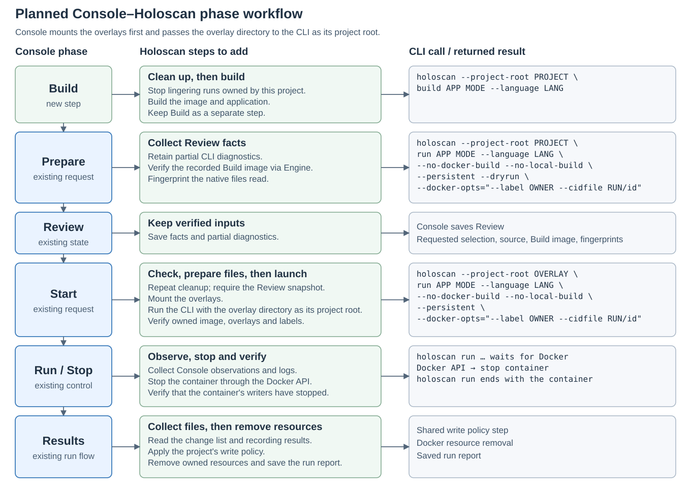

# Holoscan launch

Created November 10, 2026. Updated November 16, 2026. Status: launch design agreed;
initial real-container lifecycle demonstrated with `first_pipeline`.
[Adoption overview](110926-holoscan-adoption.md).

`PROJECT`, `OVERLAY`, `APP`, `MODE`, `LANG`, `OWNER` and `RUN` in the diagram stand for
the selected project, its overlay directory, application, mode, language, ownership
label and run folder. Every `holoscan run` call disables image and application builds.

## How Console steers the CLI

Console mounts the overlays, then passes the project folder's overlay directory to
the CLI as its project root. The CLI builds its usual Docker command. Console sets
no environment variable and places no program between the CLI and Docker.

| Need | How it is met |
| --- | --- |
| Project files in the change list | The overlay directory is the CLI's project root. |
| Extra data folders | The CLI's `--add-volume`; each overlay directory carries its host folder's name. |
| Ownership label and container identity | The CLI's native Docker options. |
| Stopped container kept for collection | The CLI's `--persistent` flag. |

Mounts the project declares in its own Docker options keep their host folder and
are not tracked. Application and Module projects retain native settings and YAML;
the existing locked `toml` crate reads Module defaults.

Build and Start resolve the native Docker configuration and compare its daemon ID
with Console's Engine through local Unix sockets before side effects. The same
daemon owns the Holoscan and system-app containers. Inherited environment stays
unchanged; unknown or mismatched daemon identity is rejected. The
[socket adapter](https://github.com/Cutuy/doramcap/pull/446) adds no Docker subprocess.

## Review snapshot

Initial Review records the verified selection, current source facts, image ID and
fingerprints of the native input files read. Start rechecks these facts and file
identities. Raw Application/Module inputs can reveal file changes without proving
which native settings take effect.

CLI dry-run output is retained as partial diagnostics. Effective mounts, log
driver, IPC and other launch settings remain unknown. Initial Prepare adds no
native shell tokenizer, Docker-option parser, interception wrapper or new
Docker-option environment reads.

## Required constraints

The [existing run shared-memory contract](../../workload-lifecycle/docs/110826-run-shared-memory.md)
requires explicit `PASSTHROUGH` for host IPC; `BLOCKED` rejects it. Mandatory
recording and IPC requirements still apply, and unknown evidence cannot establish
compliance. Post-creation container checks are runtime evidence and provide no
before-start guarantee.

Holoscan retains CPU/GPU placement, graph execution and sensor recording. Console
collects files from its overlays. Inspecting application code and rewriting native
recording settings remain outside this plan.

## Probe result

November 10, 2026: CLI 5.0.0, the [Holoscan applications repository][applications]
and its `bci_visualization` Python application, with a fake Docker that recorded
calls and a project copy standing in for the overlay directory.

| Question | Observed |
| --- | --- |
| Same container path for another project root? | Yes: `/workspace/holohub` for any host path. |
| Stable dry run? | Yes, apart from a printed timestamp. |
| Dry run matches the launch? | Yes, apart from the hidden Docker options. |
| Labels and identity file arrive? | Yes, unchanged. |
| Extra data folder? | `/workspace/volumes/` plus the host folder's name. |
| Docker calls? | None for a dry run; two image inspections, then `docker run`, for a launch. |

November 16, 2026: CLI 5.0.0 and the unchanged official SDK `first_pipeline`, using
native metadata, CMake and a small image on x86. The
[repeatable probe](https://github.com/Cutuy/doramcap/pull/444) needs no dataset,
model or display.

| Mechanism | Observed |
| --- | --- |
| Build and overlay root | The native build artifact runs through the mounted project overlay. |
| Extra data folder | Its named overlay reaches the same native container path. |
| Ownership and controls | Labels, cidfile, one CPU and journald options reach the container. |
| Completion and logs | Engine events retain application exit and stop; journal output and the Engine tail are readable. |
| Engine stop and cleanup | Engine stop ends the CLI; owned containers and mounted views are removed. |

This is initial lifecycle evidence. Recorded replay, GPU kernels and larger
application recovery remain milestone 7. The two larger visualization applications
still need their acceptance display mode settled there.

Applicable rules: D-01 to D-07, D-09, D-12 to D-14. Evidence: [launcher][launcher],
[run flags][run], [Docker/local selection][mode];
[Console review and Start](../../../console/server/src/service.ts),
[snapshot check](../../../console/server/native/src/execution.rs).

[launcher]: https://github.com/nvidia-holoscan/holoscan-cli/blob/v5.0.0/src/holoscan_cli/container/core.py
[run]: https://github.com/nvidia-holoscan/holoscan-cli/blob/v5.0.0/src/holoscan_cli/commands/run.py
[mode]: https://github.com/nvidia-holoscan/holoscan-cli/blob/v5.0.0/src/holoscan_cli/utils/holohub.py
[applications]: https://github.com/nvidia-holoscan/holoscan-applications
