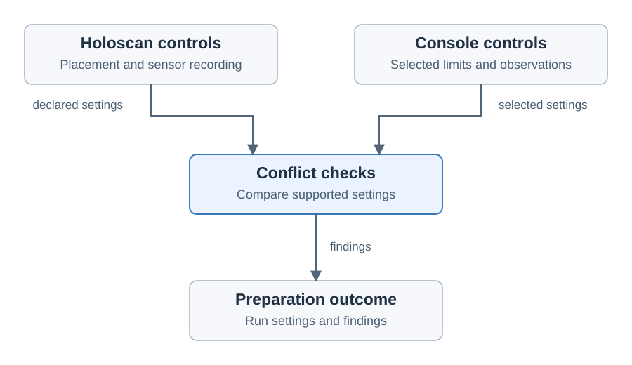
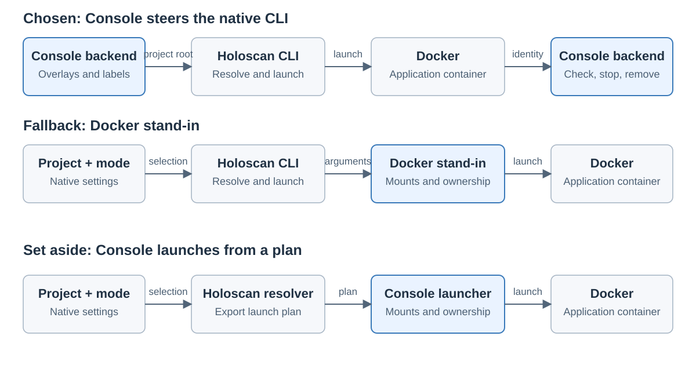

# Holoscan launch

Created November 10, 2026. Updated November 16, 2026. Status: launch design agreed;
initial real-container lifecycle demonstrated with `first_pipeline`.
[Adoption overview](110926-holoscan-adoption.md).

`PROJECT`, `OVERLAY`, `APP`, `MODE`, `LANG`, `OWNER` and `RUN` in the diagram stand for
the selected project, its overlay directory, application, mode, language, ownership
label and run folder. Every `holoscan run` call disables image and application builds.

## How Console steers the CLI

Console mounts the overlays, then passes the project folder's overlay directory to
the CLI as its project root. The CLI builds its usual Docker command. Console sets
no environment variable and places no program between the CLI and Docker.

| Need | How it is met |
| --- | --- |
| Project files in the change list | The overlay directory is the CLI's project root. |
| Extra data folders | The CLI's `--add-volume`; each overlay directory carries its host folder's name. |
| Ownership label and container identity | The CLI's native Docker options. |
| Selected limits and the log driver | The same Docker options. |
| Stopped container kept for collection | The CLI's `--persistent` flag. |

Mounts the project declares in its own Docker options keep their host folder and
are not tracked. Application and Module projects retain native settings and YAML;
the existing locked `toml` crate reads Module defaults.

Build and Start resolve the native Docker configuration and compare its daemon ID
with Console's Engine through local Unix sockets before side effects. The same
daemon owns the Holoscan and system-app containers. Inherited environment stays
unchanged; unknown or mismatched daemon identity is rejected. The
[socket adapter](https://github.com/Cutuy/doramcap/pull/446) adds no Docker subprocess.

## Review snapshot

Review saves one snapshot; Start requires the same one. It covers:

- The Docker command from the CLI's dry run, without its timestamp.
- The image ID, read through the Engine API.
- The project's own Docker options, which the dry run hides.

Overlay directory paths, the ownership label and the container-identity file are
replaced with fixed names before hashing. After the CLI creates the container,
Console checks the image ID, overlay mounts and labels; a mismatch stops it.

Not detected: a device added after Review, and a changed value of an environment
variable the CLI forwards by name.

## Controls and conflicts

| Area | Owner and behavior |
| --- | --- |
| CPU and GPU placement | Holoscan; native settings are kept. |
| Sensor recording | Holoscan; Console collects the output files. |
| Resource limits | Console; only limits the user selects, passed as Docker options. The first version offers none. |
| Observations | Console; host telemetry and workflow logs. |

Prepare compares selected limits with the project's own Docker options:

| Evidence | Outcome |
| --- | --- |
| Compatible | Continue. |
| Overlapping | Warn with the settings and the consequence. |
| Cannot work together | Fail Prepare with the cause. |
| Not comparable | Leave the check unverified. |

Inspecting application code and rewriting native recording settings are out of scope.

## Designs compared

| Design | Outcome |
| --- | --- |
| Console steers the native CLI | Chosen: fewest new parts, no environment setting. |
| Docker stand-in between the CLI and Docker | Fallback if real-container qualification fails. An earlier test showed it can see and rewrite the full command, but it needs a Docker-argument parser and `HOLOSCAN_CLI_DOCKER_EXE`. |
| Console launches from an exported plan | Set aside: Console would repeat the CLI's device, display and GPU setup. CLI 5.0.0 exports no plan. |

## Probe result

November 10, 2026: CLI 5.0.0, the [Holoscan applications repository][applications]
and its `bci_visualization` Python application, with a fake Docker that recorded
calls and a project copy standing in for the overlay directory.

| Question | Observed |
| --- | --- |
| Same container path for another project root? | Yes: `/workspace/holohub` for any host path. |
| Stable dry run? | Yes, apart from a printed timestamp. |
| Dry run matches the launch? | Yes, apart from the hidden Docker options. |
| Labels and identity file arrive? | Yes, unchanged. |
| Extra data folder? | `/workspace/volumes/` plus the host folder's name. |
| Docker calls? | None for a dry run; two image inspections, then `docker run`, for a launch. |

November 16, 2026: CLI 5.0.0 and the unchanged official SDK `first_pipeline`, using
native metadata, CMake and a small image on x86. The
[repeatable probe](https://github.com/Cutuy/doramcap/pull/444) needs no dataset,
model or display.

| Mechanism | Observed |
| --- | --- |
| Build and overlay root | The native build artifact runs through the mounted project overlay. |
| Extra data folder | Its named overlay reaches the same native container path. |
| Ownership and controls | Labels, cidfile, one CPU and journald options reach the container. |
| Completion and logs | Engine events retain application exit and stop; journal output and the Engine tail are readable. |
| Engine stop and cleanup | Engine stop ends the CLI; owned containers and mounted views are removed. |

This is initial lifecycle evidence. Recorded replay, GPU kernels and larger
application recovery remain milestone 7. The two larger visualization applications
still need their acceptance display mode settled there.

Applicable rules: D-01 to D-07, D-09, D-12 to D-14. Evidence: [launcher][launcher],
[run flags][run], [Docker/local selection][mode];
[Console review and Start](../../../console/server/src/service.ts),
[snapshot check](../../../console/server/native/src/execution.rs).

[launcher]: https://github.com/nvidia-holoscan/holoscan-cli/blob/v5.0.0/src/holoscan_cli/container/core.py
[run]: https://github.com/nvidia-holoscan/holoscan-cli/blob/v5.0.0/src/holoscan_cli/commands/run.py
[mode]: https://github.com/nvidia-holoscan/holoscan-cli/blob/v5.0.0/src/holoscan_cli/utils/holohub.py
[applications]: https://github.com/nvidia-holoscan/holoscan-applications
