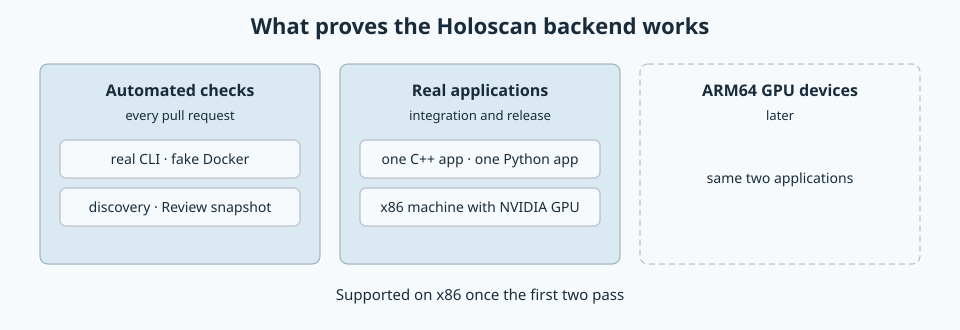

# Holoscan backend acceptance

Created November 11, 2026. Stage 6 architecture: agreed acceptance bar.
[Adoption overview](110926-holoscan-adoption.md) ·
[Runner plan](111126-holoscan-runner-impl.md).

Console supports Holoscan projects on x86 once automated checks pass and two
real applications build, run and recover through Console on an x86 machine with
an NVIDIA GPU.

## Levels

| Level | Runs | Covers |
| --- | --- | --- |
| Automated checks | Every pull request | Real CLI with a fake Docker: discovery outcomes, dry run, Review snapshot, conflict reports. Shared Docker steps keep their own tests. |
| Real applications | Integration points and before release | The scenarios below, on an x86 machine with an NVIDIA GPU. Results are reported separately. |
| ARM64 GPU devices | Later | The same two applications on a Jetson or IGX class device. |

Until the third level passes, ARM64 is described as expected to work.

## Applications

Both come from NVIDIA's Holoscan applications repository, declare x86 and ARM64
support and replay recorded data.

| Application | Language | Reason |
| --- | --- | --- |
| `endoscopy_tool_tracking` | C++ | Covers the compiled build path. |
| `bci_visualization` | Python | Covers the Python path. Used in the earlier probe. |

## Scenarios

Each application goes through all of them.

| Scenario | Checks |
| --- | --- |
| Same as upstream | The container Console launches matches a plain CLI launch, apart from views, labels and the log driver. |
| Normal run | Build, Review, Start, the application's own exit, its exit code, file changes and its log in the journal. |
| Stop | Stop from Console ends the container within the deadline. |
| Failures | Container differs from the snapshot. CLI exits before a container exists. Build fails. |
| Recovery | Console is killed during Build, during start and mid-run. The next run cleans up. |

## Limits of this bar

- Both applications replay recorded data. Live sensors and real-time capture are later work.
- Both open a visualization window. Milestone 1 of the runner plan settles whether
  acceptance uses their headless mode or a virtual display.
- Real runs need Docker access on the acceptance machine.

Applicable rules: D-01, D-07, D-11, D-12 and D-13.
