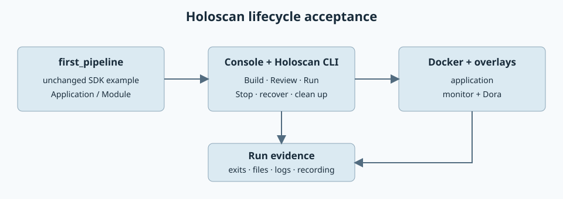

# Holoscan runner: implementation plan

Created November 11, 2026. Updated November 16, 2026. Status: milestones 1 to 5
implemented in ready pull requests; integration and milestones 6 to 7 remain open.
[Adoption overview and decisions](110926-holoscan-adoption.md#decisions).

Build `workload-holoscan` and connect it to Console's backend. A user can then
discover a project's applications, build one, review its launch, run it and get
its results. The web app journey is a later stage.

## Starting point

| Piece | State |
| --- | --- |
| `docker-engine` | On `main`: Engine client, cleanup by label and the container filesystem diff. |
| Overlays, change list, write policy | On `main` in `host-filesystem`, with the change list read from the uppers ([Cutuy/doramcap#318](https://github.com/Cutuy/doramcap/pull/318), [Cutuy/doramcap#326](https://github.com/Cutuy/doramcap/pull/326)). |
| Shared run sequence | On `main`: `workload_lifecycle::run` with `Running`; [#442](https://github.com/Cutuy/doramcap/pull/442) adds successful completion through shared teardown. |
| Admission lock | On `main`, from [Cutuy/doramcap#315](https://github.com/Cutuy/doramcap/pull/315). |
| Shared apps crate, `compose-apps` | On `main`, including system apps sequences from [Cutuy/doramcap#324](https://github.com/Cutuy/doramcap/pull/324). |
| Console backend | Inspect and start support Compose and systemd. [#443](https://github.com/Cutuy/doramcap/pull/443) adds the Holoscan catalog and approved configuration. |
| Holoscan | Lifecycle fixture in [#444](https://github.com/Cutuy/doramcap/pull/444); discovery in #443; native routing in [#446](https://github.com/Cutuy/doramcap/pull/446); raw Module inputs in [#447](https://github.com/Cutuy/doramcap/pull/447). |

The [overview's decisions](110926-holoscan-adoption.md#decisions) are the design
this plan implements; each stage document holds the detail.

## Configuration

Console reads its backend from the `form` field of its configuration. Today the
values are `COMPOSE` and `SYSTEMD`. The TypeScript server reads the field in a
few places: configuration and manifest checks, finding the user's apps and
building the run plan. The native backend never sees it and acts on the plan it
is given.

Approved additions:

| Input | Meaning |
| --- | --- |
| `form: HOLOSCAN` | The Holoscan backend runs this project. |
| `holoscan { cli }` | Required with `HOLOSCAN` and rejected otherwise. `cli` is the absolute path of the Holoscan CLI executable. |

`workload_holoscan::environment::configure_container` sets child-only
`HOLOSCAN_CLI_BUILD_LOCAL=0` for native Build, Run and their dry-runs. CLI 5 uses
this selector for both operations; omit `--local`. Preserve the parent environment,
Docker routing variables and every other child variable. Catalog queries keep
their inherited environment.

| `form` | User's apps | Dora and system apps |
| --- | --- | --- |
| `COMPOSE` | Compose services | Compose services |
| `SYSTEMD` | systemd units | systemd units |
| `HOLOSCAN` | The Holoscan CLI | Chosen by the Holoscan workflow from the project's environment |

The first version supports application Build/Run in existing Application and Module
projects through Docker. Read Module defaults from native `pyproject.toml` with the
existing locked `toml` crate. YAML stays native and unchanged. Host execution,
Module creation and packaging/publishing workflows remain outside this plan.

## Crate

A new crate, `libs/workload-holoscan`.

| Depends on | For |
| --- | --- |
| `workload-lifecycle` | Run sequence, admission lock, shared run plan. |
| `docker-engine` | Engine client, cleanup by label and container filesystem diff. |
| `host-filesystem` | Process-group helper, overlays, change list and write policy, with shared filesystem steps in `workload-lifecycle`. |
| `orchestrator` | Steps and progress events. |
| `compose-apps` | Existing per-app Docker placement and cleanup; Dora and system-app sequences from milestone 6. |
| `toml` | Read native Module defaults using the version already locked in the workspace. |

Boundary rule to add in `scripts/ci/boundaries.json`: `workload-holoscan` must
not depend on `workload-docker`, `workload-systemd` or `workload-supervisor`.
The direct `toml` dependency is approved. Other dependency choices follow
[AGENTS.md](../../../AGENTS.md#third-party-crates).

## Contract

A new package, `doramcap.holoscan.v1`, following the existing plan contracts.
Messages use plain fields and repeated messages.

| Message | Carries |
| --- | --- |
| `Selection` | Requested application, language and mode; omitted native defaults remain unknown. |
| `HoloscanPlan` | Requested selection and extra data folders; shared `RunPlan` owns common run settings. |
| `Catalog` | Applications with their languages and modes, plus diagnostics from the CLI. |
| `BuildRecord` | Selection, image ID, available source commit and Clean/Dirty/Unknown state from current observation. |
| `ConfigurationSnapshot` | Requested selection, source facts, the recorded Build image verified through Engine and native file fingerprints; CLI diagnostics remain partial. |
| `HoloscanRunReport` | Execution error, container exit, stop and cleanup facts, change-list counts and coverage, observed untracked mounts. |

Console's execution contract gains a Holoscan form beside Compose and systemd in
`RunRequest`, `Inspection` and `StartRequest`, and two operations: catalog and build.

## Steps

Each is an orchestrator step with its own progress and failure.

| Step | Does |
| --- | --- |
| `DiscoverApplications` | Runs the CLI's list and modes queries in the project. Returns the catalog and diagnostics. |
| `BuildApplication` | Runs the CLI build under the admission lock. Streams output. Writes the build record. |
| `PrepareLaunch` | Records requested selection/source facts, verifies the recorded Build image through Engine, fingerprints native files and retains partial CLI diagnostics. |
| `ResetProject` | Stops and removes leftover containers by label through `docker-engine` and discards leftover overlays. |
| `LaunchApplication` | Starts the CLI with the overlay directories, waits for its labelled container and checks the image and Console-owned placement after creation. |

Mounting overlays, reading the change list and applying the write policy are the
shared steps in `host-filesystem` and `workload-lifecycle`, as the
[overlay plan](https://github.com/Cutuy/doramcap/pull/316) describes. The runner adds
none of its own. The project's write policy (write back, keep with the run or
discard) applies to Holoscan runs as well.

## Run sequence

The runner implements `Running` and calls `workload_lifecycle::run`.

| Phase | Work |
| --- | --- |
| Before `run` | Take admission. Verify native Docker routing through Unix sockets, then reset. Prepare and compare with Review; mount the project and data-folder overlays. |
| `start` | Subscribe to Engine events for the run label, then start the CLI. Wait for the container. Check image ID, overlay mounts and labels. |
| `ready` | Publish readiness once the container is running and checked. |
| `ended` | Resolve when the Engine reports the container stopped, with its exit code. |
| `stop` | Stop the container through the Engine with the run's deadline. Verify it stopped. Read the uppers into the change list. |
| `remove` | Save the report, unmount the overlays and apply the write policy. Remove the container when permitted. |

The application-only run passes an empty recording list. Normal completion and
failure both use shared teardown. For CLI processes spawned directly by Console,
retain `tokio::process::Child` until `wait()` reaps it. Use the existing application
hierarchy for placement.
Owned-resource reset and removal accept missing resources and resume partial
cleanup. Repeating cleanup must not repeat capture or write-back.

## System apps

Console's system apps, which include the Dora apps, run in the form that matches
the Holoscan project's environment.

| Holoscan project runs | System apps run as |
| --- | --- |
| In Docker | Docker containers, through the existing Compose form |
| On the host | systemd units, when host execution is supported |

The Holoscan workflow is its own sequence. It reuses the steps and structs that
run Dora and system apps as containers, which move to a shared crate,
`compose-apps`, in [Cutuy/doramcap#317](https://github.com/Cutuy/doramcap/pull/317).
The Compose workflow uses the same crate. Each workflow keeps its own run order,
and the Holoscan launch takes the place where Compose starts user services.

| Order | Start | Stop |
| --- | --- | --- |
| 1 | Dora apps | Holoscan application |
| 2 | Other system apps | Other system apps |
| 3 | Holoscan application | Dora apps |

The Compose start sequence already skips its user-app step when there are no
user apps, so a run of system apps alone is a path the code anticipates. The
Holoscan application takes the place of the user apps, after the system apps
are up and stable.

Review shows the system apps and the Holoscan launch together.

This is built in milestone 6, after the application-only run works. Until then
a Holoscan run has machine snapshots, workflow events, its change list and its
log, and no monitor telemetry.

## Milestone 1: prove the lifecycle on a real container

Use the unchanged official SDK `first_pipeline` with native project metadata,
CMake and a small image. This CPU graph needs no dataset, model or display.
[#444](https://github.com/Cutuy/doramcap/pull/444) supplies the fixture and probe.
Milestone 7 uses the same lightweight application.

**Work items**

- [x] Build `first_pipeline` through the real CLI.
- [x] Launch with a real project-root overlay.
- [x] Launch with a named extra-data overlay.
- [x] Pass ownership, identity, CPU and journal options.
- [x] Capture labelled Engine lifecycle events.

**Validation**

- [x] Build output visible through the overlay.
- [x] Extra folder at its native container path.
- [x] Headless application completion through the overlay.
- [x] Labels, CPU limit and log driver retained.
- [x] Host journal output and Engine log tail.
- [x] Application exit code from the Engine.
- [x] Engine stop ends the CLI.
- [x] Evidence in the [launch document](111026-holoscan-launch.md#probe-result).

## Milestone 2: crate, contract and discovery

Implemented in [#443](https://github.com/Cutuy/doramcap/pull/443), stacked on #442.

**Work items**

- [x] Create the crate, protobuf package and boundary rule.
- [x] Implement the [discovery outcomes](110926-holoscan-discovery.md#outcomes).
- [x] Add `form: HOLOSCAN` and the checked `holoscan` block.
- [x] Add the backend catalog operation.
- [x] Cancel, kill, reap and join catalog work at close.
- [x] Retain the first cleanup or task-join failure.

**Validation**

- [x] Real CLI catalog and native project search.
- [x] Empty, unavailable and failed-query outcomes.
- [x] Catalog close and cleanup-error delivery.
- [x] Boundaries, formatting and Clippy.

## Milestone 3: Prepare and Review

The raw Module reader in [#447](https://github.com/Cutuy/doramcap/pull/447) is a
prerequisite. Limited Review is implemented in ready
[#448](https://github.com/Cutuy/doramcap/pull/448); native launch settings remain partial.

**Work items**

- [x] Implement `PrepareLaunch` for Application and Module projects with requested selection/source facts and the recorded Build image verified through Engine.
- [x] Apply the native Docker socket check before Docker-dependent preparation.
- [x] Fingerprint native input files and retain CLI output as partial diagnostics; mark effective launch settings unknown.
- [x] Report missing Build/image facts, known source mismatches and unverified freshness separately.
- [x] Keep mandatory recording/IPC constraints explicit; unknown evidence cannot satisfy them.
- [x] Add the Holoscan form to Console's inspect operation.

**Validation**

- [x] Unchanged verified inputs give the same snapshot.
- [x] Changes to selection, source/Build facts, image, policies or observed file/folder identities invalidate Review.
- [x] Missing artifacts and known source mismatches retain their causes.
- [x] Unknown/missing source facts preserve known facts without implying a mismatch.
- [x] Partial diagnostics never establish complete mount, log or IPC coverage.
- [x] Real CLI source, Application and Module Review.
- [x] Review close cancels and reaps the direct CLI child.

## Milestone 4: Build request

Ready [#458](https://github.com/Cutuy/doramcap/pull/458) implements native Build,
latest-attempt storage and Console delivery. Recovery checks are in draft
[#466](https://github.com/Cutuy/doramcap/pull/466).

**Work items**

- [x] Implement `BuildApplication` and its record for Application and Module projects.
- [x] Verify native Docker daemon identity before Build side effects.
- [x] Add the build operation to Console's backend, with progress and its own result.

**Validation**

- [x] A real build succeeds and writes a record that Prepare accepts.
- [x] A failed build keeps its output and blocks Prepare with a clear cause.
- [x] A build is refused while a run holds the repository, and the reverse.
- [x] An edit committed after Build makes Prepare report "rebuild needed".

## Milestone 5: run

Ready [#465](https://github.com/Cutuy/doramcap/pull/465) implements the application
run, stacked on Build and the shared filesystem prerequisite
[#463](https://github.com/Cutuy/doramcap/pull/463).

**Work items**

- [x] Implement `ResetProject`, `LaunchApplication` and the `Running` handle.
- [x] Recheck native Docker identity before Start side effects.
- [x] Reuse existing application placement and retain/reap directly spawned CLI children.
- [x] Make resource reset/removal repeatable without replaying capture or write-back.
- [x] Use the shared overlay, change-list and write-policy steps. Name each extra data
  folder's overlay directory after the folder.
- [x] Add the Holoscan form to Console's start operation, with the snapshot check before admission completes.
- [x] Write the run report into the run's folder and map it to Console's execution result.

**Validation**

- [x] A real application runs to its own exit and reports its exit code.
- [x] Stop from Console ends the container within the deadline and saves the change list.
- [x] A created container with a different image or Console-owned placement is stopped and Start fails.
- [x] The CLI exiting before a container exists fails Start with the CLI's output.
- [x] Killing the CLI mid-run leaves the run going and records a note.
- [x] Files the application writes appear in the change list; the project folder is unchanged under discard and under keep with the run.
- [x] An extra data folder appears at the same container path as without Console.
- [x] Observed mounts outside Console overlays are marked untracked in the result.

## Milestone 6: system apps

Draft [#464](https://github.com/Cutuy/doramcap/pull/464) integrates Docker system
apps with the native application. [#468](https://github.com/Cutuy/doramcap/pull/468)
corrects Dora shutdown before graph registration. Shared helper crash recovery
remains open in milestone 7; systemd follows with host execution.

**Work items**

- [x] Prepare Dora and system apps as one project through `compose-apps`, with no extra group.
- [x] In the Holoscan workflow, start the system part, then launch the application.
  Watch both. Stop the application, then the system part.
- [x] Take the admission lock once for the whole run and mount overlays once for
  both parts' writable host folders.
- [x] Include the system apps in Prepare and the Review snapshot.

**Validation**

- [x] A Holoscan run records monitor telemetry as a Compose run does.
- [x] Stop ends the application first, then the other system apps, then Dora.
- [x] A failed system-app start stops the run before the application launches.
- [x] Compose runs without Holoscan behave as before.

## Milestone 7: recovery and acceptance

Draft [#466](https://github.com/Cutuy/doramcap/pull/466) covers native Build/Run
controller loss, competing owners and combined Dora shutdown. Shared Compose
and filesystem-copy commands reuse the existing application cgroup and recovery
record in draft [#470](https://github.com/Cutuy/doramcap/pull/470). This remaining
recovery work uses `first_pipeline`.

**Work items**

- [ ] Cover controller loss during Build, during start and mid-run. The next run cleans up.
- [ ] Cover cancellation during start, failed stop and failed removal.
- [ ] Run every [acceptance](#acceptance) scenario with `first_pipeline`.
- [x] Cover application Build/Run in Application and Module projects.

**Validation**

- [ ] After each interruption, the next run on the repository starts cleanly.
- [ ] Unrelated containers and a live competing run keep their resources.
- [ ] Full local CI on the final revision.

The owner waived the ARM64 worker run for this stack on November 16.

## Acceptance

The acceptance target is the unchanged official SDK `first_pipeline`, exercised
through CLI 5, Docker and OverlayFS on x86. It uses a small test image with CUDA
runtime libraries and needs no replay dataset, inference model or display.
Application and Module project metadata cover both supported project forms.

### Scenarios

| Scenario | Checks |
| --- | --- |
| Same as upstream | The container matches a plain CLI launch apart from overlay directories and ownership labels; native logging configuration is preserved. |
| Normal run | Build, Review, Start, application exit/code, file changes, saved CLI output and available runtime log evidence. |
| Stop | Stop ends the application, monitor and Dora in order within the deadline; recording and cleanup finish. |
| Failures | Wrong image or owned placement, CLI exit before container creation, failed Build and failed system startup retain their causes. |
| Recovery | Kill Console during Build, startup, running and shared helper work; the next admitted run stops old helpers and cleans owned resources. |
| Repeat cleanup | Missing resources succeed; unrelated containers, competing owners and prior evidence are preserved. |

Real runs require the existing Docker, cgroup and OverlayFS test capabilities.
The ARM64 worker is waived for this stack; no ARM64 GPU-device claim is made.

## Settled details

| Detail | Decision |
| --- | --- |
| Limits offered | None in the first version. Console offers no user-selected limits for a user's project today. The launch-option mechanism stays agreed for when it does. |
| Build record | A new `builds/` folder in Console's data folder, one record per application, language and mode. |
| Source facts | Use current HEAD and Clean/Dirty/Unknown as Compose/systemd do; retain readable HEAD on status failure, with no prior-run fallback. |
| Build freshness | Dirty/Unknown or missing commit is unverified. Only known commit or known Clean/Dirty mismatches require rebuild. |

## Outside this plan

- Heavy replay applications, GPU-kernel qualification and live sensors.
- Module creation and packaging/publishing workflows.
- The [web app journey](111126-holoscan-web-app.md). It gets its own plan after the application-only run works.
- Host-native execution without Docker.
- Launching the container through the Engine API in place of the CLI.

## Tests

Scripted end-to-end checks are TypeScript. Rust tests stay small and cover
observable contracts. The Holoscan CLI is an upstream Python tool that the user
installs; Console runs it as an external program and adds no Python of its own.

Applicable rules: D-01, D-02, D-03, D-04, D-06, D-07, D-08, D-09, D-10, D-12,
D-13 and D-14 in the [design guide](../../../docs/design-guide.md); I-03, I-04,
I-05, I-06, I-07 and I-09 in the [implementation guide](../../../docs/impl-guide.md).
