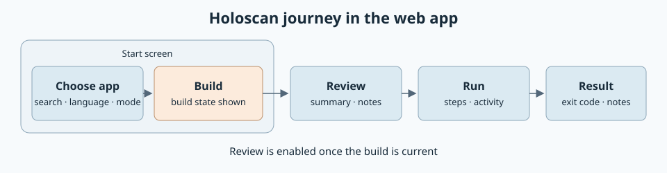

# Holoscan in the web app

Created November 11, 2026. Stage 7 architecture: agreed journey and screens.
[Adoption overview](110926-holoscan-adoption.md) ·
[Runner plan](111126-holoscan-runner-impl.md).

A Holoscan project uses the web app's existing journey with one added step,
Build. The existing Run, History and Compare screens stay as they are.

## Journey

| Step | Screen | Holoscan behavior |
| --- | --- | --- |
| Choose app | Start | A searchable list of the catalog's applications. Language and mode pickers show what the chosen application offers. |
| Build | Start | The build state of the current selection and a Build action with live output. |
| Review | Review | Summary rows, a notes list and the launch command. Enabled once the build is current. |
| Run | Run | Unchanged. |
| Result | Result | The container's exit code, run facts and notes. |

The run status gains a building phase.

## Start screen

- The catalog loads when the page opens and has a refresh action.
- The server pre-fills the last selection from the last build or run, as it does
  for profiles today. Nothing is kept in the browser.
- Each application, language and mode combination has its own build state:

| Build state | Shown as | Review |
| --- | --- | --- |
| No build record or image | Not built | Disabled |
| Record matches the current source | Built, with commit and Clean or Dirty | Enabled |
| Source commit or clean state differs | Source changed since build | Disabled |

Discovery outcomes appear in place of the list:

| Outcome | Shown as |
| --- | --- |
| Applications found | The list |
| Valid entries with metadata errors | The list, with the CLI's diagnostics as a note above it |
| No applications | An empty-catalog message |
| CLI missing or query unavailable | Discovery unavailable, with the cause |
| Query failed | Discovery failed, with the CLI's output |

## Review screen

| Part | Content |
| --- | --- |
| Summary rows | Application with language and mode, image ID, the build's commit and Clean or Dirty, and where the log goes. |
| Notes | One list: a Dirty build, mounts not captured, a project-set log driver. Nothing in it blocks Start. |
| Launch command | The normalized command the snapshot covers, collapsed behind a toggle. The project's own Docker options are listed with it. |
| Kept from today | System apps, once support apps are built, and the comparison with an earlier run. |

Review has no recordings section for Holoscan.

## Result screen

| Part | Content |
| --- | --- |
| Outcome | Succeeded or failed, with the container's exit code. |
| Facts | Writers stopped and cleanup verified, as today. |
| Recordings | Shown as not checked. Console runs no recording check for Holoscan. |
| Notes | Mounts not captured, and the CLI exiting before the application when that happened. |
| File changes | Arrive with [Cutuy/doramcap#312](https://github.com/Cutuy/doramcap/pull/312). |
| Application log | Arrives with [Cutuy/doramcap#314](https://github.com/Cutuy/doramcap/pull/314). |

## Later options

- One button that builds when needed and then reviews.
- A default selection in the `holoscan` configuration block. This is a new
  configuration input and needs approval.

The web app work gets its own implementation plan after the runner's
application-only run works.

Applicable rules: D-01, D-02, D-07, D-08, D-09 and D-10.
