# Holoscan runner stack

Created November 16, 2026.
Plan: [#264](https://github.com/Cutuy/doramcap/pull/264).

Implement the seven runner milestones as stacked pull requests. The web app gets
its implementation plan after the application-only run works. Nothing is merged
by this task. The code PRs form GitHub stack #469.

## Work

| Milestone | Scope | PR |
| --- | --- | --- |
| Prerequisite | Shared normal completion | [#442](https://github.com/Cutuy/doramcap/pull/442), ready |
| Prerequisite | Native Docker socket check | [#446](https://github.com/Cutuy/doramcap/pull/446), ready |
| Prerequisite | Supervisor removal retry | [#445](https://github.com/Cutuy/doramcap/pull/445), ready |
| Prerequisite | Raw Module Docker inputs | [#447](https://github.com/Cutuy/doramcap/pull/447), ready |
| Prerequisite | Empty-slice cleanup race | [#455](https://github.com/Cutuy/doramcap/pull/455), ready |
| Prerequisite | Container-only CLI environment | [#460](https://github.com/Cutuy/doramcap/pull/460), ready |
| Prerequisite | Application-slice CLI containment | [#461](https://github.com/Cutuy/doramcap/pull/461), ready |
| Prerequisite | Shared Compose filesystem preparation | [#463](https://github.com/Cutuy/doramcap/pull/463), ready |
| 1 | Lightweight real CLI, container and overlay probes | [#444](https://github.com/Cutuy/doramcap/pull/444), ready |
| 2 | Crate, protobuf contract and discovery | [#443](https://github.com/Cutuy/doramcap/pull/443), ready |
| 3 | Limited Prepare and Review | [#448](https://github.com/Cutuy/doramcap/pull/448), ready |
| 4 | Build request | [#458](https://github.com/Cutuy/doramcap/pull/458), ready |
| 5 | Application run | [#465](https://github.com/Cutuy/doramcap/pull/465), ready |
| 6 | System apps | [#464](https://github.com/Cutuy/doramcap/pull/464), draft |
| 7 | Recovery and acceptance | [#466](https://github.com/Cutuy/doramcap/pull/466), draft |
| Follow-up | Build validation, Review reasons and empty-helper observation | [#467](https://github.com/Cutuy/doramcap/pull/467), ready |
| Follow-up | Dora shutdown before graph registration | [#468](https://github.com/Cutuy/doramcap/pull/468), ready |

## Agents

| Agent | Model | Assignment |
| --- | --- | --- |
| `holoscan_probe_audit` | GPT-6.1 Sol, xhigh | Native process containment and shared cleanup retry |
| `holoscan_contract_audit` | GPT-6.1 Sol, xhigh | Build complete; milestone 7 recovery and admission |
| `holoscan_discovery` | GPT-6.1 Sol, xhigh | Milestone 3 limited Prepare/Review, completed |
| `holoscan_container_environment` | GPT-6.1 Sol, xhigh | Application Run complete; review follow-up fixes |
| `holoscan_process_scope` | GPT-6.1 Sol, xhigh | Shared filesystem reuse reviewed; milestone 6 system apps |

## Decisions

The agreed decisions in #264 remain the baseline. Each implementation decision
below records its approval or pending status.

### 1. Normal application completion — approved

Context: Holoscan must preserve the application's exit code and allow a successful
normal exit. The shared lifecycle currently treats every natural end as an error.

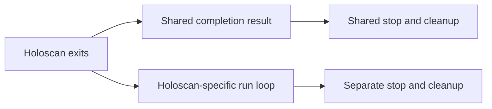

| Option | Effect |
| --- | --- |
| Shared completion result, recommended | Change `Running::ended` to return success or failure; preserve existing backends' behavior and shared teardown. |
| Holoscan-specific run loop | Handle normal completion in a separate lifecycle sequence owned by Holoscan. |

Choice: the owner approved the shared completion result on November 16. It keeps
lifecycle policy with its current owner and avoids duplicating teardown.

### 2. Lightweight lifecycle application — approved

Context: the owner asked for a lightweight project for lifecycle testing. The two
applications in #264 require replay data and exercise additional application
behavior. Their full acceptance remains later work.

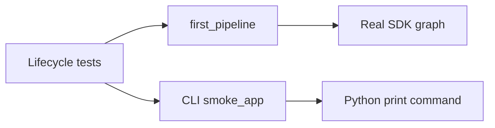

| Option | Effect |
| --- | --- |
| Official SDK first_pipeline, recommended | Runs three CPU operators for ten values, requests stop and checks termination. |
| Official CLI smoke_app | Exercises CLI command execution without an SDK graph. |

Choice: the owner approved the unchanged SDK example with native metadata and
a small test image. It uses CUDA runtime libraries, supplied by the CUDA base and
NVIDIA runtime, without GPU computation, a dataset, model or display. The two
larger applications remain later acceptance work.

Source: [SDK first_pipeline](https://github.com/nvidia-holoscan/holoscan-sdk/tree/358c772f2d2e88d117651a961d6f6bf9b650cf8d/examples/first_pipeline).
The earlier synthetic-mode proposal was superseded by this investigation; it was
not approved or executed.

### 3. Console configuration — approved

Context: milestone 2 adds the configuration already planned in #264. Automatic
approval review required direct confirmation of those additions.

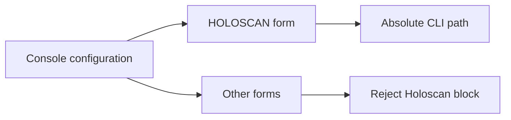

| Option | Effect |
| --- | --- |
| Planned configuration, recommended | Add `form: HOLOSCAN` and required `holoscan { cli }`; reject the block for other forms. |
| Defer configuration | Leave discovery disconnected from Console's configured backend. |

Choice: the owner explicitly approved the planned configuration on November 16.

### 4. Docker routing — approved

Context: Holoscan, system containers and Console's Engine API must reach the same
Docker daemon. Compose and Holoscan workflows do not need to run together. CLI
5.0 has no daemon host/context flag or project setting; a child `DOCKER_HOST`
override also disables its automatic local CPU-limit forwarding.

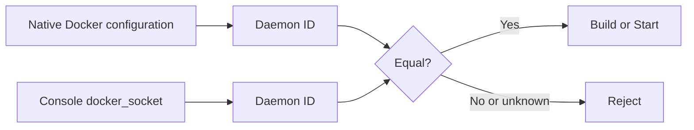

| Option | Effect |
| --- | --- |
| Matching native setup, recommended | Preserve native routing and CPU behavior; compare daemon identity before Build and Start. |
| Child DOCKER_HOST override | Select Console's socket explicitly; lose automatic local CPU-limit forwarding. |

Choice: the owner approved native setup when the daemon matches and requested
a socket-based check without a Docker subprocess. Resolve the native endpoint
from Docker configuration, then query the Engine API directly. The owner approved
implementation on November 16. Routing must remain stable during each operation;
per-command routing wrappers are unsupported. Docker routing values remain unchanged;
decision 10 records the later approved container-execution selector.

### 5. Catalog process ownership — approved

Context: closing Console currently kills an active catalog CLI as its runtime
shuts down, without reaping it. The cancellation check exposes a persistent zombie.

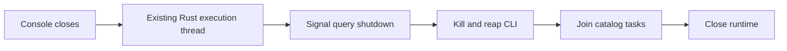

| Option | Effect |
| --- | --- |
| Existing Rust execution thread, recommended | Track catalog tasks and await child cleanup before closing their runtime. |
| Separate process supervisor | Add a dedicated component for child ownership. |

Choice: the owner approved the existing execution thread waiting for catalog
cancellation and process reaping. This adds no separate process supervisor.

### 6. Process containment and cleanup — reuse existing slices

Context: the owner asked whether detached processes and cgroups suffice, and
required idempotent pre-run and post-run cleanup across workflows. A proposed
separate CLI cgroup was superseded by the owner's instruction to reuse the
existing application slices.

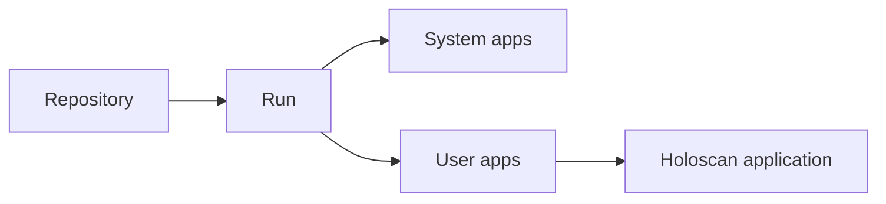

| Option | Effect |
| --- | --- |
| Existing application hierarchy, owner choice | Reuse repository/run/user/application placement and cleanup. |
| Separate CLI hierarchy | Introduce another containment boundary and recovery path. |

Keep the actual `tokio::process::Child` returned by spawn until `wait()` reaps it.
Cgroup emptiness does not establish reaping. Docker owns the containers and Engine
cleanup verifies them separately. Catalog remains usable without cgroup access.

Cleanup accepts missing owned resources and resumes partial removal. It verifies
writers have stopped and preserves unrelated resources. Repeating teardown must
not replay capture or write-back. Console retains the admission lock; Holoscan
children use its default close-on-exec behavior so the next controller can acquire
admission and clean surviving owned resources.

### 7. Module application compatibility — approved

Context: CLI 5.0 uses JSON metadata for application and Module projects. Only
Module projects read optional `pyproject.toml` defaults from `[tool.holoscan]`.
Their Docker options are hidden from dry-run output. Read the raw files for
provenance; the limited Review does not reconstruct their effective options.
Application YAML remains native.

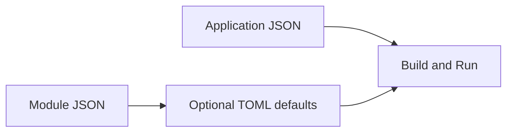

| Option | Effect |
| --- | --- |
| Run applications in both project types, recommended | Preserve Module project defaults; module creation and packaging remain outside Console. |
| Application projects only | Defer application execution inside Module projects. |

NVIDIA documents the Module workflow and lists Deltacast and RTI community
modules; that establishes real use, without establishing broad adoption. After
reviewing this evidence, the owner approved application Build/Run in both project
types and the existing locked `toml` crate on November 16.

For read-only TOML support, `toml` and `toml_edit` are reputable candidates from
[toml-rs](https://github.com/toml-rs/toml), both already in Cargo.lock.
`toml` is recommended because formatting-preserving editing is unnecessary.

Sources: [Module tutorial](https://nvidia-holoscan.github.io/tutorials/create-a-module/),
[community catalog](https://nvidia-holoscan.github.io/modules/).

### 8. Source metadata — follow existing workflows

Context: the owner directed Holoscan to follow Compose/systemd source capture.
Both workflows use the same Console helper. It reads current HEAD and status
independently; local changes are Dirty, failed status is Unknown, and an unreadable
commit stays absent. There is no cached-commit fallback.

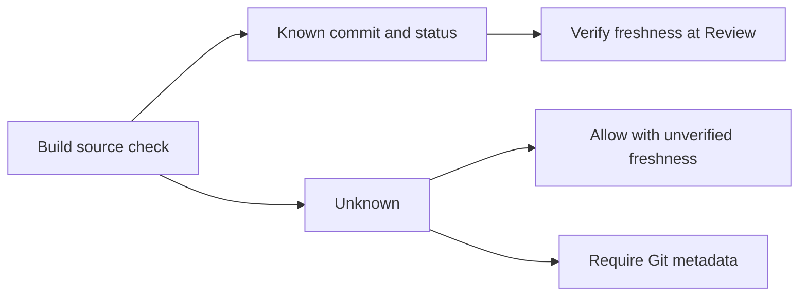

| Option | Effect |
| --- | --- |
| Allow Unknown, recommended | Keep copied projects usable; explicitly mark source freshness unverified. |
| Require known Git metadata | Refuse Build/Run until commit and status are available. |

Choice: follow the existing workflows, as the owner directed on November 16.
Dirty, Unknown or absent Git metadata alone do not gate execution. Retain the
readable current commit with Clean, Dirty or Unknown. Their freshness remains
unverified; known changes relative to a build still require rebuilding as #264
specifies.
Unknown never becomes Dirty merely because a Git command failed.

### 9. Limited Review — approved

Context: CLI 5.0 hides configured Docker options in dry-run output. Its human
command formatter also loses quoting information. A complete settings screen
would require additional interpretation or interception. The owner rejected
that complexity and chose limited Review.

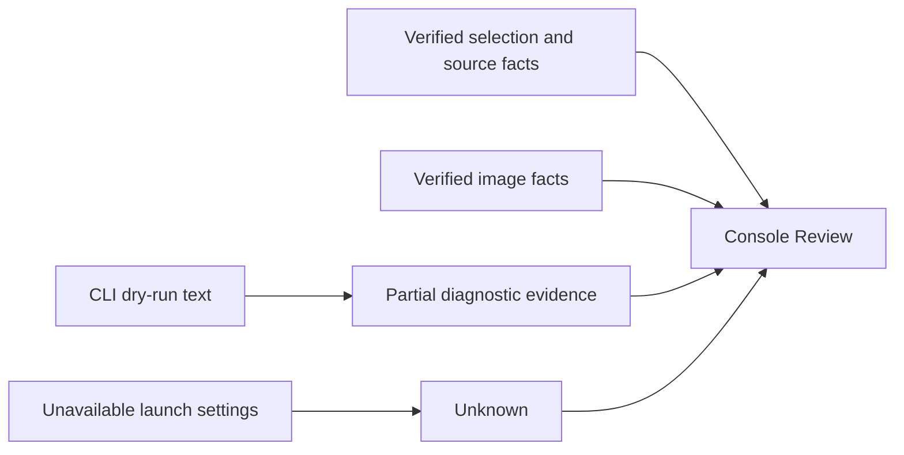

| Option | Effect |
| --- | --- |
| A: limited Review, owner choice | Show verified facts and explicitly identify unavailable launch details. Preserve CLI execution. |
| B: interpret native configuration | Duplicate CLI parsing and expansion without a complete resolved launch. Rejected. |
| C: intercept Docker invocation | Add an executable and paused-launch lifecycle; structured settings still need interpretation. Rejected. |

Choice: on November 16 the owner instructed, "Just follow A." Remove the
comprehensive pre-run inspection promise from #264. Keep raw native input
fingerprints and approved source freshness checks. Do not add a shell tokenizer,
Docker-option parser, interception executable or new Docker-option environment
reads. CLI display text is partial evidence, never exact argv or proof that
mounts/conflicts are absent. Existing mandatory constraints still require proof;
unknown inputs cannot satisfy them. Container inspection after launch does not
provide a pre-start guarantee.

### 10. Container execution selector — approved

Context: this workflow supports Docker execution. CLI 5.0 can select host
execution through inherited `HOLOSCAN_CLI_BUILD_LOCAL` or native mode defaults;
Build and Run have no flag that forces container execution.

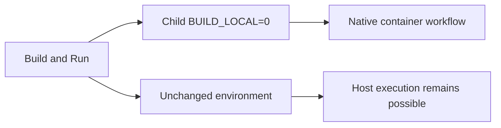

| Option | Effect |
| --- | --- |
| Child-only `HOLOSCAN_CLI_BUILD_LOCAL=0`, recommended | Force native container execution for Build, Run and Prepare's dry run; preserve Docker routing. |
| Keep environment unchanged | Defer Build/Run because this backend cannot establish container execution. |

Choice: the owner explicitly approved child-only `HOLOSCAN_CLI_BUILD_LOCAL=0`
for Build, Run and Prepare's dry run. Native source and an isolated dry-run matrix
establish the selector's behavior. Catalog queries and Docker routing retain their
existing environment. Implementation now proceeds through one named child-command
interface, shared by these callers.

### 11. Encode Console arguments — approved

Context: the CLI accepts Console's Docker additions as one string. Paths containing
spaces or quotes must survive its native tokenization.

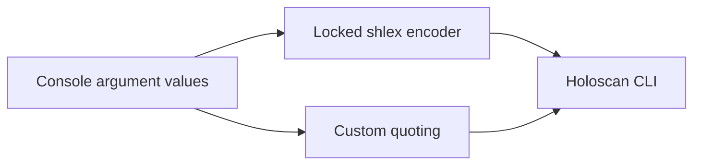

| Option | Effect |
| --- | --- |
| Locked `shlex` 2.0.1, recommended | Encode Console's own values with `try_join`; reject NUL. |
| Custom quoting | Maintain equivalent encoding code and edge cases in this backend. |

Choice: the owner approved the existing locked crate. This encodes generated
arguments; project Docker settings retain their native interpretation.

### 12. Current helper recovery — keep one record

Context: restart cleanup must find the preceding CLI helper before another Build
or Run. Attempt-local records require separate Build and Run history traversal.

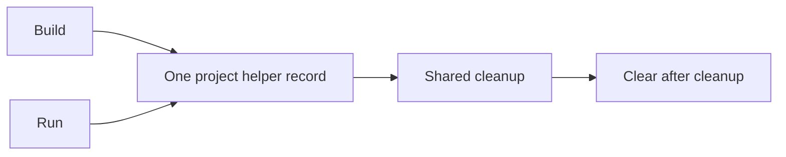

| Option | Effect |
| --- | --- |
| One record in the existing project recovery directory, recommended | Build and Run recover the current helper directly. |
| Attempt-local records | Search stored Build and Run attempts; recovery depends on the chosen data folder. |

Choice: the owner delegated the choice with “Keep it simple and stupid.” Use one
authoritative current-helper record and one cleanup path. Replace attempt-history
traversal; retain logs and results in their existing artifact folders.

### 13. System-command recovery — approved

Context: after Console is killed, a surviving Compose command can create a
container after the next Console instance acquires the repository lock. The real
probe reproduced this ordering.

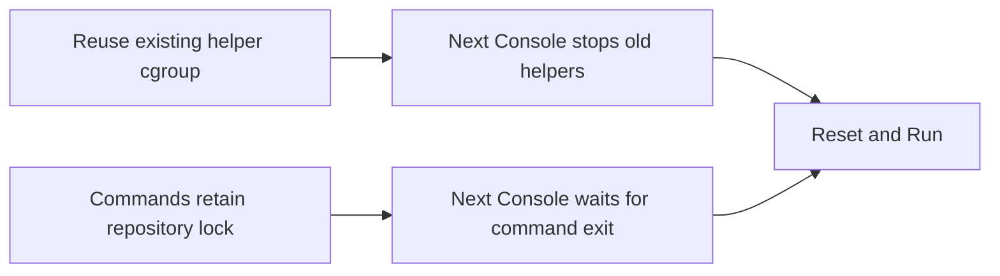

| Option | Effect |
| --- | --- |
| Reuse the existing helper cgroup, recommended | Contain finite Compose commands with the same helper record and cleanup path. |
| Let finite commands retain the lock | Prevent overlap while commands survive; a stuck command delays restart. |

Choice: on November 17 the owner approved reusing the existing cgroup. Extend
the current helper record and cleanup path to shared Compose and filesystem-copy
commands. Stop surviving helpers before resetting their resources; cleanup remains
repeatable and preserves unrelated resources. Implementation is in progress.

### 14. Larger application acceptance — pending

Context: BCI replay data alone needs 14.8 GB; this host has less free space and
lacks the full SDK image. Lightweight first_pipeline lifecycle work can continue.

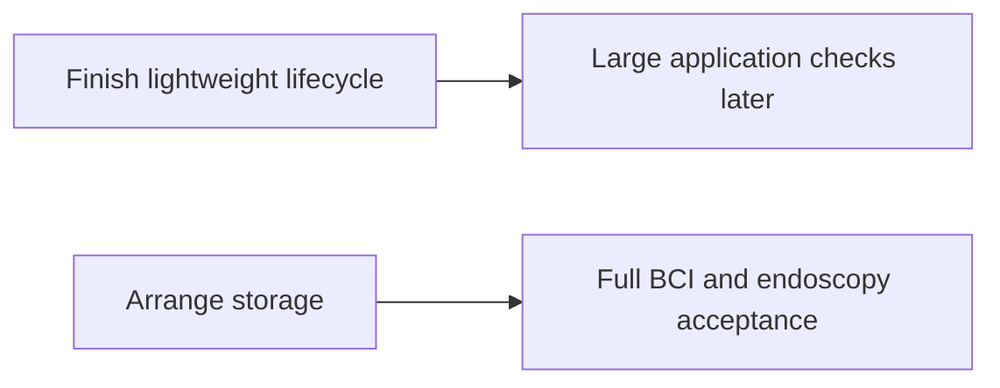

| Option | Effect |
| --- | --- |
| Defer large application checks | Publish the lifecycle implementation with explicit pending application qualification. |
| Arrange storage | Retain full application acceptance in the current completion scope. |

Choice: awaiting the owner; the original acceptance requirements remain in #264.

## Events

- November 16: read #264 at `635cd8fd` and both guides. Verified its shared
  prerequisites in `origin/main` at `e3fc8911`. Started the independent audits
  and this log in #441; all agents use separate exclusive worktree leases.
- November 16: published the normal-completion, discovery, probe, cleanup-retry
  and socket-routing PRs. The owner approved matching Docker daemons through
  socket checks, catalog cancellation/reaping and existing application slices.
- November 16: the owner approved Application and Module projects with locked
  `toml`, directed existing source-state behavior and chose limited Review A.
  Updated #264 and completed #447/#448; parser/interception proposals were dropped.
- November 16: the owner approved the child-only container selector and locked
  `shlex` encoding. Completed #460/#461 with one current-helper record, followed
  by Build #458 and the shared filesystem preparation in #463.
- November 16: the owner waived the unreachable ARM64 worker. Local integration
  and real-container qualification remain required.
- November 16: completed application Run #465 and published system apps #464
  and recovery #466. The reproduced surviving-Compose race prompted decision 13;
  storage for the original larger applications prompted decision 14. Decision 14
  remains unanswered.
- November 16: completed #467 for early Build validation, Review reasons and
  helper cleanup observations. Updated #444 so interrupted Engine waits settle
  through cleanup. Ready code leases were released; no PR was merged.
- November 17: the combined Holoscan/monitor/Dora run exposed skipped Dora
  shutdown before graph registration. Published the existing-client correction
  in ready #468 and added the combined case to #466. System apps and recovery
  remain drafts while shared command recovery and larger application acceptance
  are completed. Rebuilt the native stack as #469,
  preserving every PR and branch.

## Left for the owner

- Choose storage or deferral for full BCI/endoscopy acceptance (decision 14).
