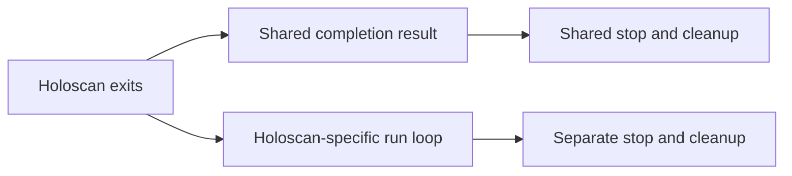
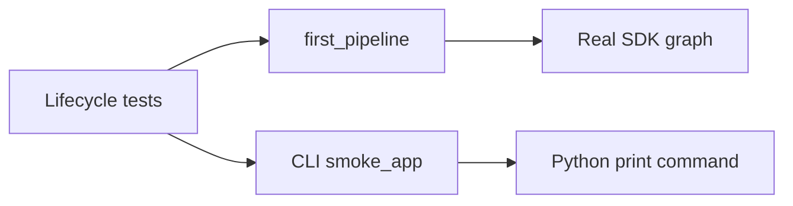

# Holoscan runner stack

Created November 16, 2026.
Plan: [#264](https://github.com/Cutuy/doramcap/pull/264).

Implement the seven runner milestones as stacked pull requests. The web app gets
its implementation plan after the application-only run works. Nothing is merged
by this task.

## Work

| Milestone | Scope | PR |
| --- | --- | --- |
| Prerequisite | Shared normal completion | [#442](https://github.com/Cutuy/doramcap/pull/442), ready |
| 1 | Real CLI, GPU container and overlay probes | Tooling in progress |
| 2 | Crate, protobuf contract and discovery | In progress |
| 3 | Prepare and Review | Pending |
| 4 | Build request | Pending |
| 5 | Application run | Pending |
| 6 | System apps | Pending |
| 7 | Recovery and acceptance | Pending |

## Agents

| Agent | Model | Assignment |
| --- | --- | --- |
| `holoscan_probe_audit` | GPT-6.1 Sol, xhigh | Milestone 1 probe tooling and qualification |
| `holoscan_contract_audit` | GPT-6.1 Sol, xhigh | Shared normal-completion prerequisite |
| `holoscan_discovery` | GPT-6.1 Sol, xhigh | Milestone 2 crate, contract and discovery |

## Decisions

The agreed decisions in #264 remain the baseline. No new design decision has
been made for the owner.

### 1. Normal application completion — approved

Context: Holoscan must preserve the application's exit code and allow a successful
normal exit. The shared lifecycle currently treats every natural end as an error.

| Option | Effect |
| --- | --- |
| Shared completion result, recommended | Change `Running::ended` to return success or failure; preserve existing backends' behavior and shared teardown. |
| Holoscan-specific run loop | Handle normal completion in a separate lifecycle sequence owned by Holoscan. |

Choice: the owner approved the shared completion result on November 16. It keeps
lifecycle policy with its current owner and avoids duplicating teardown.

### 2. Lightweight lifecycle application — awaiting owner

Context: the owner asked for a lightweight project for lifecycle testing. The two
applications in #264 require replay data and exercise additional application
behavior. Their full acceptance remains later work.

| Option | Effect |
| --- | --- |
| Official SDK first_pipeline, recommended | Runs three CPU operators for ten values, requests stop and checks termination. |
| Official CLI smoke_app | Exercises CLI command execution without an SDK graph. |

Use the unchanged SDK example with native metadata and a small test image. It
needs CUDA runtime libraries, supplied by the CUDA base and NVIDIA runtime, but
no GPU computation, dataset, model or display. The image still needs a real build
and run to verify its complete footprint and behavior.

Source: [SDK first_pipeline](https://github.com/nvidia-holoscan/holoscan-sdk/tree/358c772f2d2e88d117651a961d6f6bf9b650cf8d/examples/first_pipeline).
The earlier synthetic-mode proposal was superseded by this investigation; it was
not approved or executed.

## Events

- November 16: read #264 at `635cd8fd` and both repository guides. Verified the
  listed shared prerequisites, including #364, in `origin/main` at `e3fc8911`.
- November 16: started two independent read-only audits. Acquired a separate
  worktree lease for this log and the local review report; published this log in
  [#441](https://github.com/Cutuy/doramcap/pull/441).
- November 16: backend audit completed. Prepare and Build can proceed independently
  after the shared contracts exist. Later decisions concern Docker daemon identity,
  host IPC and shared overlay preparation for system apps.

- November 16: #442 is ready after scoped checks and parent review; its lease is
  released. No PR has been merged.

## Left for the owner

- Decision 2: first_pipeline for lightweight lifecycle tests.
