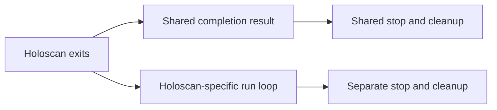

# Holoscan runner stack

Created November 16, 2026.
Plan: [#264](https://github.com/Cutuy/doramcap/pull/264).

Implement the seven runner milestones as stacked pull requests. The web app gets
its implementation plan after the application-only run works. Nothing is merged
by this task.

## Work

| Milestone | Scope | PR |
| --- | --- | --- |
| 1 | Real CLI, GPU container and overlay probes | Pending |
| 2 | Crate, protobuf contract and discovery | Pending |
| 3 | Prepare and Review | Pending |
| 4 | Build request | Pending |
| 5 | Application run | Pending |
| 6 | System apps | Pending |
| 7 | Recovery and acceptance | Pending |

## Agents

| Agent | Model | Assignment |
| --- | --- | --- |
| `holoscan_probe_audit` | GPT-6.1 Sol, xhigh | Runtime prerequisites and milestone 1 feasibility |
| `holoscan_contract_audit` | GPT-6.1 Sol, xhigh | Current backend interfaces and milestone dependencies |

## Decisions

The agreed decisions in #264 remain the baseline. No new design decision has
been made for the owner.

### 1. Normal application completion — awaiting owner

Context: Holoscan must preserve the application's exit code and allow a successful
normal exit. The shared lifecycle currently treats every natural end as an error.

| Option | Effect |
| --- | --- |
| Shared completion result, recommended | Change `Running::ended` to return success or failure; preserve existing backends' behavior and shared teardown. |
| Holoscan-specific run loop | Handle normal completion in a separate lifecycle sequence owned by Holoscan. |

Recommendation: the shared result keeps lifecycle policy with its current owner
and avoids duplicating teardown. Asked before implementation; no choice recorded.

## Events

- November 16: read #264 at `635cd8fd` and both repository guides. Verified the
  listed shared prerequisites, including #364, in `origin/main` at `e3fc8911`.
- November 16: started two independent read-only audits. Acquired a separate
  worktree lease for this log and the local review report.

## Left for the owner

- Decision 1: the shared normal-completion contract.
- Real-container probe storage and application mode will be discussed next.
