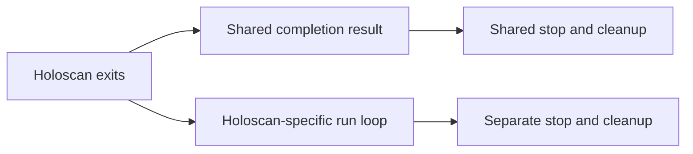
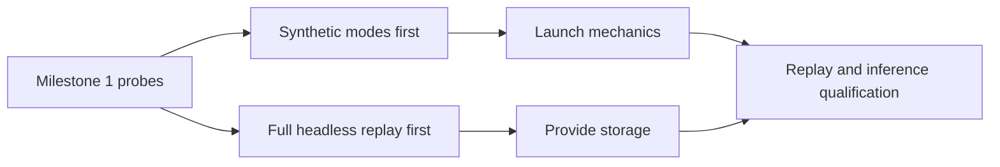

# Holoscan runner stack

Created November 16, 2026.
Plan: [#264](https://github.com/Cutuy/doramcap/pull/264).

Implement the seven runner milestones as stacked pull requests. The web app gets
its implementation plan after the application-only run works. Nothing is merged
by this task.

## Work

| Milestone | Scope | PR |
| --- | --- | --- |
| Prerequisite | Shared normal completion | In progress |
| 1 | Real CLI, GPU container and overlay probes | Tooling in progress |
| 2 | Crate, protobuf contract and discovery | In progress |
| 3 | Prepare and Review | Pending |
| 4 | Build request | Pending |
| 5 | Application run | Pending |
| 6 | System apps | Pending |
| 7 | Recovery and acceptance | Pending |

## Agents

| Agent | Model | Assignment |
| --- | --- | --- |
| `holoscan_probe_audit` | GPT-6.1 Sol, xhigh | Milestone 1 probe tooling and qualification |
| `holoscan_contract_audit` | GPT-6.1 Sol, xhigh | Shared normal-completion prerequisite |
| `holoscan_discovery` | GPT-6.1 Sol, xhigh | Milestone 2 crate, contract and discovery |

## Decisions

The agreed decisions in #264 remain the baseline. No new design decision has
been made for the owner.

### 1. Normal application completion — approved

Context: Holoscan must preserve the application's exit code and allow a successful
normal exit. The shared lifecycle currently treats every natural end as an error.

| Option | Effect |
| --- | --- |
| Shared completion result, recommended | Change `Running::ended` to return success or failure; preserve existing backends' behavior and shared teardown. |
| Holoscan-specific run loop | Handle normal completion in a separate lifecycle sequence owned by Holoscan. |

Choice: the owner approved the shared completion result on November 16. It keeps
lifecycle policy with its current owner and avoids duplicating teardown.

### 2. Probe order — awaiting owner

Context: the local GPU and Docker runtime are available, but the root filesystem
has about 19 GiB free. BCI replay data needs about 14.8 GB before images and builds.

| Option | Effect |
| --- | --- |
| Synthetic modes first, recommended | Establish launch mechanics with less data; full replay and inference remain required. |
| Full headless replay first | Provide storage, then qualify the full applications. |

Synthetic endoscopy disables inference, so synthetic success cannot complete
milestone 1 or acceptance. Asked before execution; no choice recorded.

## Events

- November 16: read #264 at `635cd8fd` and both repository guides. Verified the
  listed shared prerequisites, including #364, in `origin/main` at `e3fc8911`.
- November 16: started two independent read-only audits. Acquired a separate
  worktree lease for this log and the local review report; published this log in
  [#441](https://github.com/Cutuy/doramcap/pull/441).
- November 16: backend audit completed. Prepare and Build can proceed independently
  after the shared contracts exist. Later decisions concern Docker daemon identity,
  host IPC and shared overlay preparation for system apps.

## Left for the owner

- Decision 2: synthetic probes first or full headless replay first.
